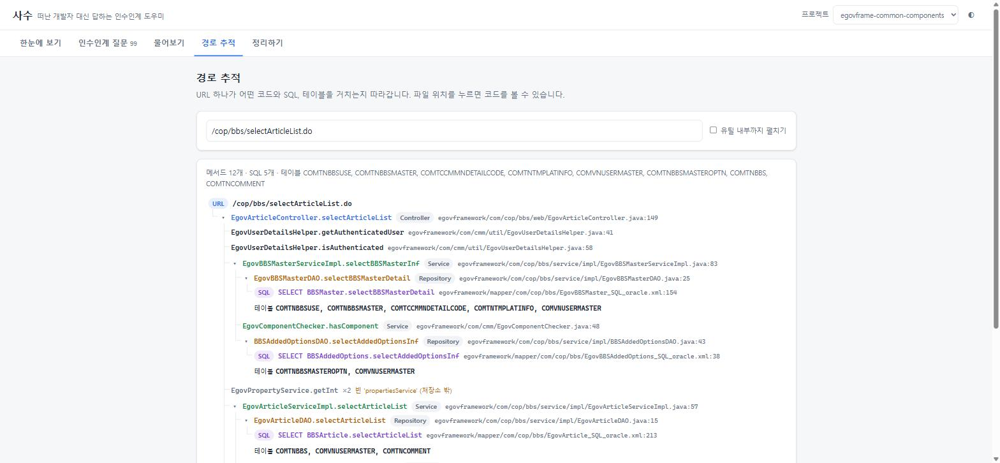
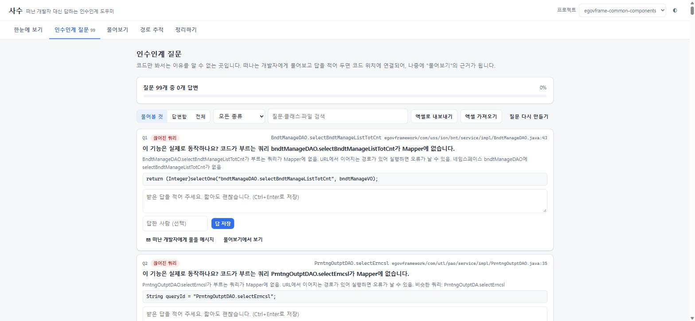

# 사수 (SASU) · 떠난 개발자 대신 답하는 SI 인수인계 에이전트

떠나는 개발자에게 무엇을 물어야 할지 코드 분석으로 먼저 찾아 주는 SI 인수인계 에이전트입니다. 받은 답변을 코드 위치에 연결해 두고, 신규 투입자의 "왜?"에 근거와 함께 답합니다.

**Java(Spring · MyBatis · JSP)와 Python(FastAPI · Flask · Django)** 프로젝트를 분석합니다.

> **상태: 개발 중.** 코드 분석(경로 추적, 프로젝트 지도, 공통화 진단, 불필요한 소스), 인수인계 질문 생성·엑셀 질문지, RAG 기반 "왜?" 질의응답, 웹 화면까지 동작합니다.



## 사용해 보기

[uv](https://docs.astral.sh/uv/)가 필요합니다.

```bash
uv sync
uv run sasu fetch-sample                                   # 예제: 전자정부 표준프레임워크 공통컴포넌트
uv run sasu index data/repos/egovframe-common-components   # 분석 (약 5초)
uv run sasu serve                                          # 웹 화면 (브라우저가 열림)
uv run sasu map                                            # 프로젝트 지도: 기술 스택, 모듈, 핵심 테이블
uv run sasu map cop.bbs                                    # 모듈 하나: URL마다 읽고 쓰는 테이블
uv run sasu trace /cop/bbs/selectArticleList.do            # URL 하나의 경로 추적
uv run sasu common                                         # 공통 코드 사용 현황, 복사해 붙인 코드, 중복 SQL
uv run sasu unused                                         # 끊어진 쿼리 참조, 안 쓰는 SQL·URL·메서드·JSP
uv run sasu questions --export 인수인계질문.xlsx             # 인수인계 질문 만들기 + 엑셀 질문지
uv run sasu answers 인수인계질문.xlsx                        # 답을 적은 질문지 가져오기
uv run sasu embed --provider local                         # 벡터 색인 (처음 한 번, uv sync --extra local-embed. 이후 index 때 자동 갱신)
uv run sasu ask "휴가 신청할 때 연차가 없으면 어떻게 돼?"      # RAG: 근거를 모아 "왜?"에 답하기
uv run sasu draft Q12                                      # 떠난 개발자에게 보낼 질문 초안
uv run sasu stats                                          # 분석 요약
uv run sasu projects                                       # 분석한 프로젝트 목록 (*: 지금 프로젝트)
uv run sasu use full-stack-fastapi-template                # 다른 프로젝트로 바꾸기
```

### 웹 화면

`sasu serve`로 브라우저에서 모든 기능을 씁니다. 화면 파일은 패키지 안에 있고 외부 CDN을 쓰지 않아 인터넷이 막힌 PC에서도 그대로 열립니다.

| 탭 | 하는 일 |
| --- | --- |
| 한눈에 보기 | 기술 스택, URL이 SQL까지 이어지는 비율, 모듈별 URL·테이블, 여러 모듈이 함께 쓰는 테이블 |
| 인수인계 질문 | 질문마다 바로 답 입력(Ctrl+Enter), 떠난 개발자에게 보낼 메시지 복사, 엑셀 내보내기·가져오기, 답변 진행률 |
| 물어보기 | 질문 → 찾은 코드 후보 → 근거(E1, E2…) → 등급과 근거 번호가 붙은 답. 근거 번호를 누르면 해당 근거로 이동 |
| 경로 추적 | URL 자동 완성, Controller→Service→DAO→SQL→테이블 트리 |
| 정리하기 | 끊어진 쿼리, 부르는 곳이 없는 SQL·URL·메서드·JSP, 공통 코드, 복사한 코드, 중복 SQL |

어느 화면에서든 `파일:줄`을 누르면 해당 코드가 오른쪽에 열립니다.



분석 결과는 프로젝트마다 `data/projects/<폴더 이름>.db`에 따로 저장됩니다. 마지막으로 분석한 프로젝트가 지금 프로젝트가 되고, 인수인계 질문과 답은 다른 프로젝트를 분석해도 섞이거나 지워지지 않습니다.

### Python 프로젝트

```bash
uv run sasu fetch-sample --python                          # 예제: FastAPI 풀스택 템플릿
uv run sasu index data/repos/full-stack-fastapi-template
uv run sasu trace "/{settings.API_V1_STR}/users/signup"
```

```
URL /{settings.API_V1_STR}/users/signup
└── users.register_user  backend/app/api/routes/users.py:147
    ├── crud.get_user_by_email  backend/app/crud.py:34
    │   └── SELECT ORM User  backend/app/models.py:52
    │       테이블 USER
    └── crud.create_user  backend/app/crud.py:10
        ├── security.get_password_hash  backend/app/core/security.py:35
        └── INSERT ORM User  backend/app/models.py:52  모델 추정
            테이블 USER
```

| 대상 | 읽는 것 |
| --- | --- |
| URL | FastAPI `@router.get`와 `include_router(prefix=...)`, Flask `@bp.route`와 `register_blueprint(url_prefix=...)`, Django `urlpatterns`·`include()`·클래스 뷰(`get`/`post`...) |
| 호출 | import 별칭·상대 import, `self.repo = Repo()` 같은 주입, 모듈 함수(`crud.get_user`). 확실하지 않으면 프로젝트에 하나뿐인 이름으로 잇고 "이름으로 추정"이라고 표시 |
| DB | Django ORM(`Post.objects.filter`), SQLAlchemy·SQLModel(`select(User)`, `session.get`, `session.add(obj)`), 코드 안의 SQL 문자열 → 테이블 (`__tablename__`, `Meta.db_table`, Django 기본 `앱_모델`) |
| 화면 | `render_template`, `render`, `TemplateResponse`의 템플릿 파일 |
| 질문 | TODO·주의 주석, 드문 값 분기(`status == "partial_refund"`처럼 Python은 소문자 코드 값도), 복잡한 분기, 복사한 코드 |
| 용어 | 모델 필드의 `verbose_name`·`description`·`comment`를 검색 용어집으로 |

소스 루트(`pyproject.toml`·`manage.py`가 있는 폴더, `src/`)를 찾아 import 경로와 파일을 맞춥니다. `tests`·`migrations`·가상환경 폴더는 건너뜁니다.

### "왜?" 질의응답 (RAG)

질문에 맞는 코드를 **BM25 + 벡터(sqlite-vec) + 코드 그래프**로 찾고, 코드·SQL·호출 관계·주석과 수정 이력·인수인계 답변·커밋 기록을 근거로 모아 LLM에 넘깁니다. LLM은 모든 문장을 [사실]/[답변]/[추정]으로 시작하고 근거 번호를 달아야 하며, 코드가 이를 검사해 근거가 약한 문장은 [추정]으로 낮춥니다. 포맷 정리·릴리스 커밋은 건너뛰고 그 줄을 실제로 바꾼 커밋 메시지를 찾습니다.

LLM은 OpenAI 호환 주소(개발: OpenRouter, 현장: 사내 LLM 서버) 또는 이 PC에 로그인된 claude CLI(`SASU_LLM_PROVIDER=claude-code`, 개발용)로 연결합니다.

- **검색:** 버그 증상 설명으로 고칠 메서드를 찾는 평가(질문 173개)에서 상위 10개 안에 정답이 있는 비율 62%.
- **답변:** 커밋 메시지를 숨기고 "이 줄은 왜 이렇게 돼 있나?"를 물었을 때(질문 15개), 실제 이유를 맞힌 답이 사수 7개 vs LLM만 2개, 틀린 이유를 단정한 답이 사수 3개 vs LLM만 8개.

구조, 평가 방법과 한계, 벡터 검색을 섞는 방법을 정한 실험은 [RAG 구조와 평가](docs/rag.md)에 정리했습니다.

### 인수인계 질문

코드만 봐서는 이유를 알 수 없는 곳을 찾아 질문으로 만듭니다. 끊어진 쿼리·동적 쿼리 ID·드문 업무 코드 값 분기(`USR03`, `BBST04`)·TODO와 주의 주석·설정에만 있는 빈·무시하는 예외·복잡한 분기·상속 대신 복사한 코드가 대상입니다. 엑셀 질문지로 내보내 인수인계 회의에서 답을 적고 다시 가져오면, 답은 질문(코드 위치)에 연결되어 다시 분석해도 지워지지 않습니다.

과거 기록으로 채점하면 질문 상위 10개의 30%가 이후 버그 수정이 들어간 메서드를 가리킵니다 (무작위 3%). 다만 버그 위치만 맞히는 데는 복잡도순이 더 강합니다. 방법과 한계는 [4단계 평가](docs/gate4-evaluation.md)에 정리했습니다.

`trace` 결과 예시:

```
URL /cop/bbs/selectArticleList.do
└── EgovArticleController.selectArticleList  egovframework/com/cop/bbs/web/EgovArticleController.java:149
    ├── EgovArticleServiceImpl.selectArticleList  egovframework/com/cop/bbs/service/impl/EgovArticleServiceImpl.java:57
    │   ├── EgovArticleDAO.selectArticleList  egovframework/com/cop/bbs/service/impl/EgovArticleDAO.java:15
    │   │   └── SELECT BBSArticle.selectArticleList  egovframework/mapper/com/cop/bbs/EgovArticle_SQL_oracle.xml:213
    │   │       테이블 COMTNBBS, COMVNUSERMASTER, COMTNCOMMENT
    │   └── ...
    ├── → /uat/uia/egovLoginUsr.do  (이동)
    └── 화면 WEB-INF/jsp/egovframework/com/cop/bbs/EgovArticleList.jsp
```

eGovFrame 공통컴포넌트(URL 1,182개)에서 URL의 83.2%가 SQL까지 이어집니다. 나머지는 화면만 보여 주는 URL(9.9%)과 LDAP·메시지·검증처럼 DB를 쓰지 않는 URL(6.9%)입니다.

문자열을 더해 만드는 동적 쿼리 ID(`"LoginUsr.updateLoginIncorrect" + userSe`), static 유틸 호출, XML 설정에만 있는 저장소 밖 빈도 따라가거나 표시합니다. 기본 보기는 Controller·Service·DAO만 펼치고, `--full`을 붙이면 유틸 내부까지 모두 펼칩니다. 검증 과정은 [관문 1 검증](docs/gate1-verification.md)에 정리했습니다.

### eGovFrame에서 찾은 것

- **실제 버그 2건:** 당직관리 목록(`/uss/ion/bnt/selectBndtManageList.do`)이 Mapper에 없는 개수 쿼리를 부르고, 인쇄 출력 DAO는 네임스페이스 오타(`PrntngOutptDA`)로 쿼리를 찾을 수 없습니다.
- **사람의 메모와 일치:** `BBSArticle.selectMaxNttId`를 안 쓰는 SQL로 찾았고, Mapper 수정 이력의 "selectMaxNttId문은 실제 사용하지 않음"을 근거로 붙입니다.
- **상속 대신 복사:** 보안 조치로 공통 부모 클래스에 넣은 권한 검사(`egovAssertAdminOrOwner`)를 47개 컨트롤러가 복사해 씁니다.

검증과 고친 오탐은 [3단계 검증](docs/gate3-verification.md)에 정리했습니다.

## 왜 만드나

SI 고도화·유지보수 프로젝트에서 인수인계는 보통 1주 정도입니다. 문서와 말로 설명을 듣고 질문할 기회는 있지만, **무엇을 물어봐야 할지 모르는 채로** 기간이 끝납니다. 기존 개발자가 떠난 뒤에야 처음 보는 로직과 버그를 만나고, 결국 다시 연락하게 됩니다.

코드는 "무엇을 하는지"는 보여 주지만 "왜 그렇게 했는지"는 보여 주지 않습니다. 그 "왜"는 떠나는 개발자의 머릿속에 있고, 인수인계 기간이 그것을 붙잡을 수 있는 유일한 때입니다.

## 사수가 돕는 세 번의 순간

| 순간 | 사수가 하는 일 |
| --- | --- |
| 인수인계 전 | 코드 위험 분석으로 **"반드시 물어봐야 할 질문 Top 20"**을 만든다 |
| 인수인계 1주 | 떠나는 개발자의 짧은 텍스트 답변을 **해당 코드 위치에 연결**해 저장한다 |
| 떠난 후 | 신규 투입자의 "왜?"에 코드 근거와 인수인계 답변으로 답한다. 답이 없으면 떠난 개발자에게 보낼 질문 초안을 만들고, 받은 답도 저장한다 |

보조 기능으로 프로젝트 지도(화면→컨트롤러→서비스→쿼리→테이블), 공통 모듈 현황, 호출되지 않는 코드 목록을 제공합니다.

## 설계 원칙

- **확정할 수 있는 건 정적 분석으로 확정한다.** 호출 관계, 참조 여부, 위험 패턴은 코드 분석으로 찾고, LLM은 설명과 질의응답만 맡는다.
- **답변의 근거를 구분해 표시한다.** 모든 답에 "확인된 사실 / 인수인계자 답변 / 추정"을 붙이고, 근거가 없으면 "모름"이라고 답한다.
- **LLM은 주소 하나로 연결한다.** OpenAI 호환 주소만 바꾸면 개발용 API에서 사내 LLM 서버로 옮겨 갈 수 있다. 폐쇄망 기관의 자체 sLLM 서버에 붙이는 것을 전제로 설계한다.
- **가볍게 돈다.** 서버 없는 파일형 DB를 쓰고, 개발 PC에서 모델을 직접 돌리지 않는다.

## 기술 구성 (계획)

| 역할 | 도구 |
| --- | --- |
| 코드 분석 | tree-sitter (Java, Python), MyBatis XML 파서 |
| 산출물 파싱 | openpyxl, python-pptx |
| 저장 | SQLite + sqlite-vec (벡터 색인) |
| 검색 | BM25(한국어 글자 2-gram) + 벡터 + 코드 그래프 전파 |
| 임베딩 | fastembed 로컬 모델 또는 OpenAI 호환 `/embeddings` |
| LLM | OpenAI 호환 API (개발: OpenRouter / 현장: 사내 LLM 서버) |
| API · 화면 | FastAPI, 웹 UI, MCP 도구 |
| 평가 | PyDriller로 공개 프로젝트의 과거 커밋 기록 분석 |

## 평가 방법 (계획)

실제 회사 코드 대신 **공개 프로젝트의 과거 기록**을 정답지로 씁니다.

1. **질문 생성:** 과거 시점의 코드로 질문 Top 20을 만들고, 이후 실제로 버그가 수정된 위치를 얼마나 미리 짚었는지 채점합니다. 무작위 선택, 복잡도 순 선택과 비교합니다.
2. **"왜?" 답변:** 커밋 메시지를 숨긴 채 "이 줄은 왜 이렇게 돼 있나"를 묻고, 숨긴 메시지와 비교합니다. 근거가 없을 때 추정이라고 표시하는지도 봅니다.

"나중에 버그가 난 곳 = 인수인계 때 물어봤어야 할 곳"은 완벽한 등식이 아니므로, 1번은 참고 지표로 다룹니다.

분석·평가 대상 후보는 [전자정부 표준프레임워크 공통컴포넌트](https://github.com/eGovFramework/egovframe-common-components)(Java · Spring · MyBatis · JSP, Apache-2.0)입니다.

## 진행 단계

날짜 대신 관문을 통과해야 다음 단계로 넘어갑니다.

- [x] 준비: 대상 프로젝트를 사수 없이 직접 읽고 기능 3개의 흐름 정답 메모 작성
- [x] 기반 그래프: Java + MyBatis 연결 (관문 1: 정답 메모의 흐름이 그대로 나옴 → [검증 기록](docs/gate1-verification.md))
- [x] 보조 기능: 지도, 공통화, 불필요한 소스 → [검증 기록](docs/gate3-verification.md)
- [x] 질문 생성 → [과거 기록 평가](docs/gate4-evaluation.md)
- [x] 답변 연결 + "왜?" 질의응답 (관문 2: 폴더 하나로 질문 → 답 입력 → "왜?" 답변까지) → [RAG 구조와 평가](docs/rag.md)
- [x] 평가와 개선 (관문 3: 비교표 완성, 약한 결과도 기록)
- [x] Python 프로젝트 지원 (FastAPI · Flask · Django), 프로젝트별 분석 파일
- [x] 다듬기: 웹 화면, 엑셀 내보내기·가져오기
- [ ] 설치 패키지
- [ ] 사용 테스트
- [ ] 확장: MCP, 기존 동작 목록
