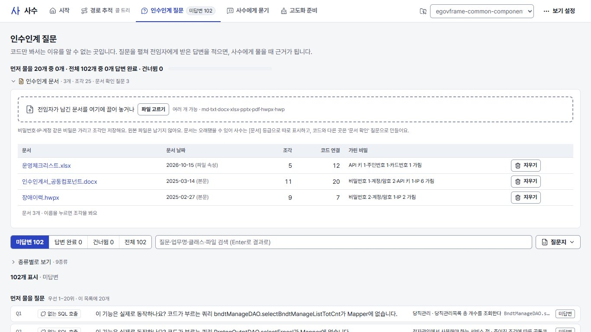

# 인수인계 문서를 근거로 쓰기

- 기준일: 2026-10-15
- 코드: `src/sasu/docs/` (넣기·검색·불일치), `src/sasu/analysis/handover_doc.py` (인수인계서 만들기)
- 함께 보는 문서: [SDD 8.5](sdd.md#85-인수인계-문서-docs) · [설치 안내](install.md) · [웹 화면 디자인](ui-design.md#77-인수인계-문서-질문-화면-접기)

전임자가 남긴 인수인계서·운영 체크리스트·장애 이력 같은 문서를 사수에 넣으면, 문서 조각이 "사수에게 묻기"의 근거가 됩니다. 문서는 오래됐을 수 있어서 코드보다 낮게 믿습니다. 답에는 **[문서]** 등급으로 따로 표시하고, 문서와 코드가 다른 값을 말하면 "문서와 코드가 달라요"로 짚은 뒤 전임자에게 물을 '문서 확인' 질문으로 만듭니다.

## 1. 넣기

```bash
sasu docs add 인수인계서.docx 운영체크리스트.xlsx    # 파일 여러 개
sasu docs add C:\work\인수인계 --by 김인수            # 폴더 (하위 폴더 포함, ~$·. 로 시작하는 임시 파일은 건너뜀)
sasu docs list                                       # 넣은 문서: 조각 수·코드 연결 수·가린 비밀·문서 날짜
sasu docs show 2                                     # 문서 하나의 조각과 이어진 코드 (코드에 없는 이름은 빨갛게)
sasu docs search "배치 수동 실행"                      # 질문과 맞는 조각
sasu docs conflicts                                  # 문서와 코드가 다른 곳
sasu docs remove 2                                   # 문서 지우기 (답이 없는 '문서 확인' 질문도 함께)
sasu docs relink                                     # 조각과 코드를 다시 잇기 (sasu index가 저절로 한다)
```

웹 화면에서는 **인수인계 질문** 화면 진행 줄 아래 "인수인계 문서" 접기를 펼쳐 끌어 놓거나 [파일 고르기]로 올립니다. 시작 화면 "인수인계 중" 카드의 "인수인계 문서 올리기" 링크도 같은 곳을 엽니다.



넣는 순서는 읽기 → 비밀 가리기 → 조각 나누기 → 저장 → 코드와 잇기 → (임베딩이 설정돼 있으면) 조각 임베딩 → 문서–코드 불일치 찾기입니다. **원본 파일은 복사하지 않고** 비밀을 가린 조각만 분석 파일에 둡니다. 같은 이름을 다시 넣으면 새 판으로 바꾸고, 내용(SHA-1)까지 같으면 건너뜁니다. 문서는 사람이 넣은 데이터라 다시 분석해도, 스키마가 바뀌어도 지우지 않습니다.

## 2. 형식

| 형식 | 읽는 방법 | 설치 |
| --- | --- | --- |
| md · txt | 글자 (UTF-8 · CP949 · UTF-16), md는 `#` 제목 | 기본 |
| docx · pptx · hwpx | zip 안의 XML을 표준 라이브러리로. 제목 스타일·개요 번호, 표는 한 행씩, 슬라이드 번호 | 기본 |
| xlsx | openpyxl. 시트마다, 행을 한 줄로 | 기본 |
| pdf | pypdf. 쪽 번호를 남긴다 | `uv sync --extra docs` (`sasu[docs]`) |
| hwp (한글 5.0) | olefile로 본문 레코드의 글자만 | `uv sync --extra docs` (`sasu[docs]`) |

- 읽지 못하면 이유를 그대로 보여 줍니다: 50MB 넘음, 암호가 걸림, 배포용(복사 방지) 한글 문서, HWP 3.x, 그림만 있는 문서·스캔한 PDF(글자 인식 OCR은 하지 않음), 손상된 파일.
- **아직 시험하지 않은 것:** 테스트와 평가의 문서는 형식의 최소 구조를 코드로 만든 것입니다(docx·pptx·hwpx·hwp·pdf·xlsx). **실제 한글·Word 프로그램으로 만든 파일과 한국어 PDF**(글꼴·인코딩이 다양함)는 아직 넣어 보지 않았습니다.

## 3. 조각과 문서 날짜

- 제목(머리글) 단위로 자르고, 1,200자가 넘으면 문단 경계에서 나눕니다. 80자보다 짧은 문단 조각은 앞 조각에 붙입니다.
- 조각마다 절 번호(3.2), 제목 경로("3 운영 > 3.2 배치 운영"), 쪽·시트·슬라이드를 남깁니다. 근거 제목은 `인수인계서.docx 3.2 배치 운영 (2025-03)` 꼴입니다.
- 문서 날짜는 본문의 "작성일·개정일" 날짜 → 파일 속성 → 본문 첫 날짜 → 올린 날 순서로 정하고, 어디서 정했는지(본문·파일 속성·올린 날)를 함께 보여 줍니다.

## 4. 비밀 가리기

넣기 전에 아래를 `[가림:종류]`로 바꾸고 종류별 개수를 보여 줍니다 (`docs/redact.py`). 가린 자리가 남아 무엇이 있었는지는 알 수 있습니다.

| 종류 | 예 |
| --- | --- |
| 접속 문자열 | `jdbc:oracle:thin:user/비밀@host`, `scheme://user:비밀@host` — 비밀번호 부분만 |
| 비밀번호 | `비밀번호: …`, `password=…`, `DB_PASSWORD = '…'`, `비번은 …` (띄어 쓴 꼴은 글자+숫자가 섞인 값만) |
| 계정/암호 | `계정 admin / …`, `ID/PW: admin/…` — 계정은 두고 암호만 |
| API 키 | `sk-…`·`AKIA…`·`AIza…`·`ghp_…`·`xox…`, `api_key=…`, `서비스키: …`, `인증키·승인키·접근키·비밀키·개인키·연계키·암호화키` 뒤의 값 |
| 토큰 | JWT, `token: …`, `Bearer …` |
| 주민번호 · 카드번호 | `900101-1234567`, 4자리×4 카드번호 |
| IP | 사설·공인 IPv4 (127.0.0.1·0.0.0.0, 줄 맨 앞 절 번호 "1.2.3.4", "버전 4.1.0.0"은 둠) |

- "비밀번호는 90일마다", "암호=SHA-256"처럼 값이 아닌 말은 가리지 않습니다.
- 규칙 기반이라 모양이 다른 비밀(이름 없이 적힌 값, 사진 속 글자)은 놓칠 수 있습니다. 반출 전 확인은 사람이 해야 합니다.
- 가짜 비밀을 심은 시험 문서: 처음 14/17(API 키 0/2) → 고친 뒤 17/17, 과잉 가림 0. 새 문서(holdout)에서는 5/6으로 "승인키는 <값>"을 놓쳤고, 그 뒤 키 낱말(승인키·접근키·비밀키·개인키·연계키·암호화키)을 더했지만 다시 재지 않았습니다 ([9절](#9-평가와-한계)).

## 5. 코드와 잇기

조각 글에서 URL(`/uss/ion/vct/…do`), 테이블 이름, `Class.method`·클래스·메서드 이름, 한글 업무명(클래스 주석에서 뽑은 이름표), 설정 키·설정 파일 이름을 찾아 코드에 있는 이름과 맞춥니다 (`docs/linking.py`). 연결은 코드 id가 아니라 **이름으로** 저장해서 다시 분석해도 남고, `sasu index`가 끝나면 저절로 다시 잇습니다. 문서에는 있는데 코드에 없는 URL·테이블처럼 보이는 이름도 `found=0`으로 남겨 불일치 후보로 씁니다.

연결된 조각 수는 경로 추적 노드와 질문 행 옆 "문서 n" 칩으로 보이고, 누르면 그 조각들이 열립니다.

## 6. 근거로 쓰기 ([문서] 등급)

묻기 근거(코드·SQL·답변·기록) 뒤에 문서 조각을 최대 4개 붙입니다 (`docs/evidence.py`).

- 대상 코드와 이어진 조각: 대상 `Class.method`·그 클래스·이 메서드를 거치는 URL은 강하게, 쓰는 테이블·클래스 업무명은 약하게 칩니다. 약한 연결만 있으면 질문 낱말도 맞아야 넣습니다.
- 질문과 잘 맞는 조각: 연결이 없어도 질문 낱말(idf 가중)의 34% 이상이 있으면 (상위 3개 안에서) 넣습니다. 조각 검색은 코드 검색과 같은 BM25(한국어 2-gram) + 벡터 선형 결합입니다.
- LLM 규칙: 문서에만 있는 내용은 `[문서]`로 시작해 "문서에 따르면 …"으로 씁니다. 문서 내용이 코드 근거로 확인되면 `[사실]`로 쓰되 코드 근거 번호를 답니다. **문서만 근거인 [사실]은 코드가 [추정]으로 낮춥니다.** `[문서]`인데 문서 근거 번호가 없어도 [추정]으로 낮춥니다.
- 답과 상관없이 질문과 맞는 다른 조각은 묻기 화면 "질문과 맞는 다른 문서 조각"에 접어 둡니다.

## 7. 문서와 코드가 다를 때

규칙으로 찾는 것 (`docs/conflicts.py`, LLM 없이). 문장(또는 그 조각의 제목)이 코드와 이어져 있을 때, 그 코드 범위(처리 메서드에서 부르는 메서드 3단계까지)와 문장이 말하는 값을 비교합니다.

| 종류 | 문서 | 코드 | 판정 |
| --- | --- | --- | --- |
| URL 없음 | 이 프로젝트 URL처럼 생긴 `/x.do` | `url_mappings`에 없음 | 다름 (비슷한 URL을 함께 보여 줌) |
| 테이블 없음 | 테이블처럼 생긴 이름 | SQL·ORM 어디에도 없음 | 다름 |
| 테이블 | 같은 문장에 URL(메서드·업무명)과 테이블 | 그 코드가 그 테이블을 쓰지 않음 (다른 테이블은 씀) | 다름 |
| 숫자 | 같은 문장에 코드 + "5회·30일·10MB" | 코드 범위에 그 수가 없고, 조건에 다른 수가 있음 | 다름 |
| 코드 값 | 같은 문장에 코드 + `'03'`·`"Y"` | 코드 범위에 그 값이 없고, 같은 모양의 다른 값이 조건에 있음 | 다름 |

- 코드에 그 값이 아예 보이지 않으면(설정 파일에서 읽는 값 등) 다르다고 하지 않습니다. 잘못 잡기보다 놓치는 쪽을 택했습니다.
- 찾은 차이는 인수인계 질문 **'문서 확인'**(`doc_check`)이 됩니다 ("문서는 5회라고 하는데 코드는 … 어느 쪽이 지금 맞나요?"). 문서를 지우면 답하지 않은 '문서 확인' 질문도 사라지고, 답한 것은 남습니다.
- 묻기 화면은 근거로 넣은 조각에서 규칙이 찾은 차이를 답 위 "문서와 코드가 달라요" 상자에 문서 쪽·코드 쪽으로 나란히 보여 주고, LLM이 답에서 짚은 문장도 같은 상자로 모읍니다. 상자의 [전임자에게 물을 질문으로]는 같은 '문서 확인' 질문이 있으면 그 질문으로, 없으면 메시지 초안으로 갑니다.
- **LLM 판정 (선택):** 규칙이 못 보는 것(설정 값, 상태값의 뜻, 물리/논리 삭제 같은 동작)은 `--llm-judge` 또는 `SASU_DOC_JUDGE=on`으로 켭니다. 코드와 이어진 조각마다 한 번, 문장들과 관계있는 코드 근거(메서드 소스·SQL·비밀을 가린 설정 값)를 주고 "다른 사실을 말하나"를 묻습니다. 공급자는 `SASU_JUDGE_PROVIDER`(기본 `anthropic`: Claude API, 모델 `SASU_JUDGE_MODEL` 기본 `claude-haiku-5-5` / `expand`: 넓히기와 같은 공급자)이고, 결과는 `cache/doc-judge/`에 프롬프트 해시로 둡니다. 문장에 값이 직접 적혀 있지 않거나 근거가 같은 대상을 직접 말하지 않으면 다르다고 하지 않게 했습니다.
- 일부러 틀린 문장 12개를 심은 시험 문서: 규칙만 재현율 3/12 · 정밀도 4/4 → 규칙 + LLM 판정 11/12 · 11/12 (같은 자료로 고침). 새 문서(holdout)에서는 3/6 · 3/3입니다 ([9절](#9-평가와-한계)). LLM 판정으로 찾은 불일치의 '문서 확인' 질문 우선순위는 70입니다.

## 8. 인수인계서 만들기

```bash
sasu handover-doc                                    # 전체 → <프로젝트>-인수인계서.md · .docx
sasu handover-doc --business 휴가관리 --format md      # 업무 하나
sasu handover-doc --module uss.ion --out 인수인계서-당직  # 모듈 하나, 저장 경로
```

웹 화면은 **고도화 준비**의 보조 버튼 [인수인계서 만들기 ▾] (Word·Markdown)이고, "기능 찾기"에서 고른 범위와 같은 범위로 만듭니다 (`GET /api/handover-doc?format=docx|md&module=&business=`).

코드 분석·받은 답변·문서 조각·아직 답을 못 받은 질문을 화면/업무별 문서 한 권으로 모읍니다. 전임자는 "확인 필요"의 빈칸만 채우면 됩니다. 모든 줄에 근거 등급이 붙습니다.

| 등급 | 뜻 |
| --- | --- |
| [사실] | 코드에서 확인한 것: URL → 처리 코드 → SQL → 테이블, 읽기/쓰기, 업무 코드 분기, 주석 |
| [답변] | 전임자가 준 답 (답한 사람·날짜) |
| [문서] | 넣은 인수인계 문서 조각 (문서를 넣었을 때만). 코드로 확인되기 전까지는 사실로 보지 않음 |
| [확인 필요] | 아직 답을 못 받은 질문, 코드로 확정하지 못한 연결(저장소 밖 빈 등), 업무마다 "운영 중 알아야 할 것" 칸 |

- 목차: 요약 → 근거 등급 범례 → 차례 → 업무마다(개요 · 화면(URL)별 처리 · 받은 답변 · 확인 필요 (전임자 기입) · 관련 문서) → 업무에 묶이지 않은 것.
- 업무 묶음은 기존 동작 목록의 URL을 처리 클래스의 한글 업무명으로 묶은 것입니다. 업무명이 없으면(한글 주석이 없는 코드, Django 등) 모듈로 묶습니다. 문서와 코드가 다른 곳은 '관련 문서'에 ⚠로 표시하고 그 업무의 확인 필요에 넣습니다.
- md는 의존성 없이, docx는 python-docx(`uv sync --extra docx`)로 씁니다. docx가 없으면 CLI는 md만 만들고, 웹은 이유를 알립니다.
- 크기와 만드는 시간 (docx 쪽 수): eGovFrame 휴가관리 9쪽 0.6초, eGovFrame 전체 561쪽 3.3초, django-oscar 전체 70쪽 0.8초.
- 산출물 양식(회사별 인수인계서 서식)에 맞추지는 않습니다. 사람이 고쳐 쓰는 초안입니다.

## 9. 평가와 한계

`sasu eval-docs --docs <문서 폴더> --key <answer-key.json> --db <분석 파일>`은 분석 파일의 **복사본**에 문서를 넣고 정답 목록으로 잽니다(원본 분석 파일은 바꾸지 않음). 실제 SI 인수인계 문서가 없어서, AI가 eGovFrame용 **가상 인수인계 문서**(인수인계서 docx · 운영 체크리스트 xlsx · 장애 이력 hwpx)를 만들고 코드로 알 수 없는 운영 지식, 일부러 틀린 문장 12개, 가짜 비밀 17개, 문서 질문을 심었습니다. 비밀 가리기·불일치 판정·연결 규칙은 이 자료를 보며 고쳤으므로 "개선 후" 열은 높게 나올 수 있습니다. 그래서 고친 뒤 **다른 에이전트가 새로 만든 문서 1개(holdout: 틀린 문장 6·비밀 6·질문 10)**로 한 번 더 쟀습니다.

| 지표 | 처음 (규칙만) | 개선 후 (같은 자료 — 과적합 주의) | 새 문서 holdout (개선 뒤 한 번) |
| --- | --- | --- | --- |
| 비밀 가림 | 14/17 (API 키 0/2) | 17/17, 과잉 가림 0 | 5/6 (놓침: "승인키는 <값>") |
| 불일치 재현율 | 3/12 | 11/12 (규칙 3 + LLM 판정) | 3/6 |
| 불일치 정밀도 | 4/4 (1건은 컬럼을 테이블로 착각) | 11/12 (잘못 1건은 실제로도 코드와 다른데 정답 목록에 없던 문장) | 3/3 |
| 문서 질문 상위 6 / 1위 (문서에만 답, 22문항) | 22 / 13 | 21 / 14 | 6/6 / 4/6 |
| 문서 질문 상위 6 / 1위 (문서 + 코드, 9문항) | 9 / 4 | 9 / 5 | 4/4 / 3/4 |
| 코드 연결: 정확 / 클래스·업무명까지 (38) | 12 / 20 | 22 / 30 | 5/8 / 7/8 |
| 형식별 읽기 | 4/4 (hwpx 소제목을 못 읽어 조각 2) | 4/4 (hwpx 조각 9) | docx 1/1 |
| 코드 질문 상위 6 dev / test (문서 넣기 전 → 후, LLM 없이) | 5/16 → 5/16, 26/44 → 26/44 | 같음 (순위가 바뀐 질문 0) | 같음 |

- holdout에서 놓친 불일치: SMTP 포트(다른 빈의 값), "30초" vs 코드 상수 `60000`(ms 단위), 엑셀 업로드 "덧붙이기" vs 코드의 "전체 삭제 후 넣기". holdout 결과를 보고 판정 규칙은 고치지 않았습니다.
- **holdout으로 찾은 뒤 고치고 다시 재지 않은 것:** 비밀 가리기 키 낱말에 승인키·접근키·비밀키·개인키·연계키·암호화키를 더했습니다. 위 holdout 5/6은 고치기 전 값입니다.
- 채택하지 않은 실험: 문서 검색에 코드 넓히기 말을 더하기(문서에만 답이 있는 질문 1위 14 → 12), 줄 단위 BM25(1위 5 → 3), 줄 단위 벡터(상위 6 +1뿐이고 같은 자료라 과적합 위험).
- LLM 비용(이 평가 전체): Haiku 95번(판정 64 + 실험 31), 입력 약 55만 · 출력 약 3.7만 토큰. 원자료는 작업용 폴더의 `dq-*.json`에 두었습니다.

**한계**

- 시험 문서는 AI가 만든 가상 문서이고, holdout은 문서 1개(틀린 문장 6·비밀 6·질문 10)뿐입니다. 퍼센트로 말하기에는 표본이 작습니다.
- 실제 한글·Word 프로그램으로 만든 파일과 한국어 PDF는 시험 전입니다.
- 불일치 규칙은 숫자·코드 값·테이블·URL만 봅니다. LLM 판정을 켜도 다른 빈의 값, 단위가 바뀐 상수, 동작 방식의 차이는 놓칠 수 있습니다. 운영 절차·담당자·일정처럼 코드에 없는 내용은 비교하지 않습니다(맞는지 알 수 없음).
- 비밀 가리기는 규칙 기반이라 완전하지 않습니다. 반출 규정 확인은 사람이 합니다.
