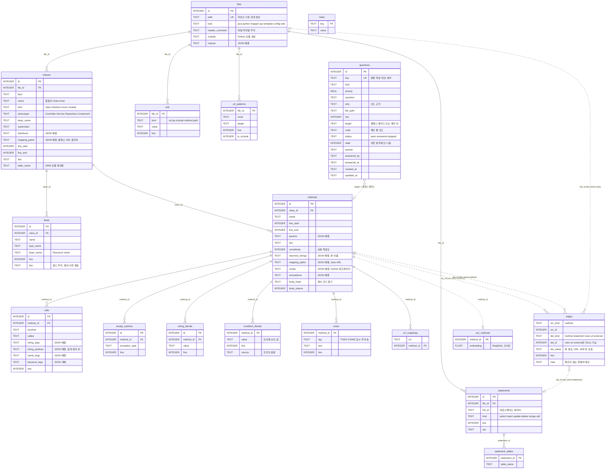
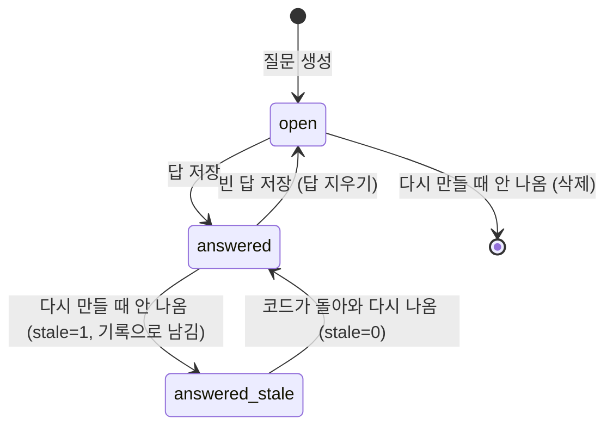
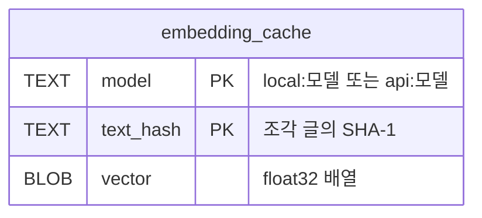

# 사수 (SASU) 데이터 모델 (ERD)

- 기준일: 2026-10-11
- 기준 코드: `src/sasu/db.py` (스키마 버전 7), `src/sasu/rag/vectors.py`
- 함께 보는 문서: [제품 요구사항 (PRD)](prd.md) · [소프트웨어 설계 (SDD)](sdd.md)

사수는 서버 DB를 쓰지 않는다. 분석한 프로젝트마다 SQLite 파일 하나(`projects/<이름>.db`)에 코드 그래프, 인수인계 질문과 답, 벡터 색인을 모두 담는다. 임베딩 캐시만 프로젝트와 상관없이 따로 둔다.

## 1. 저장 위치

```
SASU_HOME                       기본 ~/.sasu, 이 저장소에서 개발할 때는 data/ (.env의 SASU_HOME=data)
├── .env                        sasu setup이 만든 설정 (LLM·임베딩·SQL 방언)
├── current_project             지금 프로젝트 이름 (sasu index·sasu use가 바꾼다)
├── projects/
│   └── <프로젝트 이름>.db       분석 파일: 이 문서 2~4절
├── cache/
│   ├── embeddings.db           임베딩 캐시: 5절
│   └── ignore-revs-v2-<HEAD>.txt   git blame에서 건너뛸 포맷 정리·릴리스 커밋 목록
├── models/                     로컬 임베딩 모델 파일 (fastembed)
├── repos/                      sasu fetch-sample로 받은 예제 저장소
└── out/                        평가 결과 (eval-why.json 등)
```

프로젝트 이름은 분석한 폴더 이름에서 파일 이름에 못 쓰는 글자를 `-`로 바꾼 것이다. `SASU_DB_PATH`를 주면 분석 파일 위치를 직접 정할 수 있다.

## 2. 분석 파일 ERD

SQLite가 강제하는 외래 키(`REFERENCES`)는 실선, 코드가 값으로 잇는 논리 연결은 점선이다.



## 3. 테이블

### 3.1 코드 구조

| 테이블 | 한 행 | 채우는 곳 | 비고 |
| --- | --- | --- | --- |
| `files` | 분석한 파일 하나 | `indexer.py` | JSP·템플릿은 항상, 그 밖의 JS·HTML·XML·properties는 참조가 있을 때만 저장한다 |
| `classes` | 클래스·인터페이스·enum, 또는 Python 모듈의 최상위 함수 묶음(`module`) | 파서 → `indexer._store_code` | `stereotype`은 애노테이션(Java)이나 이름·위치(Python)로 정한다 |
| `fields` | 필드 하나 (Python은 클래스·모듈 대입문과 `__init__`의 `self.x`) | 같음 | `doc`(필드 주석)은 검색 용어 사전이 된다 |
| `methods` | 메서드·함수 하나 | 같음 | 메서드 하나가 검색·임베딩 조각 하나다 |

### 3.2 메서드 안에서 뽑은 것

| 테이블 | 한 행 | 쓰는 곳 |
| --- | --- | --- |
| `calls` | 호출 하나 | 연결(linker) |
| `string_literals` | 문자열 리터럴 하나 | 변수를 거쳐 부르는 쿼리 ID, 코드 안 SQL, 안 쓰는 SQL·URL 판단, 검색 |
| `condition_literals` | 조건식에 쓰인 값 하나 | 업무 코드 분기 질문(`magic_value`), 기존 동작 목록의 분기 |
| `notes` | 주의 주석 하나 | 질문(`note`), 근거(기록), 검색 |
| `empty_catches` | 비어 있는 catch 하나 | 질문(`empty_catch`) |

### 3.3 URL·SQL·화면

| 테이블 | 한 행 | 비고 |
| --- | --- | --- |
| `url_mappings` | URL과 그것을 처리하는 메서드 한 쌍 | 연결 단계에서 만든다. 한 URL에 메서드가 여럿일 수 있다 |
| `url_patterns` | Django `urls.py`의 `path()` 한 줄 | `is_include=1`이면 `include()` |
| `statements` | SQL 하나 | Mapper XML 쿼리, `@Select`·`@Query`, 코드 안 SQL 문자열(`SQL <파일>:<줄>`), Python ORM 합성 쿼리(`ORM <모델>`) |
| `statement_tables` | SQL이 쓰는 테이블 하나 | `FROM`·`JOIN`·`INTO`·`UPDATE`·`MERGE INTO`에서 뽑는다. JPQL은 엔티티 이름을 테이블로 바꾼다 |
| `refs` | JSP·JS·설정 파일 안의 참조 하나 | 안 쓰는 URL·JSP·메서드를 판단하는 재료 |

### 3.4 연결 그래프 (`edges`)

출발은 항상 메서드(`src_kind='method'`)이고, 도착 종류에 따라 `dst_id`가 가리키는 테이블이 다르다.

| `dst_kind` | `dst_id` | `dst_name` | 뜻 |
| --- | --- | --- | --- |
| `method` | `methods.id` | — | 메서드 호출 |
| `statement` | `statements.id` | — | SQL 실행 |
| `view` | `files.id` (파일이 없으면 NULL) | 뷰 경로 | 화면 (JSP·템플릿) |
| `url` | NULL | 이동 URL | `redirect:`·`forward:` |
| `external` | NULL | `타입.메서드` | 저장소 안에 구현이 없는 빈 호출 |

`note`에는 확신이 없는 연결의 이유를 남긴다.

| `note` | 뜻 |
| --- | --- |
| `동적 ID: "<접두어>" + …` | 문자열 + 변수로 만든 쿼리 ID. 그 접두어로 시작하는 쿼리 전부에 잇는다 |
| `빈 '<이름>' (저장소 밖)` | XML 설정·프레임워크에만 있는 빈 |
| `이름으로 추정` | Python에서 import로 못 찾아, 프로젝트에 하나뿐인 이름으로 이었다 |
| `메서드 이름으로 추정` | JPA 상속 메서드 등 이름으로 조회·저장·삭제를 정했다 |
| `모델 추정` | `session.add(obj)`처럼 모델 이름이 안 보이는 쓰기를, 메서드가 다루는 모델로 판단했다 |

### 3.5 인수인계 질문 (`questions`)

사람이 입력한 데이터라 다른 테이블과 수명이 다르다.

- **보존:** 다시 분석해도(`db.reset`), 스키마 버전이 바뀌어도(`PRESERVED_TABLES`) 지우지 않는다.
- **식별:** 코드 id는 분석할 때마다 바뀌므로 외래 키를 두지 않는다. `key`(`종류|파일|대상|세부`)로 같은 질문을 알아보고, `target`(`클래스.메서드`)과 `file_path`·`line`으로 코드에 다시 붙는다.
- **상태:**



| 열 | 값 |
| --- | --- |
| `kind` | `broken_sql` `dynamic_sql` `note` `magic_value` `external_bean` `empty_catch` `copied_code` `complex` `unused_sql` |
| `status` | `open` `answered` `skipped` |
| `priority` | 기본 점수 × 영향 범위 × 복잡도 × 스테레오타입 ([SDD 7.4](sdd.md#74-인수인계-질문-analysisquestionspy)) |
| `code` | 질문을 만들 때 원본에서 읽은 그 줄 (200자까지). 원본 폴더가 없으면 NULL |

### 3.6 `meta`

| key | value |
| --- | --- |
| `repo_path` | 분석한 원본 폴더의 절대 경로. 코드 보기·`git blame`·질문의 코드 줄에 쓴다 |
| `repo_head` | 분석할 때의 `git rev-parse HEAD` |
| `sql_dialect` | 읽은 Mapper의 DB 종류 (기본 `oracle`) |
| `indexed_at` | 분석 시각 (UTC, ISO 8601) |
| `build_info` | 기술 스택 JSON (pom.xml·build.gradle·pyproject.toml) |
| `embed_model` | 벡터 색인을 만든 임베딩 모델 (`local:…`, `api:…`) |
| `jparepo:<classes.id>` | Spring Data 저장소가 다루는 엔티티 이름 |
| `pyassign:<files.id>:<이름>` | Python 모듈 수준 대입(`router = APIRouter(prefix=…)`)의 타입과 인자 JSON. URL 접두어 계산에 쓴다 |

### 3.7 벡터 색인 (`vec_methods`)

- sqlite-vec 가상 테이블 `vec0(method_id INTEGER PRIMARY KEY, embedding float[차원] distance_metric=cosine)`. `vec_methods_chunks`·`vec_methods_info`·`vec_methods_rowids`·`vec_methods_vector_chunks00`은 sqlite-vec가 만드는 보조 테이블이다.
- 분석 결과에서 파생된 것이라, 다시 분석하면 지우고 임베딩 캐시로 다시 만든다.
- `meta.embed_model`이 지금 설정한 임베딩 모델과 같을 때만 검색에 쓴다.

## 4. 인덱스

| 인덱스 | 대상 | 쓰는 곳 |
| --- | --- | --- |
| `idx_classes_name` | `classes(name)` | 타입·static 호출 해석 |
| `idx_classes_bean` | `classes(bean_name)` | `@Resource(name)` 해석 |
| `idx_methods_class` | `methods(class_id, name)` | 호출 대상 메서드 찾기 |
| `idx_methods_hash` | `methods(body_hash)` | 복사 코드 묶기 |
| `idx_url` | `url_mappings(url)` | 경로 추적 |
| `idx_statements_full` | `statements(full_id)` | 쿼리 ID 해석 |
| `idx_statement_tables` | `statement_tables(table_name)` | 테이블별 쿼리 |
| `idx_edges_src` · `idx_edges_dst` | `edges(src_kind, src_id)` · `edges(dst_kind, dst_id)` | 그래프 순회 (정방향·역방향) |
| `idx_condition_literals` | `condition_literals(value)` | 드문 값 세기 |
| `idx_refs` | `refs(kind, value)` | 참조 여부 |

## 5. 임베딩 캐시 (`cache/embeddings.db`)



- 프로젝트와 상관없이 하나다. 같은 조각 글이면 프로젝트·분석 시점이 달라도 다시 임베딩하지 않는다.
- 다시 분석할 때 바뀐 조각만 새로 임베딩한다 (예: eGovFrame 4,570개 조각을 다시 분석해도 새로 임베딩 0개).

## 6. 수명 주기

| 작업 | 분석 테이블 | `vec_methods` | `questions` | `meta` |
| --- | --- | --- | --- | --- |
| `sasu index` (다시 분석) | 비우고 새로 채움 | 지우고 캐시로 다시 만듦 (임베딩 설정 시) | 그대로 | 비우고 새로 씀 |
| 스키마 버전이 다른 파일을 열 때 | 테이블을 지우고 새로 만듦 | 지움 | 그대로 | 지움 |
| `sasu questions` · 웹 "새로 만들기" | — | — | 갱신·추가·stale 표시, 답 없는 stale 삭제 | — |
| `sasu answer` · `answers` · `record_answer` | — | — | `answer`·`status`·`answered_*` 갱신 | — |
| `sasu embed` | — | 다시 만듦 | — | `embed_model` |

분석 테이블의 id(`files`·`classes`·`methods`·`statements`)는 다시 분석할 때마다 바뀐다. 다른 데이터가 이 id를 오래 붙잡지 않게 설계했다: 질문은 `key`·`target`, 임베딩 캐시는 글 해시를 쓴다.

## 7. 자주 쓰는 조회

URL을 처리하는 메서드:

```sql
SELECT u.url, c.name || '.' || m.name AS handler, f.path, m.line_start
FROM url_mappings u
JOIN methods m ON m.id = u.method_id
JOIN classes c ON c.id = m.class_id
JOIN files f ON f.id = c.file_id
WHERE u.url = '/cop/bbs/selectArticleList.do';
```

메서드가 직접 부르는 SQL과 테이블:

```sql
SELECT c.name || '.' || m.name AS method, s.full_id, s.kind, t.table_name
FROM edges e
JOIN methods m ON m.id = e.src_id
JOIN classes c ON c.id = m.class_id
JOIN statements s ON s.id = e.dst_id
LEFT JOIN statement_tables t ON t.statement_id = s.id
WHERE e.src_kind = 'method' AND e.dst_kind = 'statement'
  AND m.name = 'selectArticleList';
```

테이블을 바꾸는 쿼리:

```sql
SELECT t.table_name, s.kind, s.full_id
FROM statement_tables t JOIN statements s ON s.id = t.statement_id
WHERE t.table_name = 'COMTNBBS' AND s.kind IN ('insert', 'update', 'delete', 'merge');
```

답을 받은 인수인계 질문:

```sql
SELECT id, kind, target, question, answer, answered_by
FROM questions
WHERE status = 'answered' AND stale = 0
ORDER BY priority DESC;
```

URL 하나의 전체 경로(서비스 → DAO → SQL을 여러 단계로 따라가기)는 SQL 한 줄로 쓰기보다 `sasu trace`·`trace.py`를 쓴다.

## 8. 규모 예시 (eGovFrame 공통컴포넌트, 2026-10-11 분석)

| 항목 | 수 |
| --- | --- |
| 파일 | Java 1,092 · JSP 747 · Mapper 153 · 설정 170 · 웹 13 |
| 클래스 | class 942 · interface 158 · enum 2 |
| SQL | select 723 · update 184 · insert 177 · delete 164 |
| 연결 (`edges`) | method 7,949 · statement 1,290 · view 1,000 · url 708 · external 466 |
| 참조 (`refs`) | url 3,875 · jsp 868 · method 164 · path 10 · include 4 |
| 벡터 조각 | 4,570 |
| 인수인계 질문 | 99 |
