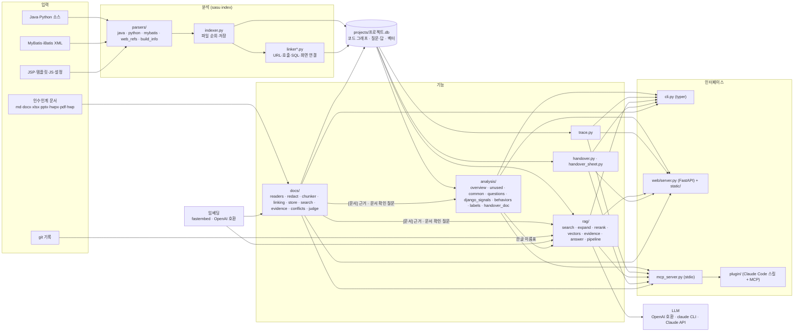
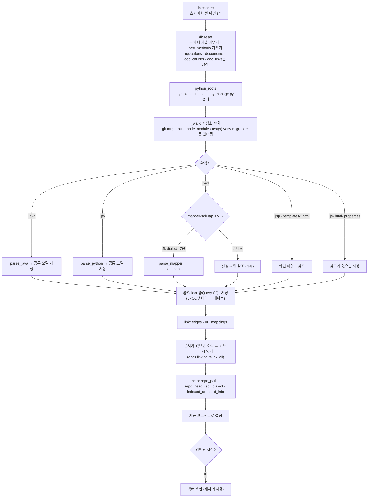
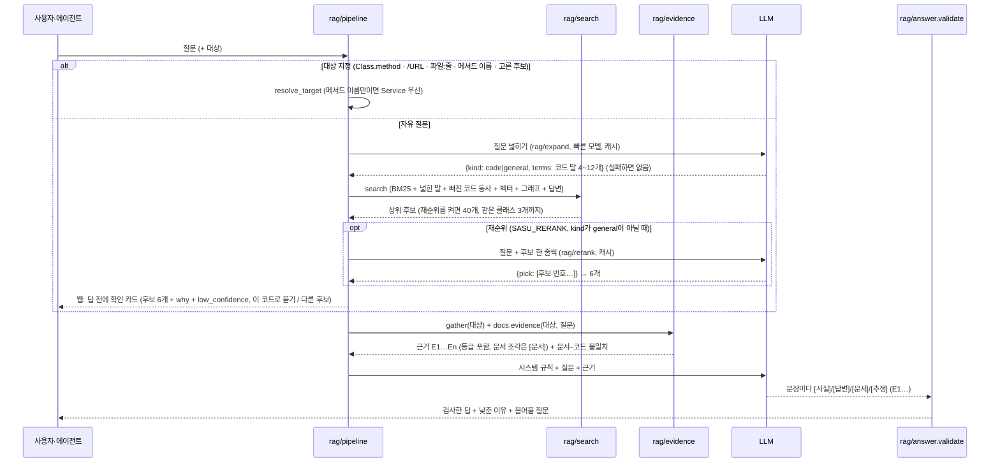
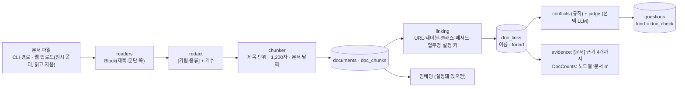

# 사수 (SASU) 소프트웨어 설계 (SDD)

- 기준일: 2026-10-15
- 기준 코드: `main` 7109bb8 + 6·7단계 변경(Django 분석, Claude API 공급자, LLM 재순위, 일반 질문 판정, 인수인계 문서, 인수인계서) · 패키지 0.1.0 · 분석 파일 스키마 버전 7 (문서 테이블 3개는 `CREATE TABLE IF NOT EXISTS`로 더하고 보존 테이블에 넣어 버전은 그대로)
- 함께 보는 문서: [제품 요구사항 (PRD)](prd.md) · [데이터 모델 (ERD)](erd.md) · [RAG 구조와 평가](rag.md) · [인수인계 문서](documents.md) · [설치 안내](install.md)

## 1. 설계 원칙

1. **확정할 수 있는 것은 정적 분석이 확정한다.** 호출 관계, SQL, 테이블, 참조 여부는 tree-sitter와 정규식으로 찾는다. LLM은 모은 근거로 설명만 한다.
2. **LLM이 쓴 문장은 코드가 다시 검사한다.** 등급과 근거가 맞지 않으면 [추정]으로 낮춘다.
3. **확신이 없는 연결은 표시한다.** 동적 쿼리 ID, 저장소 밖 빈, 이름으로 추정한 호출은 연결에 메모(`edges.note`)를 남기고, 안 쓰는 코드는 "후보"로만 말한다.
4. **사람이 입력한 데이터는 지우지 않는다.** 인수인계 질문과 답, 넣은 인수인계 문서는 다시 분석해도, 스키마가 바뀌어도 남긴다.
5. **서버 없이 돈다.** 프로젝트마다 SQLite 파일 하나. 벡터 색인도 같은 파일 안(sqlite-vec)에 둔다.
6. **문서는 코드보다 낮게 믿는다.** 인수인계 문서 조각은 [문서] 등급으로만 인용하고, 코드 근거 없이 [사실]이 되지 않는다. 문서와 코드가 다르면 사람에게 물을 질문으로 만든다.

## 2. 시스템 구성



## 3. 모듈 구성

| 경로 | 역할 |
| --- | --- |
| `cli.py` | 모든 명령의 진입점 (typer). 결과를 rich 표·트리로 출력 |
| `config.py` | `SASU_HOME`, `.env` 읽기, 프로젝트별 분석 파일 경로, 지금 프로젝트 |
| `db.py` | 분석 파일 스키마, 스키마 버전 확인, 다시 분석 전 초기화 |
| `indexer.py` | 저장소 순회, 확장자별 파서 호출, 저장, `meta` 기록 |
| `parsers/java_parser.py` | tree-sitter-java: 클래스·필드·메서드·호출·애노테이션·조건 값·주의 주석·빈 catch·복잡도·본문 해시 |
| `parsers/python_parser.py` | tree-sitter-python: 같은 공통 모델(JavaFile)로 함수·클래스·데코레이터·import·ORM 모델·Django urlpatterns·앱 설정 `get_urls()`. 모듈마다 Django 신호 재료(`@receiver`, settings 읽기, `path(name=)`, `reverse()`, 클래스 본문의 이름 대입) |
| `parsers/mybatis_parser.py` | MyBatis `<mapper>`·iBatis `<sqlMap>`: 쿼리 ID, `<include>` 펼치기, SQL 정리, 테이블 추출 |
| `parsers/web_refs.py` | JSP·HTML·JS·XML·properties 안의 URL·JSP·include·메서드 이름 참조 |
| `parsers/build_info.py` | pom.xml·build.gradle·pyproject.toml에서 기술 스택 |
| `linker.py` | Java 연결: URL 매핑, 필드 주입·인터페이스 구현·static 호출, 쿼리 ID·동적 ID, 뷰·이동 URL |
| `linker_java_data.py` | iBatis 짧은 ID, 매퍼 인터페이스, `@Select`, JPA 저장소, JDBC·JPQL 문자열 |
| `linker_python.py` | Python 연결: 라우터 접두어·include·앱 설정 `get_urls()`, 클래스 뷰의 HTTP 메서드·제네릭 뷰 훅, import·self·`get_class`·이름 추정 호출, ORM(역방향 관계·추상·proxy 모델)·SQL 문자열, 템플릿(`template_name` 포함) |
| `trace.py` | URL에서 출발하는 트리, URL → SQL 연결률 |
| `analysis/overview.py` | 프로젝트 지도: 모듈, 모듈별 URL·SQL·테이블, 공유 테이블 |
| `analysis/unused.py` | 끊어진 쿼리, 부르는 곳이 없는 SQL·URL·메서드·JSP |
| `analysis/common.py` | 공통 코드 사용, 복사 코드(본문 해시), 중복 SQL |
| `analysis/questions.py` | 인수인계 질문 생성과 저장 (Django 신호와 '문서 확인' 질문을 함께 넣는다) |
| `analysis/django_signals.py` | Django에서 코드 흐름에 보이지 않게 동작을 바꾸는 8가지(시그널·직접 쓴 SQL·설정값 분기·숨은 조회 조건·배치·트랜잭션·요청 훅·교체 가능한 클래스) → 질문 신호 ([7.4](#74-인수인계-질문-analysisquestionspy)) |
| `analysis/handover_doc.py` | 인수인계서: 기존 동작 목록의 URL을 업무명(없으면 모듈)으로 묶고 코드·받은 답변·문서 조각·확인 필요를 등급과 함께 md·docx로 ([7.6](#76-인수인계서-analysishandover_docpy)) |
| `analysis/behaviors.py` | 기존 동작 목록과 엑셀 내보내기 (모듈·업무명으로 좁히기, "사용법" 시트, "기능(한글)" 열) |
| `analysis/labels.py` | 한글 이름표: 클래스 업무명(Javadoc·파일 머리말 `Description`, 20자), 메서드 한글 설명(Javadoc 첫 한글 줄, 40자), 모듈 업무명(모듈 안 Controller 업무명 중 가장 흔한 것), 업무명별 URL 수, 한글로 URL 찾기. 주석에 없으면 None (지어내지 않음) |
| `handover.py` | 질문 새로 만들기, 답 저장, 건너뛰기, 질문 초안 (CLI·웹·MCP 공용) |
| `handover_sheet.py` | 엑셀 질문지 내보내기(전체 또는 고른 id, '번호' = Q{id})·가져오기(바뀜·같음·못 찾음을 따로 셈) (openpyxl) |
| `githistory.py` | `git blame`으로 줄을 바꾼 커밋, 포맷 정리·릴리스 커밋 제외 목록 |
| `rag/search.py` | BM25(한국어 2-gram) + 용어 사전 + 넓힌 말(가중치 0.7) + 벡터 + 그래프 전파 + 답변 끌어올리기 |
| `rag/expand.py` | LLM 질문 넓히기: 일상어 질문 → JSON 객체 `{"kind": "code" 또는 "general", "terms": [...]}` (코드에 나올 말 4~12개 + 질문 종류, 한 번의 호출). 프롬프트에 코드에서 뽑은 힌트(업무명=클래스 조각 120개, 자주 나오는 조각 50개). 공급자는 `SASU_EXPAND_PROVIDER`(Claude API면 `claude-haiku-5-5` effort low). 질문 해시로 캐시, 실패하면 빈 목록 |
| `rag/rerank.py` | LLM 재순위: 검색 상위 40개(같은 클래스 3개까지)를 한 줄씩 보여 주고 빠른 LLM이 `{"pick": [...]}`로 6개를 고른다. 고르지 않은 후보는 검색 순서대로 뒤를 채운다. 질문·후보 해시로 캐시 |
| `rag/embeddings.py` · `rag/vectors.py` | 임베딩(로컬·API), 임베딩 캐시, sqlite-vec 색인과 검색 |
| `rag/evidence.py` | 대상 메서드 정하기, 근거 모으기와 등급 |
| `rag/answer.py` | LLM 호출(OpenAI 호환·claude CLI·Claude API `AnthropicClient`), 답변 형식 검사([문서] 등급 포함) |
| `rag/pipeline.py` | 대상 선택 → 근거 수집 (CLI·웹·MCP 공용). 검색으로 고르면 후보 6개(상위 30개에서 같은 클래스는 2개까지, 재순위를 켜면 40개·3개까지 모아 LLM이 고름)와 고른 이유(why), `auto`, `low_confidence`, 넓힌 말, 질문 종류. 코드 근거 뒤에 문서 근거를 붙이고 문서–코드 불일치를 찾는다 |
| `docs/` | 인수인계 문서: `readers`(형식별 읽기) · `redact`(비밀 가리기) · `chunker`(제목 단위 조각·문서 날짜) · `linking`(조각 → 코드 이름) · `store`(넣기·목록·지우기) · `search`(조각 BM25 + 벡터) · `evidence`([문서] 근거, 노드별 문서 수) · `conflicts`(규칙 불일치 → '문서 확인' 질문) · `judge`(선택 LLM 판정) · `configs`(설정 파일 키=값) · `cli`(`sasu docs …`). [8.5절](#85-인수인계-문서-docs) |
| `web/server.py` · `web/static/` | FastAPI API와 CDN 없는 화면 (HTML·JS·CSS). 묻기 검색 색인·넓히기는 `_AskCache`로 메모리에 두고 분석 파일의 경로·변경 시각·크기가 바뀌면 다시 만든다 |
| `mcp_server.py` | MCP 서버 (도구 10개) |
| `setup_env.py` | `sasu setup`의 설정 파일 쓰기, `sasu doctor`의 점검 항목 (Claude API: 모델·키·SDK) |
| `evaluation/` | 과거 시점 재현(`git archive`), 질문·검색·"왜?" 채점. `everyday_eval.py` + `everyday.json`(eGovFrame 71문항: dev 19 + test 52, 이제 둘 다 tune) · `everyday-oscar.json`(django-oscar dev 22): 묻기 대상 후보 채점, split `dev`·`test`·`holdout`(holdout 세트 파일은 저장소 밖). `docs_eval.py`: 가상 인수인계 문서와 정답 목록으로 문서 기능 채점 |

## 4. 실행 환경과 설정

### 4.1 저장 위치

`SASU_HOME`(기본 `~/.sasu`, 이 저장소에서 개발할 때는 `.env`의 `SASU_HOME=data`) 아래에 둔다. 자세한 배치는 [ERD 1절](erd.md#1-저장-위치).

### 4.2 설정 읽는 순서

1. 이미 있는 환경 변수
2. 지금 폴더의 `.env`
3. `SASU_HOME/.env` (`sasu setup`이 만든다)

`.env`는 외부 라이브러리 없이 읽고, 이미 설정된 값은 덮어쓰지 않는다.

### 4.3 환경 변수

| 변수 | 기본값 | 뜻 |
| --- | --- | --- |
| `SASU_HOME` | `~/.sasu` | 분석 파일·캐시·모델·설정을 두는 곳 |
| `SASU_DB_PATH` | 없음 | 분석 파일을 직접 지정 (보통은 프로젝트마다 자동) |
| `SASU_SQL_DIALECT` | `oracle` | `*_SQL_<dialect>.xml`처럼 DB별로 나뉜 Mapper 중 읽을 것 |
| `SASU_LLM_PROVIDER` | `openai` | `openai`(OpenAI 호환 주소) · `claude-code`(claude CLI) · `anthropic`(Claude API, 개발용) |
| `SASU_ANTHROPIC_API_KEY` | 빈 값 | Claude API 키. SDK 클라이언트에 직접 넘기고 `ANTHROPIC_API_KEY`로 내보내지 않는다(같은 PC의 claude CLI가 그 이름을 보면 구독 대신 API 요금으로 바뀜). `Settings` repr에서 뺀다 |
| `SASU_LLM_BASE_URL` | `https://openrouter.ai/api/v1` | OpenAI 호환 주소 (현장: 사내 LLM 서버) |
| `SASU_LLM_API_KEY` | 빈 값 | 키 없는 사내 서버면 비우거나 `none` |
| `SASU_LLM_MODEL` | 빈 값 | 모델 이름 (claude-code는 기본 `sonnet`, anthropic은 기본 `claude-opus-5-5`, `haiku`·`sonnet`·`opus` 짧은 이름 가능) |
| `SASU_EMBED_PROVIDER` | `none` | `none`, `local`(fastembed), `api`(OpenAI 호환 `/embeddings`) |
| `SASU_EMBED_MODEL` | local: `sentence-transformers/paraphrase-multilingual-MiniLM-L12-v2` | 임베딩 모델 (api는 필수) |
| `SASU_EMBED_BASE_URL` · `SASU_EMBED_API_KEY` | LLM 값 | 임베딩 서버가 따로 있을 때 |
| `SASU_QUERY_EXPAND` | `auto` | 묻기 검색 전 LLM 질문 넓히기. `auto`(LLM이 설정돼 있으면 켬) · `on` · `off`. 대상을 직접 적은 질문(Class.method·URL·파일:줄)에는 쓰지 않는다 |
| `SASU_EXPAND_MODEL` | claude-code: `haiku` / anthropic: `claude-haiku-5-5` / OpenAI 호환: `SASU_LLM_MODEL` | 질문 넓히기·재순위에 쓸 모델 (빠른 모델 권장) |
| `SASU_EXPAND_PROVIDER` | `auto` | 넓히기·재순위 공급자: `auto`(= `SASU_LLM_PROVIDER`) · `anthropic` · `claude-code` · `openai` |
| `SASU_EXPAND_VARIANT` | `default` | 넓히기 프롬프트 변형 `default` · `strict` · `union2` (흔들림 실험용) |
| `SASU_RERANK` | `auto` | LLM 재순위 `auto`(넓히기 공급자가 anthropic일 때만) · `llm` · `off` |
| `SASU_RERANK_POOL` | `40` | 재순위에 보여 줄 후보 수 (6~60) |
| `SASU_DOC_JUDGE` | `off` | `on`이면 문서–코드 불일치를 LLM으로도 판정 (`--llm-judge`와 같음) |
| `SASU_JUDGE_PROVIDER` · `SASU_JUDGE_MODEL` | `anthropic` · `claude-haiku-5-5` | 불일치 판정 공급자(`anthropic` · `expand`)와 모델 |

## 5. 분석 파이프라인 (`sasu index`)



- Maven 사이트 문서(`src/site/`)의 예제 Mapper는 실제 코드로 착각하므로 건너뛴다.
- 2MB가 넘는 참조 파일은 내용을 읽지 않는다.
- Java와 Python 파서는 같은 공통 모델(`JavaFile` → 클래스·필드·메서드·호출)을 돌려준다. Python 모듈의 최상위 함수는 `kind='module'`인 클래스 하나로 묶는다.

## 6. 연결 규칙 (linker)

모든 연결은 `edges(src_kind='method', src_id, dst_kind, dst_id, dst_name, line, note)` 한 테이블에 모은다.

### 6.1 Java

| 규칙 | 결과 |
| --- | --- |
| 클래스 `@RequestMapping` 접두어 × 메서드 매핑 경로 | `url_mappings` |
| 받는 쪽이 없거나 `this`·`super` | 자기 클래스와 상속 체인에서 찾는다 |
| 받는 쪽이 필드 | `@Resource(name)` 빈 이름 우선, 없으면 타입. 타입이 인터페이스면 구현 클래스 |
| 받는 쪽이 대문자로 시작 | static 유틸 호출 |
| 주입받은 빈인데 저장소 안에 구현이 없음 | `dst_kind='external'`, `note="빈 '이름' (저장소 밖)"` |
| 문자열 인자 = 쿼리 ID | `dst_kind='statement'` |
| `"Ns.prefix" + 변수` | 그 접두어로 시작하는 쿼리 전부, `note='동적 ID: "…" + …'` |
| DAO(`@Repository`) 안의 문자열 리터럴 = 쿼리 ID | 변수를 거쳐 부르는 쿼리 |
| 컨트롤러가 돌려준 `redirect:`·`forward:` | `dst_kind='url'` |
| 컨트롤러가 돌려준 뷰 이름 | `WEB-INF/jsp/{뷰}.jsp` 또는 Thymeleaf `templates/{뷰}.html` (`dst_kind='view'`) |
| iBatis 짧은 ID, 매퍼 인터페이스, `@Select`, JPA 저장소(상속 메서드는 이름으로 조회·저장·삭제), JDBC·JPQL 문자열 | `linker_java_data.py`. 이름으로 정한 것은 `note='메서드 이름으로 추정'` |

### 6.2 Python

| 규칙 | 결과 |
| --- | --- |
| FastAPI `@router.get` + `include_router(prefix=…)`, `APIRouter(prefix=…)` | `url_mappings` |
| Flask `@bp.route` + `register_blueprint(url_prefix=…)` | `url_mappings` |
| Django `urlpatterns`·`include()`·클래스 뷰(`get`/`post`…) | `url_mappings` |
| import 별칭·상대 import, `self.repo = Repo()` 주입, 모듈 함수 | `dst_kind='method'` |
| 위로 못 찾았지만 프로젝트에 하나뿐인 이름 | `note='이름으로 추정'` |
| ORM 호출 (`Post.objects.filter`, `select(User)`, `session.get(User, 1)`) | 모델마다 합성 쿼리 `ORM <모델>` (`statements`) |
| `session.add(obj)` 등 모델 이름이 안 보이는 쓰기 | 메서드가 만들거나 다루는 모델로 판단, `note='모델 추정'` |
| 코드 안의 SQL 모양 문자열 | 쿼리 `SQL <파일>:<줄>` (로그 문구는 거른다) |
| `render_template`·`render`·`TemplateResponse`, 클래스 뷰의 `template_name` | `dst_kind='view'` |
| Django 앱 설정 클래스의 `get_urls()` + `include()` (`urls.py` 대신 앱 설정으로 URL을 거는 django-oscar 구조) | `url_mappings` |
| 클래스 뷰: 그 클래스와 프로젝트 안 부모의 HTTP 메서드·제네릭 뷰 훅(가까운 정의만), `get_class`로 불러 둔 뷰(`self.add_view.as_view()`) | URL → 뷰 메서드 |
| `get_class("basket.views", "BasketView")`·`get_model("basket", "Basket")` | 그 이름의 클래스·모델 |
| 역방향 관계(`order.notes.create` ← `ForeignKey(related_name="notes")`), 제네릭 뷰의 `model =`·`queryset =`, 추상 모델 상속·proxy 모델 | 실제 테이블을 가진 모델의 `ORM <모델>` |

## 7. 분석 기능

### 7.1 경로 추적 (`trace.py`)

- URL에 매핑된 메서드에서 출발해 `edges`를 깊이 8까지 따라간다.
- 기본은 스테레오타입(Controller·Service·Repository·Component) 클래스만 펼치고, 유틸은 한 줄로 보여 준다. 유틸이 직접 SQL을 부르면 그것은 보여 준다. `--full`이면 모두 펼친다.
- 이미 펼친 메서드는 "위에서 펼침"으로 표시하고, 같은 부모에서 같은 대상을 여러 번 부르면 `×N`으로 합친다.
- URL이 정확히 맞지 않으면 부분 일치로 후보를 돌려준다.

### 7.2 정리 후보 (`analysis/unused.py`)

- **끊어진 쿼리:** DAO 안의 `"Ns.id"` 문자열인데 Mapper에 없는 쿼리. URL에서 이어지지 않으면 "죽은 코드"로 따로 표시한다.
- **SQL·URL·JSP:** 코드·화면·설정 어디에도 참조가 없는 것.
- **메서드:** Service·DAO·Component 중 부르는 코드나 설정이 없는 것. 프레임워크가 부르는 애노테이션(`@PostConstruct`, `@Scheduled`, AOP 등)은 뺀다.
- **Python:** URL은 경로 대신 이름으로 찾는다 (`path(..., name="summary")` ↔ 템플릿 ``·`reverse()`·설정 문자열, 네임스페이스는 떼고 맞춰 넉넉하게 "쓰는 것"으로 본다). 메서드는 이름이 코드 어디에서든 쓰이면(호출, 콜백 인자, `property(_get, _set)`, 딕셔너리 값, 문자열 `"x"`·`"_validate_%s"` 앞부분, 템플릿 `{{ obj.x }}`) 쓰는 것으로 보고, 같은 이름의 클래스 메서드가 여러 곳(재정의), 데코레이터(시그널·템플릿 태그·프로퍼티·작업), 저장소 밖 부모가 부르는 훅(`clean_*`·`get_*`·`render_*` 등), 프레임워크가 부르는 모듈(templatetags·receivers·admin·management·settings 등)과 뷰는 뺀다. 미사용 템플릿은 동적 이름이 많아 아직 보지 않는다.
- 결과마다 확신 정도(`높음`/`후보`)와, 수정 이력 주석처럼 사람이 남긴 근거를 붙인다.

### 7.3 공통화 진단 (`analysis/common.py`)

- **공통 코드:** 다른 모듈에서 부르는 클래스를, 부르는 모듈 수와 호출 횟수 순으로 보여 준다. 모듈은 모든 패키지가 공유하는 앞부분 다음 두 단계다 (`egovframework.com.cop.bbs.service.impl` → `cop.bbs`). Django는 프로젝트 지도와 같이 앱(apps.py가 있는 폴더) 단위다 (`basket`, `dashboard.orders`).
- **복사 코드:** 식별자·리터럴을 지운 본문 토큰의 해시(`methods.body_hash`)가 같은 메서드를 묶는다 (토큰 60개 이상). 묶음 안에 다른 클래스가 상속하는 공통 부모가 있으면 "상속하지 않고 복사한 곳 N" 메모를 붙인다.
- **중복 SQL:** 공백을 정리하고 대문자로 맞춘 SQL(80자 이상)이 다른 쿼리 ID로 여러 번 있는 것.

### 7.4 인수인계 질문 (`analysis/questions.py`)

LLM 없이 규칙과 템플릿으로 만든다.

| 신호 (`kind`) | 기본 점수 | 찾는 것 |
| --- | --- | --- |
| `broken_sql` | 100 | URL에서 이어지는 끊어진 쿼리 (항상 맨 앞) |
| `dynamic_sql` | 90 | 실행 때 정해지는 쿼리 ID |
| `note` | 80 | TODO·FIXME·XXX·HACK·임시 처리·하드코딩·주의·나중에·확인 필요·추후 |
| `magic_value` | 70 | 코드 전체에서 3곳 이하에서만 쓰는 업무 코드 값 분기 (`USR03`, `'09'`, Python 소문자 코드 값) |
| `complex` | 70 | 순환 복잡도 15 이상인 Controller·Service·DAO·Component |
| `external_bean` | 60 | 설정에만 있는 빈 (같은 타입은 한 질문으로) |
| `empty_catch` | 50 | 비어 있는 catch |
| `copied_code` | 45 | 공통 부모가 있는데 복사한 코드 |
| `unused_sql` | 30 | 사람이 "안 쓴다"고 남긴 SQL |
| `doc_check` | 60~75 | 인수인계 문서와 코드가 다른 값을 말하는 곳 ('문서 확인', 문서를 넣었을 때만. [8.5](#85-인수인계-문서-docs)) |

Python(Django)은 코드 흐름(URL → 뷰 → 호출)에 보이지 않게 동작을 바꾸는 장치를 따로 찾는다 (`analysis/django_signals.py`). 재료는 파서가 모듈마다 남긴 사실(`meta`의 `pyclass:<모듈 클래스>`의 `facts`: `@receiver`, settings 읽기, `path(name=)`, `reverse()`, 클래스 본문의 이름 대입·문자열, 쓰인 이름)과 `calls` 표다. Java 프로젝트에는 Python 파일이 없어 결과가 그대로다.

| 신호 (`kind`) | 기본 점수 | 찾는 것 |
| --- | --- | --- |
| `signal` | 75 | `@receiver`·`signal.connect`로 붙은 함수. 보내는 곳(`send`·`self.x_signal.send`, 모델 시그널은 sender 모델을 저장·삭제하는 메서드)의 영향 범위를 쓴다 |
| `raw_sql` | 70 | `cursor.execute`·`.raw()`·`.extra()`·`RawSQL`·SQL 문자열 |
| `setting_branch` | 65 | 업무 설정(Django 자체 설정 제외)을 조건에서 읽는 곳. 기본값(defaults·settings·pydantic Settings)을 함께, 같은 메서드의 설정은 한 질문으로 |
| `hidden_filter` | 65 | 커스텀 매니저 `get_queryset`·쿼리셋 메서드의 고정 조건 (`status="Open"`, `is_public=True`; 매개변수로 거르는 것은 제외) |
| `batch_job` | 55 | 관리 명령(`management/commands`)·`@shared_task` 같은 작업 |
| `request_hook` | 40 | 미들웨어(클래스마다)·컨텍스트 프로세서(한 질문으로). 영향 범위는 모든 URL |
| `transaction` | 55 | `atomic`(데코레이터·with)·`select_for_update` |
| `swappable_class` | 40 | `get_class`·`get_model`로 이름으로 불러오는 곳이 5곳 이상 (포크한 앱이 바꿀 수 있음, 프로젝트에 한 질문) |

Python은 그 밖에 비어 있는 `except`를 계층과 상관없이 보고(모든 예외를 삼키면 문구를 따로, `DoesNotExist`·`KeyError`처럼 "없으면 넘어감"은 점수 × 0.5), 복잡한 분기도 계층과 상관없이 본다. 업무 코드 값은 같은지 비교한 값만 보고(`> 100`·`startswith("X")` 제외), 프로젝트의 필드·메서드 이름과 같은 값(`field == "title"`)과 화면 버튼·형식 이름(`continue`·`csv`)은 뺀다.

우선순위 계산:

```
우선순위 = 기본 점수 × 영향 범위 × 복잡도 × 스테레오타입
  영향 범위   = 1 + log2(1 + 닿는 URL 수)   (닿는 URL이 없으면 0.5)
  복잡도      = 1 + log2(순환 복잡도)
  스테레오타입 = Controller·Service·Repository 1.0, Component 0.8, 그 밖 0.5
  한 메서드에 신호 종류가 하나 더 겹칠 때마다 × 1.5
  Django 신호 중 영향 범위를 따로 주는 것(시그널·미들웨어·매니저·배치·get_class)은 그 값을 쓰고 스테레오타입은 1.0
```

- 같은 `key`(종류|파일|대상|세부)는 점수가 높은 하나만 남긴다.
- 한 메서드에 2개, 한 클래스에 4개까지만 앞에 두고 나머지는 뒤로 보낸다.
- 끊어진 쿼리는 확인된 고장이라, 나머지 최고점 위로 올려 맨 앞에 둔다.

저장 (`save_questions`): 같은 `key`가 있으면 내용만 갱신하고 답은 지킨다. 이번에 나오지 않은 질문은 `stale=1`로 표시한 뒤, 답이 없는 것은 지우고 답한 것은 기록으로 남긴다.

### 7.5 기존 동작 목록 (`analysis/behaviors.py`)

URL마다 경로 추적 결과를 한 줄로 접는다: 처리 메서드, 화면, 이동, 읽는 테이블, 쓰는 테이블(INSERT→등록, UPDATE→수정, DELETE→삭제, MERGE→저장, CALL→프로시저), 업무 코드 분기, 주의 주석, 받은 답, 확인할 연결(저장소 밖 빈·동적 쿼리). Django는 업무 코드 분기에 설정값 분기(`설정 OSCAR_X`)를, 확인할 연결에 이 처리가 일으키는 시그널과 받는 쪽(`시그널 order_placed → receivers.receive_order_placed`)을 더한다. 엑셀에는 "고도화 후 확인" 열(같음 / 달라짐(의도) / 달라짐(확인 필요) / 없어짐)을 둔다.

### 7.6 인수인계서 (`analysis/handover_doc.py`)

`sasu handover-doc`·`GET /api/handover-doc`. 기존 동작 목록(`list_behaviors`, 모듈·업무명으로 좁힘)의 URL을 처리 클래스의 업무명으로 묶고(업무명이 없으면 모듈), 질문은 대상(Class.method·쿼리 ID·URL)을 가장 많은 화면이 거치는 업무 하나에 붙인다.

| 절 | 내용 | 등급 |
| --- | --- | --- |
| 요약 | 업무·URL·데이터를 바꾸는 URL·테이블 수, 받은 답변 수, 확인 필요 수 | [사실]·[답변]·[확인 필요] |
| 근거 등급 범례 · 차례 | 등급 4개의 뜻, 업무 목록 | – |
| 업무마다: 개요 · 화면(URL)별 처리 | URL → 처리 메서드 → SQL → 테이블, 읽기/쓰기, 업무 코드 분기, 주의 주석 | [사실] |
| 받은 답변 | 답한 사람·날짜 | [답변] |
| 확인 필요 (전임자 기입) | 답이 없는 질문(묻는 이유·위치), 저장소 밖 빈 같은 확정 못 한 연결, "운영 중 알아야 할 것" 칸 — 답 칸은 빈칸 | [확인 필요] |
| 관련 문서 (문서를 넣었을 때만) | 업무에 이어진 문서 조각 5개까지, 불일치는 ⚠ + 확인 필요에 '문서 확인' 질문 | [문서] |
| 업무에 묶이지 않은 것 | 어느 업무에도 닿지 않는 질문·답 (범위를 좁히면 뺌) | |

md는 의존성 없이, docx는 python-docx(extra `docx`). 건너뛴 질문은 넣지 않는다. 시간: eGovFrame 휴가관리 9쪽 0.6초, 전체 561쪽 3.3초, django-oscar 전체 70쪽 0.8초.

## 8. "왜?" 질의응답 (RAG)



### 8.1 검색 (`rag/search.py`)

- **조각:** 메서드 하나 = 조각 하나 (최대 1,500자). 이름(카멜 표기를 쪼갬), Javadoc·docstring, 클래스 설명, 주의 주석, 문자열, 부르는 메서드 이름, 부르는 SQL ID와 테이블, 인수인계 답변(대상 이름으로 붙임)을 묶는다. 인터페이스와 본문 20토큰 미만의 getter·setter는 뺀다.
- **토큰:** 한국어는 조사·어미를 뗀 뒤 글자 2-gram, 영어는 카멜 표기를 쪼갠다. 질문하는 말투(어떻게·테이블·읽어 등)는 불용어로 뺀다.
- **용어 사전:** VO 필드 주석(`/** 게시물 아이디 */ nttId`)의 한국어 2-gram이 질문과 두 개 이상 겹치면 필드 이름 토큰을 0.5 가중치로 더한다.
- **점수:** BM25(k1 1.2, b 0.75) → (벡터 색인이 있으면) BM25를 최고점 1로 맞추고 코사인 유사도 × 0.3을 더하는 선형 결합 → 인수인계 답변과 질문 단어(idf 가중)가 34% 이상 겹치면 1위 점수의 최대 50%를 더함 → 직접 부르는 메서드 중 최고 점수의 25%를 부르는 쪽에 더함.
- **질문 넓히기** (`rag/expand.py`): 검색 전에 LLM이 질문을 코드 말로 넓히고, 같은 호출에서 질문 종류(`code` 이 프로젝트 코드 질문 / `general` 일반 개념 질문)를 함께 낸다. 넓힌 말은 BM25 질의에 가중치 0.7로 더하고(질문 낱말은 1), 질문의 동작 말(바꾸·지우·저장·목록…) 중 LLM이 빠뜨린 코드 동사(update·delete·insert·select)를 같은 가중치로 더한다. LLM이 넓혔으면 필드 주석 용어 사전은 쓰지 않는다. 벡터 검색은 원래 질문으로 한다. 결과는 `cache/query-expand/`에 질문 해시로 둔다. LLM이 없거나 실패하면 원래 검색 그대로. 지연은 claude CLI(haiku) 5.17초 → Claude API(Haiku 5.5, effort low) 1.46초 (같은 질문 10개 평균). 넓히기 변형(`SASU_EXPAND_VARIANT` default·strict·union2) 중 기본은 default ([일상어 평가](rag.md#일상어-질문-평가-2026-10-15)).
- **LLM 재순위** (`rag/rerank.py`): 넓히기 뒤 검색 상위 40개(`SASU_RERANK_POOL`, 같은 클래스 3개까지)를 한 줄씩(Class.method · 한글 설명 · 폴더 · URL · Javadoc/Docstring 앞 160자 · 부르는 SQL과 테이블 · 부르는 메서드) 빠른 LLM에 보여 주고 질문의 답이 들어 있을 메서드를 최대 6개 고르게 한다(`{"pick": [...]}`). 고르지 않은 후보는 검색 순서로 뒤를 채운다. 질문 종류가 `general`이면 하지 않는다(어차피 경고). 넓히기와 같은 클라이언트, 질문당 호출 1번, 약 +1.9초, 결과는 `cache/rerank/`. `SASU_RERANK=auto`는 넓히기 공급자가 Claude API일 때만 켠다(claude CLI는 호출마다 몇 초가 더 들어서). holdout에서 상위 6 Java 68.7% → 78.0%, Python 79.2% → 94.4%(1위 30.7% → 63.3%, 31.2% → 92.8%), 설정을 고른 tune에서는 Java 76.7% → 97.3%, Python 72% → 100% ([재순위 실험](rag.md#llm-재순위-실험-2026-10-15) · [holdout](rag.md#holdout-측정)). Java holdout에서는 넓히기만으로 맞힌 3문항을 재순위가 놓치기도 했다.
- **후보와 확신** (`rag/pipeline.py`): 상위 30개에서 같은 클래스는 2개까지 6개를 후보로 둔다(재순위를 켜면 위처럼 모아 LLM이 고름). 상위가 몇 클래스뿐이라 6개가 안 되면 클래스 제한으로 뺀 것을 점수 순으로 채운다. 후보마다 고른 이유 `why`("맞은 말: 로그인, Login, incorrect · 업무명 일반 로그인"). `low_confidence`는 넓히기 LLM의 질문 종류가 있으면 그것만 본다(`general`이면 true, holdout 일반 질문 9/9). 없으면(LLM 없음·실패·strict 변형) 넓힌 말 없이 질문 낱말만으로 가장 잘 맞는 코드의 BM25 점수가 12 미만이거나, 1위 후보에 질문 낱말이 하나도 없으면 true. tune 세트(일반 11 · 정답 있는 60)에서 일반 경고 55% → 100%, 잘못 경고 7.3% → 3.3%. LLM 판정에 BM25 규칙을 OR로 더하면 잘못 경고가 9%로 늘어 뺐다.
- RRF는 비교용으로만 남겼다. 약한 벡터 순위가 BM25 1위를 희석해 R@1이 28%에서 11%로 떨어졌다 ([실험 기록](rag.md#실험-기록)).

### 8.2 근거 (`rag/evidence.py`)

| 순서 | 근거 | 등급 |
| --- | --- | --- |
| 1 | 대상 메서드 코드 원문 (최대 150줄) | 확인된 사실 |
| 2 | 이 메서드를 거치는 URL (8개까지) | 확인된 사실 |
| 3 | 이 메서드가 부르는 코드와 SQL·테이블·저장소 밖 빈 | 확인된 사실 |
| 4 | Javadoc·docstring, 주의 주석, 파일 머리말 수정 이력, Mapper 수정 이력 | 기록 |
| 5 | 이 메서드(또는 그 줄 범위)에 달린 인수인계 답변 | 인수인계 답변 |
| 6 | `git blame`으로 이 코드를 마지막으로 바꾼 커밋 5개까지 (많이 바꾼 순) | 기록 |
| 7 | 인수인계 문서 조각 4개까지: 대상 메서드·클래스·거치는 URL과 이어진 조각(강), 쓰는 테이블·업무명과 이어진 조각(약, 질문 낱말도 맞아야), 연결이 없어도 질문 낱말(idf 가중) 34% 이상인 조각 ([8.5](#85-인수인계-문서-docs)) | 문서 |

포맷 정리·릴리스·첫 커밋·봇 커밋은 줄 전체를 덮어써 진짜 이유를 가린다. 이런 커밋 목록을 `cache/ignore-revs-v2-<HEAD>.txt`로 만들어 `git blame --ignore-revs-file`로 건너뛰고, 그 전에 줄을 바꾼 커밋을 찾는다.

### 8.3 생성과 검사 (`rag/answer.py`)

시스템 규칙 요약: 모든 문장을 [사실]·[답변]·[추정]으로 시작하고 근거 번호를 단다. 근거로 답할 수 없으면 "모름:"과 "물어볼 질문: …". 한 줄에 한 문장, 6문장 이내. 인수인계 답변이 코드와 어긋나 보이면 억지로 맞추지 말고 [추정]으로 짚는다.

근거에 문서 조각이 있을 때만 규칙을 더한다(`DOC_RULES`, 문서가 없는 답은 예전 그대로): 문서에만 있는 내용은 `[문서]`로 시작해 "문서에 따르면 …"으로 쓰고 문서 근거 번호를 단다. 문서 내용이 코드 근거로 확인되면 [사실]로 쓰되 코드 근거 번호를 단다. 같은 대상에 대해 문서와 코드가 다른 값을 말하면 "[추정] 문서와 코드가 달라요: 문서는 …, 코드는 …"과 "물어볼 질문: …"을 쓴다.

검사 규칙 (`validate`):

| 경우 | 처리 |
| --- | --- |
| 등급 표시가 없음 | [추정]으로 본다 |
| [사실]인데 인용한 근거 중 "확인된 사실"이 없음 | [추정]으로 낮춘다 |
| [답변]인데 인용한 근거 중 "인수인계 답변"이 없음 | [추정]으로 낮춘다 |
| [문서]인데 인용한 근거 중 "문서"가 없음 (문서만 근거인 [사실]도 위 규칙으로 낮아진다) | [추정]으로 낮춘다 |
| [문서] 문장이 "문서에"로 시작하지 않음 | 앞에 "문서에 따르면"을 붙인다 |
| 문장에 "문서와 코드가 달라요" | `doc_conflicts`에 모아 화면이 불일치 상자로 보여 준다 |
| 근거 번호가 없음 | [추정]으로 낮춘다 |
| 없는 근거 번호를 인용 | 경고를 붙인다 |

LLM 클라이언트:

- `LLMClient`: OpenAI 호환 `/chat/completions`, `temperature 0`, urllib만 쓴다. 키가 비었거나 `none`이면 인증 헤더를 보내지 않는다.
- `ClaudeCodeClient`(개발용): `claude -p --output-format json --tools "" --no-session-persistence --setting-sources "" --system-prompt …`. 도구를 끄고 설정을 섞지 않아 사수가 준 근거만으로 답한다. 근거는 표준 입력으로 넘긴다(Windows 명령줄 길이 한도).
- `AnthropicClient`(개발용, extra `anthropic`): 공식 SDK `messages.create`. 키는 `SASU_ANTHROPIC_API_KEY`를 SDK에 직접 넘긴다. **temperature를 보내지 않는다**: Haiku 5.5·Sonnet 5.5·Opus 5.5는 기본값이 아닌 temperature·top_p·top_k를 400으로 거절한다. effort(low…max)와 thinking은 선택, 생각 블록이 앞에 와도 text 블록만 모은다. `refusal`·`max_tokens`에서 글이 없음은 `LLMError`.
- LLM이 없으면 `mode='evidence_only'`로 근거만 돌려준다.

### 8.4 임베딩

- 로컬: fastembed, 모델 파일은 `SASU_HOME/models` (인터넷이 없는 PC에는 폴더를 복사).
- API: OpenAI 호환 `/embeddings`, 64개씩 묶어 보낸다.
- 캐시: `cache/embeddings.db`에 (모델, 조각 글 SHA-1)으로 저장한다. 코드가 안 바뀐 조각은 다시 분석해도 다시 임베딩하지 않는다.
- 다시 분석하면 메서드 id가 바뀌므로 `vec_methods`는 지우고 캐시로 다시 만든다.
- 문서 조각도 같은 임베딩 캐시를 쓴다(넣을 때 한 번 임베딩). 조각은 수백~수천 개라 벡터는 요청마다 캐시에서 읽어 비교한다.

### 8.5 인수인계 문서 (`docs/`)

사용법·형식·비밀 가리기·한계는 [인수인계 문서를 근거로 쓰기](documents.md).



테이블 (분석 파일 안, `PRESERVED_TABLES`라 다시 분석·스키마 변경에도 남는다):

| 테이블 | 열 | 뜻 |
| --- | --- | --- |
| `documents` | `id`, `name`(UNIQUE, 같은 이름은 새 판), `format`, `sha1`(같은 내용이면 건너뜀), `doc_date`, `date_source`(본문·파일 속성·올린 날), `chunks`, `redactions`(JSON {종류: 개수}), `added_at`, `added_by` | 넣은 문서. 원본 파일은 복사하지 않는다 |
| `doc_chunks` | `id`, `doc_id`, `seq`, `section`(3.2), `heading`("3 운영 > 3.2 배치 운영"), `page`(쪽·시트·슬라이드), `text`(비밀을 가린 글) | 조각 |
| `doc_links` | `chunk_id`, `kind`(url·table·class·method·label·config), `value`, `found`(1 코드에 있음 / 0 없음 = 불일치 후보) | 조각 → 코드. 코드 id는 다시 분석하면 바뀌어 **이름으로** 둔다. `sasu index` 끝에 `relink_all` |

- **불일치(규칙):** 문장(또는 조각 제목)이 코드와 이어져 있을 때 그 코드 범위(처리 메서드에서 3단계까지)와 비교한다. 종류 `url_missing`·`table_missing`·`table`·`number`·`code_value`. 코드에 그 값이 아예 안 보이면 다르다고 하지 않는다. 코드 범위가 300개 메서드를 넘으면 숫자·코드 값은 비교하지 않는다.
- **불일치(LLM, 선택):** `judge.py`. 코드와 이어진 조각마다 한 번, 문장들(S1…)과 코드 근거(E1…: URL 처리 메서드 소스, 문장마다 코드 검색 상위 메서드와 그 SQL, 문장과 비슷한 설정 값, 코드가 읽는 설정 키의 `${…}` 실제 값 — 설정 값은 비밀을 가린 뒤)를 주고 `{"conflicts": [{"s", "e", "doc", "code"}]}`를 받는다. 규칙과 같은 문장은 규칙 것을 둔다. 결과는 프롬프트 해시로 `cache/doc-judge/`. 켜기: `--llm-judge`·`SASU_DOC_JUDGE=on`(코드 기본 off).
- **'문서 확인' 질문:** key = `doc_check|문서 이름|종류|문서 값|대상`(판이 바뀌어도 같은 질문). 우선순위 `table`·`number` 75, `code_value`·`llm` 70, `url_missing`·`table_missing` 60. 문서를 넣거나 지울 때 `sync_doc_questions`가 맞추고, 이번에 안 나온 것 중 답이 없는 것만 지운다.
- **화면용 수:** `DocCounts`가 코드 이름마다 이어진 조각 id를 한 번 읽어 경로 추적 노드(`docs`)와 질문 행(`docs`)의 "문서 n"을 센다.

## 9. 인터페이스

### 9.1 CLI (`sasu …`)

| 무리 | 명령 |
| --- | --- |
| 설치·설정 | `version` · `setup` · `doctor [--ping]` · `fetch-sample [--python]` |
| 프로젝트 | `index <폴더>` · `projects` · `use <이름>` · `embed` |
| 분석 | `stats` · `map [모듈]` · `trace <URL> [--full]` · `unused` · `common` · `behaviors [--export]` |
| 인수인계 | `questions [--export]` · `answers <엑셀>` · `answer <Q번호> "<답>" --by <이름>` · `draft <Q번호>` |
| 질의응답 | `ask "<질문>"` (근거에 [문서], 불일치는 ⚠로) |
| 인수인계 문서 | `docs add <파일·폴더…> [--by] [--llm-judge]` · `docs list` · `docs show <id>` · `docs remove <id>` · `docs search "<질문>" [--top]` · `docs conflicts [--llm-judge]` · `docs relink` |
| 인수인계서 | `handover-doc [--module] [--business] [--format docx\|md\|both] [--out]` |
| 서버 | `serve` (웹) · `mcp` (MCP stdio) |
| 평가 | `eval-questions` · `eval-search` · `eval-why` · `eval-everyday [--set] [--db] [--split dev\|test\|holdout\|all] [--runs] [--rerank auto\|off\|llm\|both] [--expand-variant] [--no-llm] [--no-cache] [--out]` · `eval-docs --docs <폴더> --key <answer-key.json> --db <분석 파일> [--llm-judge] [--expand] [--out]` (복사본에만 문서를 넣는다) |

### 9.2 웹 API (`sasu serve`)

요청마다 지금 프로젝트의 분석 파일을 새로 연다. API 문서는 `/api/docs`.

| 메서드 | 경로 | 하는 일 |
| --- | --- | --- |
| GET | `/api/projects` | 분석한 프로젝트 목록 |
| POST | `/api/projects/current` | 지금 프로젝트 바꾸기 |
| GET | `/api/overview` | 프로젝트 지도·시작 화면 숫자 (아래 필드) |
| GET | `/api/modules/{name}` | 모듈의 URL과 읽고 쓰는 테이블, URL마다 `label`(처리 메서드 한글 설명) |
| GET | `/api/behaviors/export?module=&business=` | 기존 동작 목록 엑셀. `module`(uss.ion)·`business`(휴가관리: 처리 메서드 클래스의 업무명이 그 값인 URL만)로 좁히고, 둘 다 주면 둘 다 맞는 것. 파일 이름에 모듈·업무명 |
| GET | `/api/handover-doc?format=docx\|md&module=&business=` | 인수인계서 내려받기 (기본 docx). python-docx가 없으면 501, 범위에 URL이 없으면 404 |
| GET | `/api/urls?q=` | URL 자동 완성. 한글이면 처리 메서드·클래스 한글 설명으로도 찾고, `labels: {url: 한글 설명}` |
| GET | `/api/trace?url=&full=` | 경로 추적 트리. 메서드 노드에 `label`·`broken`(Mapper에 없는 쿼리 ID), SQL 노드에 `estimated`(동적 ID 추정 연결), 문서를 넣었으면 노드마다 `docs`(이어진 조각 수) |
| GET | `/api/code?path=&start=&end=` | 코드 보기 |
| GET | `/api/questions` | 인수인계 질문과 진행률. `answered`·`skipped` 개수, 질문마다 `label`·`module`·`module_label`·`docs`(대상 코드와 이어진 문서 조각 수) |
| POST | `/api/questions/refresh` | 질문 다시 만들기 |
| POST | `/api/questions/{id}/answer` | 답 저장 (빈 답이면 미답변으로 되돌림) |
| POST | `/api/questions/{id}/skip` | 건너뛰기. 본문 `{"reason": "", "by": null}`, 이유는 답변 칸에. 응답은 answer와 같은 모양 |
| GET | `/api/questions/{id}/draft` | 떠난 개발자에게 보낼 메시지 |
| GET | `/api/questions/export?ids=` | 엑셀 질문지 내려받기. `ids=1,2,3`(Q 붙여도 됨)이면 그 질문만 |
| POST | `/api/questions/import` | 답을 적은 엑셀 올리기. 응답 `saved`(실제로 바뀐 행)·`unchanged`·`missing` |
| POST | `/api/ask/evidence` | 대상 선택 + 근거 (LLM 답 없음, 아래 필드) |
| POST | `/api/ask/answer` | 근거 + LLM 답 + 검사 결과 |
| POST | `/api/docs` | 문서 올리기 (multipart `files` 여러 개, `by`). 임시 폴더에 받아 읽고 지운다. 응답 `results[]`(name·status added\|replaced\|unchanged\|failed·chunks·redactions·links·missing·reason)·`doc_conflicts`(문서 확인 질문 수) |
| GET | `/api/docs/list` | 넣은 문서 목록 (`GET /api/docs`는 API 문서(Swagger) 자리라 목록은 여기) |
| GET | `/api/docs/{id}` · DELETE `/api/docs/{id}` | 문서와 조각 / 지우기 (답이 없는 '문서 확인' 질문도) |
| GET | `/api/docs/chunks/{id}` | 조각 하나 (`title`·`heading`·`text`·`links`) |
| GET | `/api/docs/search?q=&top=` | 질문과 맞는 조각 |
| GET | `/api/docs/linked?kind=&value=` | 코드 노드와 이어진 조각 ("문서 n" 칩). kind: url·method(그 클래스 포함)·table·class·label |
| GET | `/api/docs/conflicts` | 문서와 코드가 다른 곳 (규칙 + 켜져 있으면 LLM 판정) |
| GET | `/api/unused` | 정리 후보 |
| GET | `/api/common?top=` | 공통 코드·복사 코드·중복 SQL |

`/api/overview`에 사용성 시험 뒤 더한 필드:

| 필드 | 뜻 |
| --- | --- |
| `modules[].label` · `modules[].labels` | 모듈의 대표 업무명("당직관리 외 27")과 업무명 목록 |
| `businesses` | 업무명마다 모듈과 URL 수 `[{"label": "휴가관리", "module": "uss.ion", "urls": 11}, …]` — 고도화 준비의 "기능 찾기" |
| `broken_sql` | 없는 SQL 호출 `{"reachable": 2, "unreachable": 9}` — URL에서 이어져 실행하면 오류가 나는 곳 / 이어지지 않는 곳 |

`/api/ask/evidence`·`/api/ask/answer` 요청 본문은 `question`, `target`(Class.method · URL · 파일:줄), `method_id`(후보 중 고른 것), `use_git`. evidence 응답:

| 필드 | 뜻 |
| --- | --- |
| `auto` | 사람이 정하지 않고 검색 1위로 골랐으면 true. 화면은 이때 답 전에 확인 카드를 띄운다 |
| `candidates[]` | 후보 6개(같은 클래스는 2개까지). 각 `label`(Class.method)·`label_ko`(한글 설명)·`why`(고른 이유)·`score`·`path`·`line` |
| `low_confidence` | 1위가 질문과 약하게만 맞으면 true. 화면은 경고하고 직접 고르게 한다 |
| `expanded_terms` | LLM이 넓힌 말 (넓히지 않았으면 `[]`) |
| `target` | 고른 대상과 `label_ko` |
| `evidence[]` | 근거 E1…En과 등급 (문서 근거는 `level="문서"`, `chunk_id`) |
| `docs[]` | 대상과 상관없이 질문과 맞는 문서 조각 (문서가 없으면 `[]`) |
| `doc_conflicts[]` | 근거로 넣은 조각이 코드와 다른 값을 말하는 곳 (규칙): `kind`·`doc_title`·`sentence`·`doc_says`·`code_says`·`question` |

`/api/ask/answer` 응답에는 `doc_conflicts: {"rule": [...], "llm": ["문서와 코드가 달라요: …"]}`를 더했다.

웹 서버는 묻기 검색 색인(`MethodIndex`)과 넓히기(`QueryExpander`)를 `_AskCache`에 두고, 분석 파일의 (경로, 변경 시각, 크기)가 같으면 요청마다 얕은 복사본을 준다(동시 요청이 '마지막 넓히기' 기록을 덮어쓰지 않게). eGovFrame에서 `/api/ask/evidence` 1.49초 → 0.20초, 넓히기를 켜면 약 6.7초 → 1.57초(같은 질문 10개 평균).

### 9.3 MCP 도구 (`sasu mcp`)

에이전트의 LLM이 답을 쓰므로 사수 쪽 LLM 설정이 없어도 된다. `project`를 비우면 지금 프로젝트를 쓴다. `record_answer`만 쓰기 도구이고 나머지는 읽기 전용이다.

| 도구 | 하는 일 |
| --- | --- |
| `list_projects` | 분석한 프로젝트, 원본 경로, 분석 시각 |
| `project_overview` | 기술 스택, 규모, 모듈별 URL·SQL·주요 테이블, 공유 테이블 |
| `trace_url` | URL → 메서드 → SQL → 테이블 (부분 일치면 후보 목록) |
| `existing_behaviors` | 기존 동작 목록 (모듈·URL로 좁히기) |
| `search_code` | 질문으로 메서드 후보 찾기 |
| `gather_evidence` | "왜?" 근거와 등급 (답변이 없으면 [추정]으로 쓰라는 안내). 문서 조각이 있으면 [문서] 안내와, 규칙으로 찾은 문서–코드 불일치를 "※ … 물어볼 질문: …"으로 덧붙인다 |
| `read_code` | 저장소 안 코드 읽기 (최대 300줄, 저장소 밖 경로는 거부) |
| `handover_questions` | 인수인계 질문 (상태·종류로 거르기, 없으면 새로 만듦) |
| `record_answer` | 받은 답 기록 (사용자가 준 답만) |
| `find_unused` | 정리 후보 (broken_sql·sql·url·method·jsp) |

### 9.4 Claude Code 플러그인

| 파일 | 내용 |
| --- | --- |
| `.claude-plugin/marketplace.json` | 이 저장소를 마켓플레이스로 등록 |
| `plugin/.claude-plugin/plugin.json` | 플러그인 이름·버전 (지금 0.1.4) |
| `plugin/.mcp.json` | MCP 서버 실행: `sasu mcp` |
| `plugin/skills/sasu/SKILL.md` | 언제 사수를 쓰는지, 근거를 받아 [사실]/[답변]/[추정]으로 답하는 흐름 |

플러그인은 PATH의 `sasu` 명령을 실행한다. 그래서 `sasu`가 먼저 설치돼 있어야 한다. 스킬을 고치면 `plugin.json`의 버전을 올려야 사용자가 새 내용을 받는다.

## 10. 오류 처리와 데이터 보존

| 상황 | 처리 |
| --- | --- |
| 분석 파일의 스키마 버전이 다름 | `questions`를 뺀 모든 테이블을 지우고 다시 만든다. 다시 `sasu index` 하면 된다 |
| 다시 분석 | 분석 테이블만 비우고 `questions`는 남긴다. 질문은 id가 아니라 `key`·`target`으로 코드와 다시 이어진다 |
| 원본 폴더가 없어짐 (옮김·삭제) | 분석 결과는 쓸 수 있지만 코드 보기·커밋 기록·질문의 코드 줄은 빠진다. `sasu doctor`가 ✗로 알리고 다시 분석하라고 안내한다 |
| LLM이 설정되지 않음 | 근거만 보여 준다 |
| LLM 오류 (HTTP·연결·형식·시간 초과) | `LLMError`로 원인을 300자까지 보여 준다 |
| 임베딩 설정 오류 | 조용히 BM25만 쓴다 |
| 질문 넓히기 LLM 오류·시간 초과 | 조용히 넓히지 않고 원래 질문으로 검색한다 (질문 종류 판정도 없어 BM25 규칙으로 경고) |
| 재순위 LLM 오류·형식 틀림 | 조용히 검색 순서 그대로 (`how`에 "LLM 재순위"를 붙이지 않음) |
| Claude API 오류 (상태 코드·연결·refusal·max_tokens) | `LLMError`로 원인을 300자까지. SDK가 없거나 키가 없으면 `available=False` → 근거만 |
| 문서를 읽지 못함 (형식·50MB·암호·배포용 한글·글자 없음·extra 없음) | 그 파일만 `failed`와 이유, 나머지는 넣는다 |
| 같은 문서를 다시 넣음 | 이름이 같고 내용(SHA-1)도 같으면 건너뜀, 내용이 다르면 새 판으로 바꿈 |
| 문서 테이블이 없는 예전 분석 파일을 읽기 전용으로 엶 | 문서 없음으로 본다 |
| sqlite-vec를 불러올 수 없음 | 벡터 색인을 만들 때 오류로 알린다 (`uv sync` 안내). 검색은 BM25로 한다 |
| MCP에서 프로젝트가 없음 | `ToolError`로 `sasu index`를 안내한다 |
| Git Bash가 `/url` 인자를 Windows 경로로 바꿈 | CLI가 원래 URL로 되돌린다 |

## 11. 배포

| 방법 | 내용 |
| --- | --- |
| 인터넷이 되는 PC | `uv tool install "sasu[local-embed,mcp] @ git+https://github.com/seungwook-kim/sasu-handover-agent"` |
| 인터넷이 막힌 PC | `scripts/make_offline_bundle.py` → `dist/sasu-offline-windows-py312.zip` (Python·휠·임베딩 모델) |
| 개발 | `uv sync --all-extras` 뒤 `uv run sasu …`. 전역 명령으로 쓰려면 `uv tool install --editable ".[local-embed,mcp]"` |
| 에이전트 | `claude plugin marketplace add seungwook-kim/sasu-handover-agent` → `claude plugin install sasu@sasu` |
| Docker | `Dockerfile`은 있지만 아직 빌드해 보지 않았다 |

선택 의존성: `local-embed`(fastembed), `mcp`(mcp 2.x), `docs`(pypdf·olefile: PDF·HWP 문서), `docx`(python-docx: 인수인계서 Word), `anthropic`(Claude API). 기본 의존성만으로 분석·질문·웹·OpenAI 호환 LLM·md·txt·docx·xlsx·pptx·hwpx 문서·md 인수인계서는 모두 된다. 오프라인 꾸러미는 지금 `mcp`(와 `local-embed`)만 넣는다.

개발용 editable 설치는 저장소 경로를 기억한다. 저장소 폴더를 옮기거나 이름을 바꾸면 `uv sync`와 `uv tool install --editable … --force`를 다시 하고, 분석한 프로젝트도 다시 `sasu index` 해야 한다. 실행 중인 `sasu mcp`가 파일을 잡고 있으면 다시 설치가 실패하므로, 그 Claude Code 세션을 먼저 닫는다.

## 12. 테스트와 평가

- `tests/` pytest 266개: 파서(Java·MyBatis·Python), 그래프·연결(Java 데이터 접근, Django 포함), 지도·정리·공통·질문·Django 신호·동작 목록, RAG·벡터·LLM 서버·Claude API·넓히기·재순위, 인수인계 문서(형식별 읽기·비밀 가리기·연결·불일치·근거)와 문서 평가, 인수인계서, 웹, MCP, 플러그인, 설치 점검, 시나리오(질문 → 답 → "왜?"). Claude API는 SDK를 흉내 내 요청 모양만 확인한다(실제 호출 없음).
- 평가는 실제 회사 코드 대신 **공개 프로젝트의 과거 기록**을 정답지로 쓴다. `evaluation/history.py`가 `git archive`로 과거 시점을 재현한다.

| 평가 | 방법 | 기록 |
| --- | --- | --- |
| 질문 생성 | 과거 시점의 질문 상위 N개가 이후 버그 수정 메서드를 가리켰나 (무작위·복잡도 순과 비교) | [4단계 평가](gate4-evaluation.md) |
| 검색 | 버그 수정 커밋 제목으로 고칠 메서드 찾기, 기법을 하나씩 켜며 비교 | [RAG 평가](rag.md) |
| 일상어 검색 | 일상어 질문으로 묻기 대상 후보(상위 6) 채점. 설정을 고르는 tune(Java 71 · Python 22문항)과 저장소 밖 holdout(마지막에 한 번만, `--split holdout`)으로 나눈다. 넓히기·재순위 전후 비교 | [RAG 평가](rag.md#일상어-질문-평가-2026-10-15) |
| 인수인계 문서 | 가상 인수인계 문서 + 정답 목록(틀린 문장·가짜 비밀·문서 질문)으로 형식별 읽기, 비밀 가림, 불일치 재현율·정밀도, 문서 질문 상위 6, 코드 연결, 코드 질문 정답률 전·후 (`sasu eval-docs`) | [인수인계 문서](documents.md#9-평가와-한계) |
| "왜?" 답변 | 커밋 메시지를 숨기고 묻기, 사수 vs LLM만, 채점 LLM | [RAG 평가](rag.md) |

## 13. 주요 설계 결정

| 결정 | 이유 |
| --- | --- |
| tree-sitter + 정규식 정적 분석 | 호출 관계·SQL·테이블은 LLM이 추측할 일이 아니다 |
| 프로젝트마다 SQLite 파일 하나 + sqlite-vec | 서버 없이, 폐쇄망 반입이 쉽다. 질문과 답이 프로젝트끼리 섞이지 않는다 |
| 질문 생성은 LLM 없이 규칙으로 | 재현 가능하고, LLM이 없는 현장에서도 된다 |
| 검색은 BM25 중심 + 벡터 선형 결합 | 작은 로컬 임베딩은 혼자서 약하고, RRF는 BM25 1위를 희석했다 |
| 답변 등급을 코드가 검사 | LLM이 [답변]이라고 해도 인수인계 답변 근거가 없으면 믿지 않는다 |
| 검색이 고른 대상은 답 전에 사람이 확인 | 사용성 시험에서 엉뚱한 대상에 대한 [사실]이 질문의 답처럼 읽혀 틀린 확신을 만들었다 |
| LLM 질문 넓히기는 BM25에 낮은 가중치로만 | 넓힌 말이 실행마다 달라도 질문 낱말이 중심이 되게. LLM이 없어도 검색은 그대로 된다 |
| 일반 질문 판정은 넓히기와 같은 호출에서 | 추가 호출 없이 LLM이 질문을 읽은 김에. BM25 문턱 하나는 dev 3문항에 과적합돼 test 일반 8개 중 3개만 잡았다 |
| LLM 재순위는 Claude API일 때만 기본으로 | 상위 6이 오르지만(holdout Java 69 → 78%, Python 79 → 94%) 호출 1번이 더 든다. claude CLI는 호출마다 몇 초가 걸리고, 사내 LLM 서버에서는 아직 재지 않았다 |
| Claude API에 temperature를 보내지 않음 | 5.5 세대 모델이 기본값 외에는 400으로 거절한다. 흔들림은 프롬프트·캐시와 5번 반복 측정으로 다룬다 |
| API 키는 `SASU_ANTHROPIC_API_KEY`로만 | `ANTHROPIC_API_KEY`가 환경에 있으면 같은 PC의 claude CLI가 구독 대신 API 요금으로 바뀐다 |
| 문서는 [문서] 등급, 코드보다 낮게 | 문서는 오래됐을 수 있다. 문서만으로 [사실]을 만들면 "사실 = 코드에서 확인"이라는 약속이 깨진다 |
| 문서 원본을 복사하지 않고 비밀을 가린 조각만 | 인수인계 문서에는 접속 정보가 흔하다. 분석 파일을 다음 담당자에게 넘겨도 비밀이 따라가지 않게 |
| 문서–코드 연결은 이름으로 저장 | 다시 분석하면 코드 id가 바뀐다. 질문 key와 같은 방식 |
| 불일치는 규칙 먼저, 값이 안 보이면 다르다고 하지 않음 | 잘못 잡은 불일치는 전임자에게 쓸데없는 질문이 된다. 규칙이 못 보는 것만 선택 LLM 판정으로 |
| LLM은 OpenAI 호환 주소 하나 | 사내 LLM 서버로 주소만 바꿔 옮긴다 |
| 질문은 id가 아니라 key로 식별 | 색인할 때마다 코드 id가 바뀌어도 사람의 답이 같은 코드에 다시 붙는다 |
| MCP에서는 에이전트 LLM이 답을 씀 | 사수 쪽 LLM 설정 없이 Claude Code·Cursor에서 바로 쓴다 |
