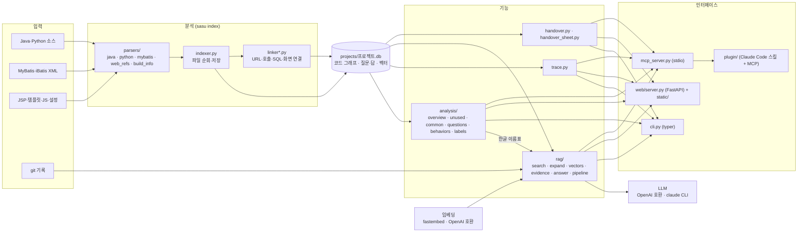
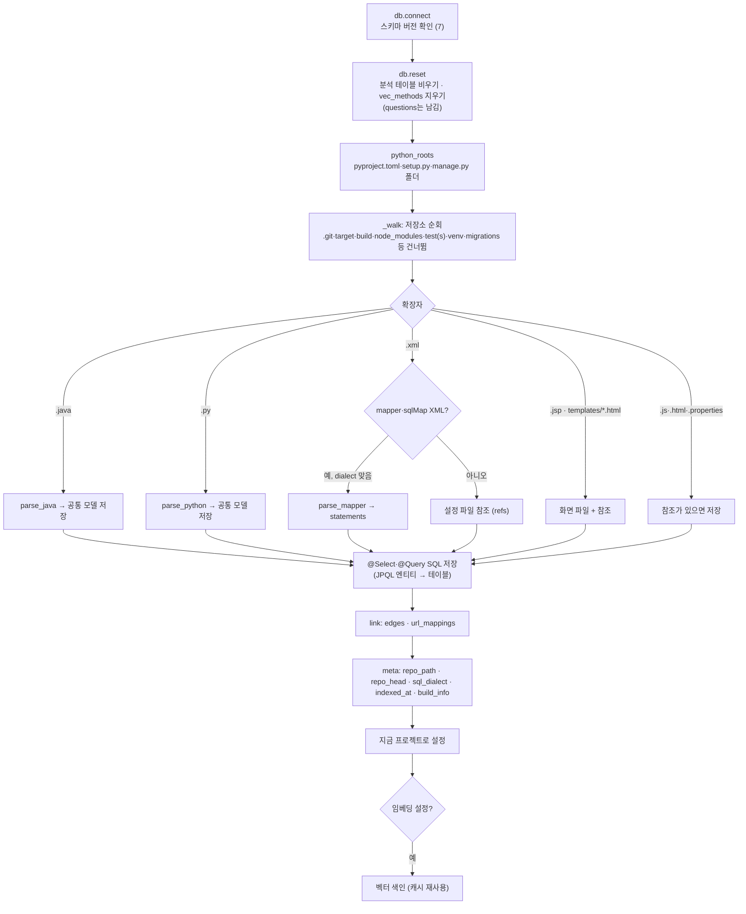
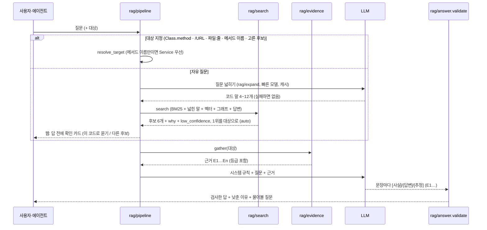

# 사수 (SASU) 소프트웨어 설계 (SDD)

- 기준일: 2026-10-15
- 기준 코드: `main` 49dfe71 + 단계별 화면 정리 · 패키지 0.1.0 · 분석 파일 스키마 버전 7
- 함께 보는 문서: [제품 요구사항 (PRD)](prd.md) · [데이터 모델 (ERD)](erd.md) · [RAG 구조와 평가](rag.md) · [설치 안내](install.md)

## 1. 설계 원칙

1. **확정할 수 있는 것은 정적 분석이 확정한다.** 호출 관계, SQL, 테이블, 참조 여부는 tree-sitter와 정규식으로 찾는다. LLM은 모은 근거로 설명만 한다.
2. **LLM이 쓴 문장은 코드가 다시 검사한다.** 등급과 근거가 맞지 않으면 [추정]으로 낮춘다.
3. **확신이 없는 연결은 표시한다.** 동적 쿼리 ID, 저장소 밖 빈, 이름으로 추정한 호출은 연결에 메모(`edges.note`)를 남기고, 안 쓰는 코드는 "후보"로만 말한다.
4. **사람이 입력한 데이터는 지우지 않는다.** 인수인계 질문과 답은 다시 분석해도, 스키마가 바뀌어도 남긴다.
5. **서버 없이 돈다.** 프로젝트마다 SQLite 파일 하나. 벡터 색인도 같은 파일 안(sqlite-vec)에 둔다.

## 2. 시스템 구성



## 3. 모듈 구성

| 경로 | 역할 |
| --- | --- |
| `cli.py` | 모든 명령의 진입점 (typer). 결과를 rich 표·트리로 출력 |
| `config.py` | `SASU_HOME`, `.env` 읽기, 프로젝트별 분석 파일 경로, 지금 프로젝트 |
| `db.py` | 분석 파일 스키마, 스키마 버전 확인, 다시 분석 전 초기화 |
| `indexer.py` | 저장소 순회, 확장자별 파서 호출, 저장, `meta` 기록 |
| `parsers/java_parser.py` | tree-sitter-java: 클래스·필드·메서드·호출·애노테이션·조건 값·주의 주석·빈 catch·복잡도·본문 해시 |
| `parsers/python_parser.py` | tree-sitter-python: 같은 공통 모델(JavaFile)로 함수·클래스·데코레이터·import·ORM 모델·Django urlpatterns |
| `parsers/mybatis_parser.py` | MyBatis `<mapper>`·iBatis `<sqlMap>`: 쿼리 ID, `<include>` 펼치기, SQL 정리, 테이블 추출 |
| `parsers/web_refs.py` | JSP·HTML·JS·XML·properties 안의 URL·JSP·include·메서드 이름 참조 |
| `parsers/build_info.py` | pom.xml·build.gradle·pyproject.toml에서 기술 스택 |
| `linker.py` | Java 연결: URL 매핑, 필드 주입·인터페이스 구현·static 호출, 쿼리 ID·동적 ID, 뷰·이동 URL |
| `linker_java_data.py` | iBatis 짧은 ID, 매퍼 인터페이스, `@Select`, JPA 저장소, JDBC·JPQL 문자열 |
| `linker_python.py` | Python 연결: 라우터 접두어·include, import·self·이름 추정 호출, ORM·SQL 문자열, 템플릿 |
| `trace.py` | URL에서 출발하는 트리, URL → SQL 연결률 |
| `analysis/overview.py` | 프로젝트 지도: 모듈, 모듈별 URL·SQL·테이블, 공유 테이블 |
| `analysis/unused.py` | 끊어진 쿼리, 부르는 곳이 없는 SQL·URL·메서드·JSP |
| `analysis/common.py` | 공통 코드 사용, 복사 코드(본문 해시), 중복 SQL |
| `analysis/questions.py` | 인수인계 질문 생성과 저장 |
| `analysis/behaviors.py` | 기존 동작 목록과 엑셀 내보내기 (모듈·업무명으로 좁히기, "사용법" 시트, "기능(한글)" 열) |
| `analysis/labels.py` | 한글 이름표: 클래스 업무명(Javadoc·파일 머리말 `Description`, 20자), 메서드 한글 설명(Javadoc 첫 한글 줄, 40자), 모듈 업무명(모듈 안 Controller 업무명 중 가장 흔한 것), 업무명별 URL 수, 한글로 URL 찾기. 주석에 없으면 None (지어내지 않음) |
| `handover.py` | 질문 새로 만들기, 답 저장, 건너뛰기, 질문 초안 (CLI·웹·MCP 공용) |
| `handover_sheet.py` | 엑셀 질문지 내보내기(전체 또는 고른 id, '번호' = Q{id})·가져오기(바뀜·같음·못 찾음을 따로 셈) (openpyxl) |
| `githistory.py` | `git blame`으로 줄을 바꾼 커밋, 포맷 정리·릴리스 커밋 제외 목록 |
| `rag/search.py` | BM25(한국어 2-gram) + 용어 사전 + 넓힌 말(가중치 0.7) + 벡터 + 그래프 전파 + 답변 끌어올리기 |
| `rag/expand.py` | LLM 질문 넓히기: 일상어 질문 → 코드에 나올 말(영어 식별자 조각·프로젝트 약어·한국어 동의어) JSON 배열, 4~12개. 프롬프트에 코드에서 뽑은 힌트(업무명=클래스 조각 120개, 자주 나오는 조각 50개). 질문 해시로 캐시, 실패하면 빈 목록 |
| `rag/embeddings.py` · `rag/vectors.py` | 임베딩(로컬·API), 임베딩 캐시, sqlite-vec 색인과 검색 |
| `rag/evidence.py` | 대상 메서드 정하기, 근거 모으기와 등급 |
| `rag/answer.py` | LLM 호출(OpenAI 호환·claude CLI), 답변 형식 검사 |
| `rag/pipeline.py` | 대상 선택 → 근거 수집 (CLI·웹·MCP 공용). 검색으로 고르면 후보 6개(상위 30개에서 같은 클래스는 2개까지)와 고른 이유(why), `auto`, `low_confidence`, 넓힌 말 |
| `web/server.py` · `web/static/` | FastAPI API와 CDN 없는 화면 (HTML·JS·CSS) |
| `mcp_server.py` | MCP 서버 (도구 10개) |
| `setup_env.py` | `sasu setup`의 설정 파일 쓰기, `sasu doctor`의 점검 항목 |
| `evaluation/` | 과거 시점 재현(`git archive`), 질문·검색·"왜?" 채점. `everyday.json` + `everyday_eval.py`: 일상어 질문 19개(정답 있는 16 + 일반 개념 3)로 묻기 대상 후보 채점 |

## 4. 실행 환경과 설정

### 4.1 저장 위치

`SASU_HOME`(기본 `~/.sasu`, 이 저장소에서 개발할 때는 `.env`의 `SASU_HOME=data`) 아래에 둔다. 자세한 배치는 [ERD 1절](erd.md#1-저장-위치).

### 4.2 설정 읽는 순서

1. 이미 있는 환경 변수
2. 지금 폴더의 `.env`
3. `SASU_HOME/.env` (`sasu setup`이 만든다)

`.env`는 외부 라이브러리 없이 읽고, 이미 설정된 값은 덮어쓰지 않는다.

### 4.3 환경 변수

| 변수 | 기본값 | 뜻 |
| --- | --- | --- |
| `SASU_HOME` | `~/.sasu` | 분석 파일·캐시·모델·설정을 두는 곳 |
| `SASU_DB_PATH` | 없음 | 분석 파일을 직접 지정 (보통은 프로젝트마다 자동) |
| `SASU_SQL_DIALECT` | `oracle` | `*_SQL_<dialect>.xml`처럼 DB별로 나뉜 Mapper 중 읽을 것 |
| `SASU_LLM_PROVIDER` | `openai` | `openai`(OpenAI 호환 주소) 또는 `claude-code`(claude CLI) |
| `SASU_LLM_BASE_URL` | `https://openrouter.ai/api/v1` | OpenAI 호환 주소 (현장: 사내 LLM 서버) |
| `SASU_LLM_API_KEY` | 빈 값 | 키 없는 사내 서버면 비우거나 `none` |
| `SASU_LLM_MODEL` | 빈 값 | 모델 이름 (claude-code는 기본 `sonnet`) |
| `SASU_EMBED_PROVIDER` | `none` | `none`, `local`(fastembed), `api`(OpenAI 호환 `/embeddings`) |
| `SASU_EMBED_MODEL` | local: `sentence-transformers/paraphrase-multilingual-MiniLM-L12-v2` | 임베딩 모델 (api는 필수) |
| `SASU_EMBED_BASE_URL` · `SASU_EMBED_API_KEY` | LLM 값 | 임베딩 서버가 따로 있을 때 |
| `SASU_QUERY_EXPAND` | `auto` | 묻기 검색 전 LLM 질문 넓히기. `auto`(LLM이 설정돼 있으면 켬) · `on` · `off`. 대상을 직접 적은 질문(Class.method·URL·파일:줄)에는 쓰지 않는다 |
| `SASU_EXPAND_MODEL` | claude-code: `haiku` / OpenAI 호환: `SASU_LLM_MODEL` | 질문 넓히기에 쓸 모델 (빠른 모델 권장) |

## 5. 분석 파이프라인 (`sasu index`)



- Maven 사이트 문서(`src/site/`)의 예제 Mapper는 실제 코드로 착각하므로 건너뛴다.
- 2MB가 넘는 참조 파일은 내용을 읽지 않는다.
- Java와 Python 파서는 같은 공통 모델(`JavaFile` → 클래스·필드·메서드·호출)을 돌려준다. Python 모듈의 최상위 함수는 `kind='module'`인 클래스 하나로 묶는다.

## 6. 연결 규칙 (linker)

모든 연결은 `edges(src_kind='method', src_id, dst_kind, dst_id, dst_name, line, note)` 한 테이블에 모은다.

### 6.1 Java

| 규칙 | 결과 |
| --- | --- |
| 클래스 `@RequestMapping` 접두어 × 메서드 매핑 경로 | `url_mappings` |
| 받는 쪽이 없거나 `this`·`super` | 자기 클래스와 상속 체인에서 찾는다 |
| 받는 쪽이 필드 | `@Resource(name)` 빈 이름 우선, 없으면 타입. 타입이 인터페이스면 구현 클래스 |
| 받는 쪽이 대문자로 시작 | static 유틸 호출 |
| 주입받은 빈인데 저장소 안에 구현이 없음 | `dst_kind='external'`, `note="빈 '이름' (저장소 밖)"` |
| 문자열 인자 = 쿼리 ID | `dst_kind='statement'` |
| `"Ns.prefix" + 변수` | 그 접두어로 시작하는 쿼리 전부, `note='동적 ID: "…" + …'` |
| DAO(`@Repository`) 안의 문자열 리터럴 = 쿼리 ID | 변수를 거쳐 부르는 쿼리 |
| 컨트롤러가 돌려준 `redirect:`·`forward:` | `dst_kind='url'` |
| 컨트롤러가 돌려준 뷰 이름 | `WEB-INF/jsp/{뷰}.jsp` 또는 Thymeleaf `templates/{뷰}.html` (`dst_kind='view'`) |
| iBatis 짧은 ID, 매퍼 인터페이스, `@Select`, JPA 저장소(상속 메서드는 이름으로 조회·저장·삭제), JDBC·JPQL 문자열 | `linker_java_data.py`. 이름으로 정한 것은 `note='메서드 이름으로 추정'` |

### 6.2 Python

| 규칙 | 결과 |
| --- | --- |
| FastAPI `@router.get` + `include_router(prefix=…)`, `APIRouter(prefix=…)` | `url_mappings` |
| Flask `@bp.route` + `register_blueprint(url_prefix=…)` | `url_mappings` |
| Django `urlpatterns`·`include()`·클래스 뷰(`get`/`post`…) | `url_mappings` |
| import 별칭·상대 import, `self.repo = Repo()` 주입, 모듈 함수 | `dst_kind='method'` |
| 위로 못 찾았지만 프로젝트에 하나뿐인 이름 | `note='이름으로 추정'` |
| ORM 호출 (`Post.objects.filter`, `select(User)`, `session.get(User, 1)`) | 모델마다 합성 쿼리 `ORM <모델>` (`statements`) |
| `session.add(obj)` 등 모델 이름이 안 보이는 쓰기 | 메서드가 만들거나 다루는 모델로 판단, `note='모델 추정'` |
| 코드 안의 SQL 모양 문자열 | 쿼리 `SQL <파일>:<줄>` (로그 문구는 거른다) |
| `render_template`·`render`·`TemplateResponse` | `dst_kind='view'` |

## 7. 분석 기능

### 7.1 경로 추적 (`trace.py`)

- URL에 매핑된 메서드에서 출발해 `edges`를 깊이 8까지 따라간다.
- 기본은 스테레오타입(Controller·Service·Repository·Component) 클래스만 펼치고, 유틸은 한 줄로 보여 준다. 유틸이 직접 SQL을 부르면 그것은 보여 준다. `--full`이면 모두 펼친다.
- 이미 펼친 메서드는 "위에서 펼침"으로 표시하고, 같은 부모에서 같은 대상을 여러 번 부르면 `×N`으로 합친다.
- URL이 정확히 맞지 않으면 부분 일치로 후보를 돌려준다.

### 7.2 정리 후보 (`analysis/unused.py`)

- **끊어진 쿼리:** DAO 안의 `"Ns.id"` 문자열인데 Mapper에 없는 쿼리. URL에서 이어지지 않으면 "죽은 코드"로 따로 표시한다.
- **SQL·URL·JSP:** 코드·화면·설정 어디에도 참조가 없는 것.
- **메서드:** Service·DAO·Component 중 부르는 코드나 설정이 없는 것. 프레임워크가 부르는 애노테이션(`@PostConstruct`, `@Scheduled`, AOP 등)은 뺀다.
- 결과마다 확신 정도(`높음`/`후보`)와, 수정 이력 주석처럼 사람이 남긴 근거를 붙인다.

### 7.3 공통화 진단 (`analysis/common.py`)

- **공통 코드:** 다른 모듈에서 부르는 클래스를, 부르는 모듈 수와 호출 횟수 순으로 보여 준다. 모듈은 모든 패키지가 공유하는 앞부분 다음 두 단계다 (`egovframework.com.cop.bbs.service.impl` → `cop.bbs`).
- **복사 코드:** 식별자·리터럴을 지운 본문 토큰의 해시(`methods.body_hash`)가 같은 메서드를 묶는다 (토큰 60개 이상). 묶음 안에 다른 클래스가 상속하는 공통 부모가 있으면 "상속하지 않고 복사한 곳 N" 메모를 붙인다.
- **중복 SQL:** 공백을 정리하고 대문자로 맞춘 SQL(80자 이상)이 다른 쿼리 ID로 여러 번 있는 것.

### 7.4 인수인계 질문 (`analysis/questions.py`)

LLM 없이 규칙과 템플릿으로 만든다.

| 신호 (`kind`) | 기본 점수 | 찾는 것 |
| --- | --- | --- |
| `broken_sql` | 100 | URL에서 이어지는 끊어진 쿼리 (항상 맨 앞) |
| `dynamic_sql` | 90 | 실행 때 정해지는 쿼리 ID |
| `note` | 80 | TODO·FIXME·XXX·HACK·임시 처리·하드코딩·주의·나중에·확인 필요·추후 |
| `magic_value` | 70 | 코드 전체에서 3곳 이하에서만 쓰는 업무 코드 값 분기 (`USR03`, `'09'`, Python 소문자 코드 값) |
| `complex` | 70 | 순환 복잡도 15 이상인 Controller·Service·DAO·Component |
| `external_bean` | 60 | 설정에만 있는 빈 (같은 타입은 한 질문으로) |
| `empty_catch` | 50 | 비어 있는 catch |
| `copied_code` | 45 | 공통 부모가 있는데 복사한 코드 |
| `unused_sql` | 30 | 사람이 "안 쓴다"고 남긴 SQL |

우선순위 계산:

```
우선순위 = 기본 점수 × 영향 범위 × 복잡도 × 스테레오타입
  영향 범위   = 1 + log2(1 + 닿는 URL 수)   (닿는 URL이 없으면 0.5)
  복잡도      = 1 + log2(순환 복잡도)
  스테레오타입 = Controller·Service·Repository 1.0, Component 0.8, 그 밖 0.5
  한 메서드에 신호 종류가 하나 더 겹칠 때마다 × 1.5
```

- 같은 `key`(종류|파일|대상|세부)는 점수가 높은 하나만 남긴다.
- 한 메서드에 2개, 한 클래스에 4개까지만 앞에 두고 나머지는 뒤로 보낸다.
- 끊어진 쿼리는 확인된 고장이라, 나머지 최고점 위로 올려 맨 앞에 둔다.

저장 (`save_questions`): 같은 `key`가 있으면 내용만 갱신하고 답은 지킨다. 이번에 나오지 않은 질문은 `stale=1`로 표시한 뒤, 답이 없는 것은 지우고 답한 것은 기록으로 남긴다.

### 7.5 기존 동작 목록 (`analysis/behaviors.py`)

URL마다 경로 추적 결과를 한 줄로 접는다: 처리 메서드, 화면, 이동, 읽는 테이블, 쓰는 테이블(INSERT→등록, UPDATE→수정, DELETE→삭제, MERGE→저장, CALL→프로시저), 업무 코드 분기, 주의 주석, 받은 답, 확인할 연결(저장소 밖 빈·동적 쿼리). 엑셀에는 "고도화 후 확인" 열(같음 / 달라짐(의도) / 달라짐(확인 필요) / 없어짐)을 둔다.

## 8. "왜?" 질의응답 (RAG)



### 8.1 검색 (`rag/search.py`)

- **조각:** 메서드 하나 = 조각 하나 (최대 1,500자). 이름(카멜 표기를 쪼갬), Javadoc·docstring, 클래스 설명, 주의 주석, 문자열, 부르는 메서드 이름, 부르는 SQL ID와 테이블, 인수인계 답변(대상 이름으로 붙임)을 묶는다. 인터페이스와 본문 20토큰 미만의 getter·setter는 뺀다.
- **토큰:** 한국어는 조사·어미를 뗀 뒤 글자 2-gram, 영어는 카멜 표기를 쪼갠다. 질문하는 말투(어떻게·테이블·읽어 등)는 불용어로 뺀다.
- **용어 사전:** VO 필드 주석(`/** 게시물 아이디 */ nttId`)의 한국어 2-gram이 질문과 두 개 이상 겹치면 필드 이름 토큰을 0.5 가중치로 더한다.
- **점수:** BM25(k1 1.2, b 0.75) → (벡터 색인이 있으면) BM25를 최고점 1로 맞추고 코사인 유사도 × 0.3을 더하는 선형 결합 → 인수인계 답변과 질문 단어(idf 가중)가 34% 이상 겹치면 1위 점수의 최대 50%를 더함 → 직접 부르는 메서드 중 최고 점수의 25%를 부르는 쪽에 더함.
- **질문 넓히기** (`rag/expand.py`): 검색 전에 LLM이 질문을 코드 말로 넓힌다. 넓힌 말은 BM25 질의에 가중치 0.7로 더하고(질문 낱말은 1), 벡터 검색은 원래 질문으로 한다. 결과는 `cache/query-expand/`에 질문 해시로 둔다. LLM이 없거나 실패하면 원래 검색 그대로. 일상어 질문 16개에서 상위 6 정답률 25% → 69~81%, 질문당 약 +5초 ([일상어 평가](rag.md#일상어-질문-평가-2026-10-15)).
- **후보와 확신** (`rag/pipeline.py`): 상위 30개에서 같은 클래스는 2개까지 6개를 후보로 둔다. 후보마다 고른 이유 `why`("맞은 말: 로그인, Login, incorrect · 업무명 일반 로그인"). `low_confidence`는 넓힌 말 없이 질문 낱말만으로 가장 잘 맞는 코드의 BM25 점수가 12 미만이거나, 1위 후보에 질문 낱말이 하나도 없으면 true.
- RRF는 비교용으로만 남겼다. 약한 벡터 순위가 BM25 1위를 희석해 R@1이 28%에서 11%로 떨어졌다 ([실험 기록](rag.md#실험-기록)).

### 8.2 근거 (`rag/evidence.py`)

| 순서 | 근거 | 등급 |
| --- | --- | --- |
| 1 | 대상 메서드 코드 원문 (최대 150줄) | 확인된 사실 |
| 2 | 이 메서드를 거치는 URL (8개까지) | 확인된 사실 |
| 3 | 이 메서드가 부르는 코드와 SQL·테이블·저장소 밖 빈 | 확인된 사실 |
| 4 | Javadoc·docstring, 주의 주석, 파일 머리말 수정 이력, Mapper 수정 이력 | 기록 |
| 5 | 이 메서드(또는 그 줄 범위)에 달린 인수인계 답변 | 인수인계 답변 |
| 6 | `git blame`으로 이 코드를 마지막으로 바꾼 커밋 5개까지 (많이 바꾼 순) | 기록 |

포맷 정리·릴리스·첫 커밋·봇 커밋은 줄 전체를 덮어써 진짜 이유를 가린다. 이런 커밋 목록을 `cache/ignore-revs-v2-<HEAD>.txt`로 만들어 `git blame --ignore-revs-file`로 건너뛰고, 그 전에 줄을 바꾼 커밋을 찾는다.

### 8.3 생성과 검사 (`rag/answer.py`)

시스템 규칙 요약: 모든 문장을 [사실]·[답변]·[추정]으로 시작하고 근거 번호를 단다. 근거로 답할 수 없으면 "모름:"과 "물어볼 질문: …". 한 줄에 한 문장, 6문장 이내. 인수인계 답변이 코드와 어긋나 보이면 억지로 맞추지 말고 [추정]으로 짚는다.

검사 규칙 (`validate`):

| 경우 | 처리 |
| --- | --- |
| 등급 표시가 없음 | [추정]으로 본다 |
| [사실]인데 인용한 근거 중 "확인된 사실"이 없음 | [추정]으로 낮춘다 |
| [답변]인데 인용한 근거 중 "인수인계 답변"이 없음 | [추정]으로 낮춘다 |
| 근거 번호가 없음 | [추정]으로 낮춘다 |
| 없는 근거 번호를 인용 | 경고를 붙인다 |

LLM 클라이언트:

- `LLMClient`: OpenAI 호환 `/chat/completions`, `temperature 0`, urllib만 쓴다. 키가 비었거나 `none`이면 인증 헤더를 보내지 않는다.
- `ClaudeCodeClient`(개발용): `claude -p --output-format json --tools "" --no-session-persistence --setting-sources "" --system-prompt …`. 도구를 끄고 설정을 섞지 않아 사수가 준 근거만으로 답한다. 근거는 표준 입력으로 넘긴다(Windows 명령줄 길이 한도).
- LLM이 없으면 `mode='evidence_only'`로 근거만 돌려준다.

### 8.4 임베딩

- 로컬: fastembed, 모델 파일은 `SASU_HOME/models` (인터넷이 없는 PC에는 폴더를 복사).
- API: OpenAI 호환 `/embeddings`, 64개씩 묶어 보낸다.
- 캐시: `cache/embeddings.db`에 (모델, 조각 글 SHA-1)으로 저장한다. 코드가 안 바뀐 조각은 다시 분석해도 다시 임베딩하지 않는다.
- 다시 분석하면 메서드 id가 바뀌므로 `vec_methods`는 지우고 캐시로 다시 만든다.

## 9. 인터페이스

### 9.1 CLI (`sasu …`)

| 무리 | 명령 |
| --- | --- |
| 설치·설정 | `version` · `setup` · `doctor [--ping]` · `fetch-sample [--python]` |
| 프로젝트 | `index <폴더>` · `projects` · `use <이름>` · `embed` |
| 분석 | `stats` · `map [모듈]` · `trace <URL> [--full]` · `unused` · `common` · `behaviors [--export]` |
| 인수인계 | `questions [--export]` · `answers <엑셀>` · `answer <Q번호> "<답>" --by <이름>` · `draft <Q번호>` |
| 질의응답 | `ask "<질문>"` |
| 서버 | `serve` (웹) · `mcp` (MCP stdio) |
| 평가 | `eval-questions` · `eval-search` · `eval-why` · `eval-everyday [--set] [--db] [--no-llm] [--no-cache] [--out]` |

### 9.2 웹 API (`sasu serve`)

요청마다 지금 프로젝트의 분석 파일을 새로 연다. API 문서는 `/api/docs`.

| 메서드 | 경로 | 하는 일 |
| --- | --- | --- |
| GET | `/api/projects` | 분석한 프로젝트 목록 |
| POST | `/api/projects/current` | 지금 프로젝트 바꾸기 |
| GET | `/api/overview` | 프로젝트 지도·시작 화면 숫자 (아래 필드) |
| GET | `/api/modules/{name}` | 모듈의 URL과 읽고 쓰는 테이블, URL마다 `label`(처리 메서드 한글 설명) |
| GET | `/api/behaviors/export?module=&business=` | 기존 동작 목록 엑셀. `module`(uss.ion)·`business`(휴가관리: 처리 메서드 클래스의 업무명이 그 값인 URL만)로 좁히고, 둘 다 주면 둘 다 맞는 것. 파일 이름에 모듈·업무명 |
| GET | `/api/urls?q=` | URL 자동 완성. 한글이면 처리 메서드·클래스 한글 설명으로도 찾고, `labels: {url: 한글 설명}` |
| GET | `/api/trace?url=&full=` | 경로 추적 트리. 메서드 노드에 `label`·`broken`(Mapper에 없는 쿼리 ID), SQL 노드에 `estimated`(동적 ID 추정 연결) |
| GET | `/api/code?path=&start=&end=` | 코드 보기 |
| GET | `/api/questions` | 인수인계 질문과 진행률. `answered`·`skipped` 개수, 질문마다 `label`·`module`·`module_label` |
| POST | `/api/questions/refresh` | 질문 다시 만들기 |
| POST | `/api/questions/{id}/answer` | 답 저장 (빈 답이면 미답변으로 되돌림) |
| POST | `/api/questions/{id}/skip` | 건너뛰기. 본문 `{"reason": "", "by": null}`, 이유는 답변 칸에. 응답은 answer와 같은 모양 |
| GET | `/api/questions/{id}/draft` | 떠난 개발자에게 보낼 메시지 |
| GET | `/api/questions/export?ids=` | 엑셀 질문지 내려받기. `ids=1,2,3`(Q 붙여도 됨)이면 그 질문만 |
| POST | `/api/questions/import` | 답을 적은 엑셀 올리기. 응답 `saved`(실제로 바뀐 행)·`unchanged`·`missing` |
| POST | `/api/ask/evidence` | 대상 선택 + 근거 (LLM 답 없음, 아래 필드) |
| POST | `/api/ask/answer` | 근거 + LLM 답 + 검사 결과 |
| GET | `/api/unused` | 정리 후보 |
| GET | `/api/common?top=` | 공통 코드·복사 코드·중복 SQL |

`/api/overview`에 사용성 시험 뒤 더한 필드:

| 필드 | 뜻 |
| --- | --- |
| `modules[].label` · `modules[].labels` | 모듈의 대표 업무명("당직관리 외 27")과 업무명 목록 |
| `businesses` | 업무명마다 모듈과 URL 수 `[{"label": "휴가관리", "module": "uss.ion", "urls": 11}, …]` — 고도화 준비의 "기능 찾기" |
| `broken_sql` | 없는 SQL 호출 `{"reachable": 2, "unreachable": 9}` — URL에서 이어져 실행하면 오류가 나는 곳 / 이어지지 않는 곳 |

`/api/ask/evidence`·`/api/ask/answer` 요청 본문은 `question`, `target`(Class.method · URL · 파일:줄), `method_id`(후보 중 고른 것), `use_git`. evidence 응답:

| 필드 | 뜻 |
| --- | --- |
| `auto` | 사람이 정하지 않고 검색 1위로 골랐으면 true. 화면은 이때 답 전에 확인 카드를 띄운다 |
| `candidates[]` | 후보 6개(같은 클래스는 2개까지). 각 `label`(Class.method)·`label_ko`(한글 설명)·`why`(고른 이유)·`score`·`path`·`line` |
| `low_confidence` | 1위가 질문과 약하게만 맞으면 true. 화면은 경고하고 직접 고르게 한다 |
| `expanded_terms` | LLM이 넓힌 말 (넓히지 않았으면 `[]`) |
| `target` | 고른 대상과 `label_ko` |
| `evidence[]` | 근거 E1…En과 등급 |

### 9.3 MCP 도구 (`sasu mcp`)

에이전트의 LLM이 답을 쓰므로 사수 쪽 LLM 설정이 없어도 된다. `project`를 비우면 지금 프로젝트를 쓴다. `record_answer`만 쓰기 도구이고 나머지는 읽기 전용이다.

| 도구 | 하는 일 |
| --- | --- |
| `list_projects` | 분석한 프로젝트, 원본 경로, 분석 시각 |
| `project_overview` | 기술 스택, 규모, 모듈별 URL·SQL·주요 테이블, 공유 테이블 |
| `trace_url` | URL → 메서드 → SQL → 테이블 (부분 일치면 후보 목록) |
| `existing_behaviors` | 기존 동작 목록 (모듈·URL로 좁히기) |
| `search_code` | 질문으로 메서드 후보 찾기 |
| `gather_evidence` | "왜?" 근거와 등급 (답변이 없으면 [추정]으로 쓰라는 안내) |
| `read_code` | 저장소 안 코드 읽기 (최대 300줄, 저장소 밖 경로는 거부) |
| `handover_questions` | 인수인계 질문 (상태·종류로 거르기, 없으면 새로 만듦) |
| `record_answer` | 받은 답 기록 (사용자가 준 답만) |
| `find_unused` | 정리 후보 (broken_sql·sql·url·method·jsp) |

### 9.4 Claude Code 플러그인

| 파일 | 내용 |
| --- | --- |
| `.claude-plugin/marketplace.json` | 이 저장소를 마켓플레이스로 등록 |
| `plugin/.claude-plugin/plugin.json` | 플러그인 이름·버전 (지금 0.1.4) |
| `plugin/.mcp.json` | MCP 서버 실행: `sasu mcp` |
| `plugin/skills/sasu/SKILL.md` | 언제 사수를 쓰는지, 근거를 받아 [사실]/[답변]/[추정]으로 답하는 흐름 |

플러그인은 PATH의 `sasu` 명령을 실행한다. 그래서 `sasu`가 먼저 설치돼 있어야 한다. 스킬을 고치면 `plugin.json`의 버전을 올려야 사용자가 새 내용을 받는다.

## 10. 오류 처리와 데이터 보존

| 상황 | 처리 |
| --- | --- |
| 분석 파일의 스키마 버전이 다름 | `questions`를 뺀 모든 테이블을 지우고 다시 만든다. 다시 `sasu index` 하면 된다 |
| 다시 분석 | 분석 테이블만 비우고 `questions`는 남긴다. 질문은 id가 아니라 `key`·`target`으로 코드와 다시 이어진다 |
| 원본 폴더가 없어짐 (옮김·삭제) | 분석 결과는 쓸 수 있지만 코드 보기·커밋 기록·질문의 코드 줄은 빠진다. `sasu doctor`가 ✗로 알리고 다시 분석하라고 안내한다 |
| LLM이 설정되지 않음 | 근거만 보여 준다 |
| LLM 오류 (HTTP·연결·형식·시간 초과) | `LLMError`로 원인을 300자까지 보여 준다 |
| 임베딩 설정 오류 | 조용히 BM25만 쓴다 |
| 질문 넓히기 LLM 오류·시간 초과 | 조용히 넓히지 않고 원래 질문으로 검색한다 |
| sqlite-vec를 불러올 수 없음 | 벡터 색인을 만들 때 오류로 알린다 (`uv sync` 안내). 검색은 BM25로 한다 |
| MCP에서 프로젝트가 없음 | `ToolError`로 `sasu index`를 안내한다 |
| Git Bash가 `/url` 인자를 Windows 경로로 바꿈 | CLI가 원래 URL로 되돌린다 |

## 11. 배포

| 방법 | 내용 |
| --- | --- |
| 인터넷이 되는 PC | `uv tool install "sasu[local-embed,mcp] @ git+https://github.com/seungwook-kim/sasu-handover-agent"` |
| 인터넷이 막힌 PC | `scripts/make_offline_bundle.py` → `dist/sasu-offline-windows-py312.zip` (Python·휠·임베딩 모델) |
| 개발 | `uv sync --all-extras` 뒤 `uv run sasu …`. 전역 명령으로 쓰려면 `uv tool install --editable ".[local-embed,mcp]"` |
| 에이전트 | `claude plugin marketplace add seungwook-kim/sasu-handover-agent` → `claude plugin install sasu@sasu` |
| Docker | `Dockerfile`은 있지만 아직 빌드해 보지 않았다 |

선택 의존성: `local-embed`(fastembed), `mcp`(mcp 2.x). 기본 의존성만으로 분석·질문·웹·OpenAI 호환 LLM은 모두 된다.

개발용 editable 설치는 저장소 경로를 기억한다. 저장소 폴더를 옮기거나 이름을 바꾸면 `uv sync`와 `uv tool install --editable … --force`를 다시 하고, 분석한 프로젝트도 다시 `sasu index` 해야 한다. 실행 중인 `sasu mcp`가 파일을 잡고 있으면 다시 설치가 실패하므로, 그 Claude Code 세션을 먼저 닫는다.

## 12. 테스트와 평가

- `tests/` pytest 142개: 파서(Java·MyBatis·Python), 그래프·연결(Java 데이터 접근 포함), 지도·정리·공통·질문·동작 목록, RAG·벡터·LLM 서버, 웹, MCP, 플러그인, 설치 점검, 시나리오(질문 → 답 → "왜?").
- 평가는 실제 회사 코드 대신 **공개 프로젝트의 과거 기록**을 정답지로 쓴다. `evaluation/history.py`가 `git archive`로 과거 시점을 재현한다.

| 평가 | 방법 | 기록 |
| --- | --- | --- |
| 질문 생성 | 과거 시점의 질문 상위 N개가 이후 버그 수정 메서드를 가리켰나 (무작위·복잡도 순과 비교) | [4단계 평가](gate4-evaluation.md) |
| 검색 | 버그 수정 커밋 제목으로 고칠 메서드 찾기, 기법을 하나씩 켜며 비교 | [RAG 평가](rag.md) |
| 일상어 검색 | 사용성 시험에서 나온 일상어 질문으로 묻기 대상 후보(상위 6) 채점, 넓히기 전후 비교 | [RAG 평가](rag.md#일상어-질문-평가-2026-10-15) |
| "왜?" 답변 | 커밋 메시지를 숨기고 묻기, 사수 vs LLM만, 채점 LLM | [RAG 평가](rag.md) |

## 13. 주요 설계 결정

| 결정 | 이유 |
| --- | --- |
| tree-sitter + 정규식 정적 분석 | 호출 관계·SQL·테이블은 LLM이 추측할 일이 아니다 |
| 프로젝트마다 SQLite 파일 하나 + sqlite-vec | 서버 없이, 폐쇄망 반입이 쉽다. 질문과 답이 프로젝트끼리 섞이지 않는다 |
| 질문 생성은 LLM 없이 규칙으로 | 재현 가능하고, LLM이 없는 현장에서도 된다 |
| 검색은 BM25 중심 + 벡터 선형 결합 | 작은 로컬 임베딩은 혼자서 약하고, RRF는 BM25 1위를 희석했다 |
| 답변 등급을 코드가 검사 | LLM이 [답변]이라고 해도 인수인계 답변 근거가 없으면 믿지 않는다 |
| 검색이 고른 대상은 답 전에 사람이 확인 | 사용성 시험에서 엉뚱한 대상에 대한 [사실]이 질문의 답처럼 읽혀 틀린 확신을 만들었다 |
| LLM 질문 넓히기는 BM25에 낮은 가중치로만 | 넓힌 말이 실행마다 달라도 질문 낱말이 중심이 되게. LLM이 없어도 검색은 그대로 된다 |
| LLM은 OpenAI 호환 주소 하나 | 사내 LLM 서버로 주소만 바꿔 옮긴다 |
| 질문은 id가 아니라 key로 식별 | 색인할 때마다 코드 id가 바뀌어도 사람의 답이 같은 코드에 다시 붙는다 |
| MCP에서는 에이전트 LLM이 답을 씀 | 사수 쪽 LLM 설정 없이 Claude Code·Cursor에서 바로 쓴다 |
