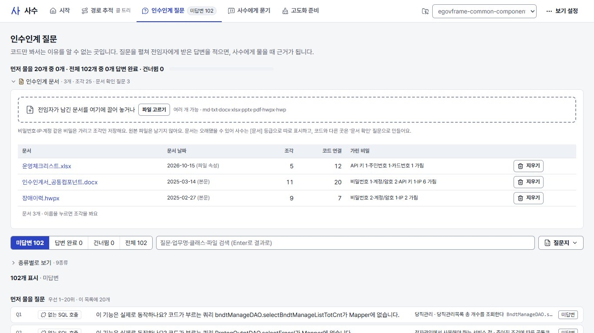

# 사수 웹 화면 디자인 (확정안)

- 회의: 2026-10-14, 7명(UX 리드·비주얼·데이터 시각화·프론트·SI 현장 도메인·UX 라이터·PO) — 1·2라운드 글, 토론 1~3, 회의실 실시간 토론, PO 목적 판정
- 고침: 2026-10-15, 사용성 시험(AI가 연기한 페르소나 20명 → 고친 뒤 4명)과 "기능이 난잡하다"는 사용자 지적을 반영해 **단계별 시작 화면, 화면마다 주 버튼 하나, 나머지 접기**로 정리했다. 바뀐 점과 이유는 [14절](#14-사용성-시험으로-바뀐-점-2026-10-15). 아래 내용은 지금 화면과 맞춘 것이다.
- 더함: 2026-10-15, 인수인계 문서([문서] 등급·문서 접기·불일치 상자·"문서 n" 칩)와 [인수인계서 만들기 ▾], Django 질문 종류 아이콘. 새 주 버튼은 만들지 않고 접기·보조 버튼·칩으로만 넣었다([7.7](#77-인수인계-문서-질문-화면-접기)).
- 회의·시험 기록(라운드별 글·토론·세션 기록)은 작업용 폴더에 두었고, 이 문서는 그 결론만 담는다. 구현은 `src/sasu/web/static/`.
- 판정 기준: docs/prd.md의 목표 G1~G5, 시나리오 S1~S5, 비목표. 모든 결정에 돕는 목표를 붙였다.

## 0. 바꿀 수 없는 제약
1. 인터넷 없이 동작. CDN·외부 링크 금지. 자산은 `src/sasu/web/static/` 안에.
2. 재배포 가능한 라이선스만(OFL·ISC·MIT), 라이선스 파일 동봉 (`static/licenses/`).
3. 빌드 없음. 순수 HTML·CSS·JS. app.js의 `h()` 구조 유지. 최신 CSS 금지: `@layer`, 중첩, `:has()`, `color-mix()`, `light-dark()`, 컨테이너 쿼리, popover. 기준선 Chrome/Edge 87.
4. 웹 API의 기존 필드·동작은 그대로 두고 **더하기만** 한다. 사용성 시험 뒤 더한 것: 건너뛰기 `POST /api/questions/{id}/skip`, `export?ids=`, `behaviors/export?business=`, 한글 이름표 `label`류, overview `businesses`·`broken_sql`, ask/evidence `auto`·`candidates[].why`·`low_confidence`·`expanded_terms` ([SDD 9.2](sdd.md#92-웹-api-sasu-serve)). 문서 기능 때 더한 것: `/api/docs*`(올리기·목록·조각·연결·불일치·지우기), `/api/handover-doc`, trace 노드·질문 항목의 `docs`, ask/evidence `docs`·`doc_conflicts`, ask/answer `doc_conflicts`. 리디자인 때 바꾼 서버 쪽은 **표시 문자열만**이었다(사회자 결정 1): 질문 종류 이름 `KIND_LABEL`(questions.py), 정리 제목 `_UNUSED_TITLES`(server.py와 cli.py 사본), 메시지 초안 `draft_message`(handover.py), 엑셀 상태 표기(handover_sheet.py), CLI 도움말 문구. 그리고 server.py에 `mimetypes.add_type("font/woff2", ".woff2")` 한 줄.
   - 메시지 초안의 `■ 질문`·`■ 코드:` 머리표는 남긴다(테스트와 코드 줄 토글이 쓴다).
   - unused.py·questions.py가 로직에 쓰는 `"죽은 코드"` 문자열은 **바꾸지 않는다.** 화면에서만 "(URL에서 이어지는 경로를 못 찾음)"으로 바꿔 보여 준다.
5. 밝게/어둡게 두 테마. 기존 `prefers-color-scheme` + `data-theme` 방식 유지, `<head>` 앞쪽에서 저장된 테마를 먼저 적용(깜빡임 방지), `color-scheme` 지정.
6. 해시 화면 id는 그대로: `overview`·`questions`·`trace`·`ask`·`cleanup` (북마크 유지). 시작 화면 `home`을 더했고 기본 화면이다. `overview`(프로젝트 지도)는 탭에서 빠졌지만 해시로는 그대로 열린다.

## 1. 브랜드
- 인상: "옆자리에서 이 줄을 짚어 주는 차분한 선배". 남색 강조색 하나 + 푸른 기 무채색. 빨강은 진짜 위험(없는 SQL 호출)에만. 이모지·◐·▸▾·🎉·✉ 쓰지 않음(아이콘으로).
- 로고 A안("사" 선 모노그램) — `static/favicon.svg`와 같은 선 모양. 머리글: 마크 24px + "사수" 18px/700. `static/favicon.svg`(타일형, 같은 절 SVG). PO 판정: 로고는 곁가지라 맨 마지막에, 밀리면 먼저 뺀다.
- 그림·일러스트 없음. 빈 상태는 Lucide 아이콘 40px(muted) + 한 줄 제목 + 누를 수 있는 실제 예시. 검색이 0건이면 "‘{입력}’에 맞는 …가 없어요" 안내와 캡션 "0개 표시"를 함께 바꾼다.

## 2. 디자인 토큰 (밝게 / 어둡게)
| 토큰 | 밝게 | 어둡게 |
|---|---|---|
| --bg | #f5f6f8 | #0e1116 |
| --panel | #ffffff | #151920 |
| --panel-2 | #eef1f5 | #1c212a |
| --line | #dfe3ea | #2a303b |
| --control (입력·체크 테두리, 3:1) | #8a93a4 | #69738a |
| --text | #151a24 | #e6e9ef |
| --muted | #586172 | #9ba4b4 |
| --accent | #2c44c2 | #94a4ff |
| --accent-hover | #2337a6 | #aab7ff |
| --on-accent | #ffffff | #0b1022 |
| --accent-soft | #eceffd | #1e2546 |
| --ok / --ok-soft | #17763f / #e5f4eb | #5cc58a / #12291c |
| --warn / --warn-soft | #9a4f06 / #fdf0e0 | #f0a54e / #2f2315 |
| --bad / --bad-soft | #c0271f / #fdebea | #ff8077 / #3a1b1a |
| --code-bg | #f7f8fa | #0b0e12 |
| --hl-line (짚은 줄) | #fff1b0 | #3b3414 |
| --scrim | rgb(15 20 30 / .32) | rgb(0 0 0 / .55) |
| --ring | = --accent, 2px + offset 2px | 같음 |
| **근거 등급 표식**(아이콘·왼쪽 띠·요약 막대에만, 글자에는 안 씀) | | |
| --g-fact (사실) | #14936a | #199e70 |
| --g-answer (답변) | #c056c8 | #b75bb8 |
| --g-guess (추정) | #d9561f | #d95926 |
| --g-doc (문서, 세피아) | #5c3a0a | #e8c080 |
| **순서형**(URL 연결률 막대 3칸, 연한→진한) | #aab3c2 / #6f7a8f / #3a4458 | #4a5468 / #7d879a / #b8c0cd |

- 등급 색 검증(데이터 시각화 검증기, OKLab·Machado 2009): 모든 쌍 색각 이상 ΔE 8 이상·정상 15 이상, 강조색과 정상 15 이상, 표면 대비 3:1 이상 — 통과.
- `--g-doc`은 나중에 더한 색이라 색만으로 가르지 않는다: [문서]는 **겹줄 테두리 칩·5px 겹줄(double) 문장 띠·`file-text` 아이콘**으로 모양부터 다르다. 밝게는 어두운 세피아(흰 바탕 대비가 높음), 어둡게는 밝은 모래색.
- 지금 화면의 AA 미달 5곳(파란·초록·주황 칩, 표 머리 글자, 입력 테두리)은 위 토큰으로 풀린다. 옅은 색 바탕 위 색 글자는 쓰지 않는다.

## 3. 글자·간격
- 글꼴: Pretendard 1.3.9 정적 subset **Regular(400)·Bold(700) 두 개만** (`Pretendard-Regular.subset.woff2` 267,096B, `Pretendard-Bold.subset.woff2` 270,784B, OFL-1.1). `@font-face`: `src: local("Pretendard Regular"), url(...)`, `font-display: fallback`, Regular만 preload. 600을 쓰지 말고 400/700만 쓴다.
- `--sans: "Pretendard", "Malgun Gothic", "Apple SD Gothic Neo", system-ui, sans-serif;`
- `--mono: "D2Coding", Consolas, "Malgun Gothic", monospace;` 고정폭 글꼴은 번들하지 않음. 코드에 `font-variant-ligatures: none`.
- 크기 (html 100%, 1rem = 16px, 모두 rem):
  - 읽는 글(설명문·사수의 답 문장·메시지 초안·묻는 이유) 15px = .9375rem
  - 펼친 질문 문장·카드 제목 16px = 1rem
  - 표·트리·입력칸·접힌 질문 행 14px = .875rem
  - `파일:줄`·칩 12px = .75rem (12px에 --muted를 겹치지 않음)
  - 화면 제목 20px = 1.25rem / 700, 통계 큰 숫자 28px = 1.75rem / 700
  - 머리글 "글자 크게" 토글 = `html{font-size:125%}` (회의실·빔프로젝터용, localStorage 기억)
  - 인쇄 본문 10pt 이상
- `tabular-nums`는 표의 숫자 열에만(큰 통계 숫자에는 쓰지 않음). 한국어 본문 `word-break: keep-all`. 경로·식별자는 `.`·`/` 뒤에서만 줄바꿈(`<wbr>` 또는 `overflow-wrap:anywhere`는 `.loc`에만).
- 간격 2·4·8·12·16·24·32. 컨트롤 높이 28/32/40. 표 행 32px. 접힌 질문 행 36px.
- 모서리: 칩 4px 사각(등급 칩 포함), 버튼·입력·코드 6px, 카드·서랍·모달 8px. 999px는 진행 막대·개수 표시만.
- 그림자: 카드에는 없음(테두리만). 자동완성·토스트만 `0 4px 16px rgb(15 20 30/.12)`, 서랍만 `-12px 0 32px rgb(15 20 30/.18)`.

## 4. 아이콘
- Lucide 1.57.0 (ISC + MIT 일부) — `index.html` `<body>` 첫머리 숨긴 `<svg>` 안 `<symbol id="i-이름">` 스프라이트. app.js에 `icon(name)` 헬퍼(`createElementNS`로 svg+use, `aria-hidden`, `focusable=false`). `stroke=currentColor`. 아이콘만 있는 버튼엔 aria-label.
- 쓰는 이름(1.57.0에서 확인된 이름, 옛 이름 circle-help·alert-triangle·filter는 없음):
  - 탭: 시작 `house`, 프로젝트 지도(탭 밖) `map`, 인수인계 질문 `message-circle-question-mark`, 경로 추적 `route`, 사수에게 묻기 `message-square-quote`, 고도화 준비 `brush-cleaning`
  - 머리글: `folder-git-2`, 보기 설정 `ellipsis`(안에 테마 `sun`/`moon`, 글자 크게 `a-large-small`)
  - 질문: `file-down`(질문지 내려받기), `file-up`(답변 엑셀 올리기·문서 끌어 놓기), `file-spreadsheet`(기존 동작 목록), `refresh-cw`, `save`, `mail`, `search`, `list-filter`, `user-round`, `ellipsis`
  - 인수인계 문서: `file-text`(문서 등급·문서 접기·"문서 n" 칩·[인수인계서 만들기 ▾]), `trash-2`(문서 지우기). 이 둘만 스프라이트에 새로 넣었다
  - 공통: `copy`, `code-xml`, `panel-right-open`, `x`, `chevron-right`/`chevron-down`, `loader-circle`
  - 상태: `triangle-alert`, `circle-alert`, `info`, `unlink`, `circle-check`
  - 등급: 사실 `circle-check`, 답변 `user-round-check`, 추정 `circle-dashed`, 모름 `circle-question-mark`, 물어볼 질문 `message-circle-question-mark`
  - 경로·정리: `link`, `database`, `table-2`, `app-window`, `git-commit-horizontal`, `network`, `files`, `circle-slash`, `corner-down-right`(이동 URL), `repeat`(반복 노드)
  - 질문 종류 아이콘(색 없음): 없는 SQL 호출 `unlink`, 동적 SQL ID `braces`, 미사용 SQL `database`(+ `circle-slash` 대신 하나만), 설정에만 있는 빈 `package`, 업무 코드 분기 `hash`, 주의 주석 `sticky-note`, 복잡한 분기 `git-branch`, 복사한 코드 `copy`, 무시하는 예외 `shield-off`, 문서 확인 `file-text`
  - Django 질문 종류(이미 스프라이트에 있는 아이콘을 다시 씀): 시그널 처리 `network`, 직접 쓴 SQL `database`, 설정값 분기 `corner-down-right`, 숨은 조회 조건 `list-filter`, 배치·관리 명령 `refresh-cw`, 트랜잭션 경계 `save`, 요청마다 실행 `route`, 교체 가능한 클래스 `repeat`. 미사용 SQL과 직접 쓴 SQL이 `database`를 함께 쓰지만, 종류 이름 글자가 늘 옆에 붙어 헷갈리지 않는다
- 등급 아이콘·트리 C/S/D 배지·질문 종류는 색이 아니라 모양·글자로 구분한다.

## 5. 등급·근거 표시 (G3 — 이 제품의 핵심 약속)
- 등급 칩: 4px 사각, `--control` 1px 외곽선, `--panel` 바탕, 글자 `--text`(대괄호 없이 "사실·답변·추정·모름·물어볼 질문"), 칩 안 아이콘 14px은 등급 색(`--g-*`). 모름 = 회색 실선 외곽선 + 글자 `--text`, 물어볼 질문 = 잉크 외곽선, 색 없음.
- 답 문장: 왼쪽 3px 띠(등급 색), **추정만 점선 띠**. 점선은 추정과 "저장소 밖"에만 쓴다.
- E칩: 보이는 글자 "E1"만, 글자 `--accent`, 안에 12px 아이콘 — 근거 종류 색: 코드·SQL = `--g-fact`, 받은 답변 = `--g-answer`, 주석·커밋 = `--muted`. aria-label "E1 코드·SQL 근거 보기". 근거 카드 머리 "E1 · 코드·SQL · BndtManageDAO.java:43", 역링크 "문장 1·3에서 씀".
- 근거 종류 표시 이름(API level 값 → 화면): 확인된 사실 → **코드·SQL**, 인수인계 답변 → **받은 답변**, 기록 → **주석·커밋**, 문서 → **문서**(E칩 아이콘 `file-text`, `--g-doc`).
- **[문서] 등급:** 칩은 겹줄 테두리, 문장 띠는 5px 겹줄. 답 머리 등급 순서는 사실 · 답변 · 문서 · 추정 · 모름. 범례 설명 "전임자가 남긴 인수인계 문서에 적힌 내용이에요. 오래됐을 수 있어 코드로 확인되기 전까지는 사실로 보지 않아요." 문서 근거 카드는 접힌 `<details>`(머리 "E5 · 문서 · 인수인계서.docx 3.2 배치 운영 (2025-03)"), 900자에서 잘린 조각은 [조각 전체 보기]로 `/api/docs/chunks/{id}`를 불러 펼친다.
- 추정으로 낮춤: 원래 등급을 회색 취소선 칩으로 + 추정 칩, 아래 12px "낮춘 이유: 코드·SQL 근거 없음". 하단 ※ 목록에서는 "추정으로 낮춤" 항목을 빼고 나머지 경고만.
- 모름: 칩 바로 아래에 물어볼 질문 + [이 질문 복사] [메시지 만들기] — 모름이 막다른 길이 아니라 다음 행동이 되게(PO).
- "사수의 답" 머리는 12px + 회색 부제 "근거로 만든 답이에요. 추정·모름은 전임자에게 확인하세요." 큰 굵은 요약·강조 상자·그림자 금지. 모든 문장 같은 크기(PO 위험 ④).
- 범례 한 줄 설명(라이터): 사실 "코드·SQL에서 직접 확인한 내용이에요." / 답변 "전임자가 준 답변에 있는 내용이에요. 기억에 기댄 것이라 코드와 다를 수 있어요." / 추정 "사수가 근거를 보고 짐작한 내용이에요. 고치기 전에 확인하세요." / 모름 "근거가 없어 답하지 않았어요. 아래 질문을 전임자에게 물어보세요." / 물어볼 질문 "전임자에게 그대로 보낼 수 있는 질문이에요."

## 6. 전체 틀
- **머리글 한 줄(약 52px, 고정):** 로고+사수(누르면 시작 화면) | 탭 5개(링크 `<a href="#…">` + `aria-current="page"`) | 오른쪽: 프로젝트 선택(분석 기준 "10-11 22:36 · 6241e39"는 툴팁, `/api/projects`의 indexed_at·head, 로컬 시각) · **[보기 설정]** 메뉴(안에 밝게/어둡게, 글자 크게). 머리글 버튼은 이 둘뿐. 맨 앞에 "본문으로 건너뛰기" 링크.
- 탭(순서·이름): **시작**(#home) · 경로 추적(#trace, 부제 "콜 트리") · 인수인계 질문 + 배지 "미답변 n"(#questions) · 사수에게 묻기(#ask) · 고도화 준비(#cleanup). 순서는 시작 화면의 단계 순서와 같다. 프로젝트 지도(#overview)는 탭이 아니라 시작 화면 "투입 첫날" 카드와 경로 추적 설명 줄의 링크로 연다. 탭 바꿀 때 `document.title = "탭 이름 · 사수"`. Alt+1~5(입력 중 무시)는 "좋음".
- **화면마다 주 버튼 하나.** 그 화면의 할 일을 하는 버튼만 채운 버튼(primary)으로 두고, 나머지는 보조 버튼·메뉴·접기(`<details>`, 머리에 개수 요약) 안에 둔다. 기능은 빼지 않는다. 접은 것: 질문 "종류별로 보기", 경로 추적 "보기 옵션", 묻기 "고급"·확인 카드 "자세히", 고도화 준비 "정리할 코드 후보 보기", 펼친 질문의 [⋯].
- 콘텐츠 폭 `min(100% - 48px, 1360px)`. 반응형: 1280px 이상 두 열 배치, 860 이하 한 열, 640 이하 위아래로 쌓기·가로 넘침 0(모바일 전용 화면은 만들지 않음).
- 해시 파서: `#trace?url=…`·`#questions?q=4`·`#ask?q=…` 같은 딥링크를 위해 화면 id와 인자를 나눠 읽는다(뒤로 가기는 pushState). 북마크 id는 그대로.

## 7. 화면별
### 7.0 시작 (#home, 기본 화면)
- 제목 "지금 어느 단계예요?" + 한 줄 "단계를 고르면 그때 할 일만 보여 드려요."
- **단계 카드 4개**(번호 · 아이콘 · 이름 · 할 일 한 줄 · 핵심 숫자 · 주 버튼 하나). 1280 이상에서 한 줄 4개.

| 카드 | 할 일 한 줄 | 핵심 숫자 | 주 버튼 → 화면 |
|---|---|---|---|
| 1 투입 첫날 | 맡은 화면이 어떤 코드·SQL·테이블을 쓰는지 봐요 | URL n개 | [화면 경로 보기] → #trace (보조 링크 "프로젝트 지도" → #overview) |
| 2 인수인계 중 | 전임자에게 물을 질문에 답을 받아 적어요 | 먼저 물을 20개 중 n개 답변 + 진행 막대 | [질문 보기] → #questions (보조 링크 "인수인계 문서 올리기" → `#questions?docs=1`, 문서 접기를 펼침) |
| 3 전임자가 떠난 뒤 | 코드가 왜 이런지 사수에게 물어요 | 받은 답변 n개가 근거로 쓰여요 | [사수에게 묻기] → #ask |
| 4 고도화 준비 | 바꾸기 전 동작을 엑셀로 남겨요 | URL n개 | [기존 동작 목록 받기] → #cleanup |

- 카드 아래 한 줄: 근거 약속 "사수는 코드·SQL·받은 답변만 근거로 답하고, 근거가 없으면 '모름'이라고 말합니다."
- 마지막으로 고른 단계는 localStorage에 기억해 그 카드에 "지난번: 인수인계 중" 칩만 붙인다. **자동 이동은 하지 않는다.**
- 이전 "한눈에 보기"의 할 일 카드 4개(질문 진행·URL→SQL 연결률·없는 SQL 호출·함께 쓰는 테이블)는 이 화면이 대신한다. 숫자 대시보드가 첫 화면이면 숫자끼리 맞추다 막혔다(시험).

### 7.1 프로젝트 지도 (#overview, 탭 밖, S1)
- 제목 "프로젝트 지도 · {프로젝트 이름}", 부제 = 빌드 이름·버전·분석 기준·커밋.
- **규모 흐름 띠** 한 줄(약 40px): `URL 1,182 → 컨트롤러 164 → 서비스 167 → DAO 151 → SQL 1,248 → 테이블 205 · 화면(JSP) 747 · 모듈 61`. 640 이하에서 2열 격자.
- 하위 탭: **모듈 | 함께 쓰는 테이블 | 기술 스택**.
  - 모듈 표: 모듈 이름 옆에 한글 업무명("uss.ion · 당직관리 외 27"), 표 위 찾기 칸은 업무명으로도 찾는다. 열 머리 눌러 정렬(▲▼, `aria-sort`), 정렬 기준 열에만 셀 안 막대(6px, 순서형 가운데 색), 0은 "–" muted, 행 32px, 상위 20행 + "나머지 n개 더 보기", 주요 테이블 mono 칩(공유 테이블이면 앞에 표식, 툴팁 "n개 모듈이 씀"), 누를 수 있는 행 끝 ›. 행을 누르면 **그 행 아래 제자리에** "CRUD (URL × 테이블)" 표(URL마다 한글 설명) + [이 모듈 기존 동작 목록(AS-IS) 내려받기] (`/api/behaviors/export?module=`). 캡션 "58개 표시 · n개 제외".
  - 함께 쓰는 테이블: 테이블 | 쓰는 모듈 수(막대, 최대값 기준) | SQL | 읽기 | 쓰기(C·U·D 글자 칩, 0은 생략) | 모듈 칩(누르면 그 모듈 펼침). 쓰기가 없으면 "이 소스에서는 조회만"(배치·프로시저·연계는 못 봄 — NFR-06).
  - 기술 스택: 무채색 외곽선 mono 칩, 핵심 5줄(빌드·프레임워크·데이터 접근·DB 드라이버·화면) + "라이브러리 n개 더" 접기.

### 7.2 인수인계 질문 (S2, G1·G2)
- **주 동작: 행을 펼쳐 답 적기.** 나머지는 메뉴·접기 안.
- 진행 한 줄: "먼저 물을 20개 중 n개 · 전체 99개 중 n개 답변 완료 · 건너뜀 n" + 막대(--ok).
- 툴바(고정): 상태 분할 버튼 **미답변 n / 답변 완료 n / 건너뜀 n / 전체 n**(`aria-pressed`) · 검색(질문·업무명·클래스·파일, 150ms 디바운스, Enter면 결과 머리로 포커스) · **[질문지 ▾]** 메뉴 하나. "미답변"은 상태 open만 센다(건너뛴 질문을 빼서 탭 배지·필터 숫자·"n개 표시"가 같은 수).
  - [질문지 ▾] 안: 전체 질문지 내려받기 / 보이는 n개 내려받기(`export?ids=`) / 골라서 내려받기… / ─ / 답변 엑셀 올리기(키보드로 열리는 버튼) / 질문 다시 만들기(확인 창 "분석 기준(10-11 22:36)으로 질문을 다시 만들어요. 받은 답변은 그대로예요. 코드가 바뀌었으면 먼저 터미널에서 `sasu index`를 실행하세요.") + 반출 안내 한 줄: "외부로 보낼 때는 '코드'·'위치' 열을 지우세요. '질문'·'묻는 이유'에도 코드 일부가 남을 수 있으니, 보내기 전에 사내 반출 규정을 확인해 주세요. 열을 지워도 답변은 그대로 가져와요."
  - "골라서 내려받기…"를 고를 때만 행 앞에 체크 칸이 생기고 선택 띠 "n개 선택됨 [내려받기] [취소]"가 뜬다. 묶음 머리 체크 = 묶음 전체.
  - 올리기 알림: "새로 반영 n · 이미 같음 n · 못 찾음 n"(서버 saved·unchanged·missing). 엑셀 '번호' 열은 화면과 같은 `Q{id}`.
- 종류별 작은 진행 막대는 **"종류별로 보기"** 접기 안(머리에 "· n종류"). 펼치면 아이콘·이름·답변/전체, 막대 길이 = 질문 수, 채움 = 답변 수. 누르면 그 종류로 거름. 0건 종류는 muted.
- 목록: 구분 머리 **먼저 물을 20 · 다음 30 · 나중**. 순위는 서버 순서(`priority DESC, id`)로 자르고 같은 점수로 경계가 갈리면 그 행에 "동점" 칩(뜻은 칩 툴팁으로만). 우선순위는 색·신호 막대 없이 구분 머리와 "우선 n위" 글자로만(비목표: 버그 예측).
- 탭을 열 때와 보이는 동안 60초마다 질문을 다시 불러온다(다른 사람이 저장한 답 반영, 펼친 행·작성 중 답은 유지). 저장 날짜는 로컬 날짜.
- **접힌 한 줄 행 36px:** Q번호(mono) · 종류(아이콘+이름, 무채색 칩) · 질문 문장(한 줄 말줄임) · 한글 이름표("휴가관리 · 휴가관리정보를 신규로 등록한다", muted) · `클래스.메서드` · 상태 칩(미답변/답변 완료/건너뜀) · "작성 중" 표시. 같은 target 질문이 2개 이상이면 묶음 머리(예: `insertVcatnManage · 2`), 묶음 순위는 묶음 안 최고 순위, 진행 개수는 질문 수로 셈. Top 20 밖 질문이 묶음에 섞이면 그 행에 "다음" 표시 유지.
- **제자리 펼침:** 펼치는 단위는 질문 1개 또는 같은 target 묶음 1개. 새 단위를 열면 앞 단위는 접히고, 누른 행의 화면 위치는 고정. 펼친 안: 우선 n위·`파일:줄`(서랍) · 묻는 이유 · 코드 한 줄(pre) · **답한 사람**(답변 칸 위, 마지막 이름을 미리 채우고 "‘김개발’ 이름으로 저장돼요"/"이름 없이 저장돼요"를 늘 보여 줌, 묶음은 칸 하나) · 답변 입력칸 · 주 버튼 **[답변 저장 (Ctrl+Enter)]** · 보조 **[건너뛰기]** · **[⋯]**(메시지 만들기 · 사수에게 묻기 · 답변 지우기). 줄 요약과 같은 질문 문장·배지는 다시 크게 쓰지 않는다(잘렸을 때만 전문).
- [건너뛰기]: 누르면 그 자리에 이유 한 줄 칸이 열리고 포커스가 간다. 저장하면 상태 건너뜀, 이유는 답변 칸에 남는다(`POST /api/questions/{id}/skip`, 답한 사람은 넣지 않음). 되돌리면 다시 미답변.
- Ctrl+Enter: 저장 후 다음 미답변 펼침. **빈 칸에서 Ctrl+Enter는 저장하지 않고 다음 질문으로 이동, 상태는 미답변 그대로**(화면 문구 "다음 질문으로"). 빈 값 저장으로 받은 답이 지워지던 버그를 막는다. 이름만 바꿔도 저장 버튼이 켜진다.
- 쓰던 답은 `drafts` Map에 보존(검색·필터·접기에도 유지), 접힌 행에 "작성 중".
- 저장 뒤: 토스트 "Q4 답변을 저장했어요 (답한 사람 김개발). 이제 사수에게 물을 때 근거로 쓰여요." + 행에 [이 코드로 묻기] (G2→G3, PO 빠진 것 ①).
- J/K·↑↓는 목록에 포커스가 있을 때만, `/`는 검색으로(설정에서 끌 수 있게) — "좋음".
- 메시지 만들기(모달): 제목 "Q1 · 전임자에게 보낼 메시지", **보내는 사람**(초안의 [이름]을 바꿈, 기억) · **받는 사람**(기본 "전임자") 칸, 고칠 수 있는 본문(textarea, 복사는 고친 글), 체크박스 "코드 한 줄 넣기 (반출 규정 확인 후)" **기본 끔** — 끄면 `■ 코드:` 줄을 지우고 `■ 묻는 이유:`의 코드 조각도 "조건 값 '09'에 따라 분기 (386번째 줄)"처럼 코드 없는 말로 바꾼다. [메시지 복사]·[닫기]는 창 아래에 고정(작은 화면에서도 보임).

### 7.3 경로 추적 (S1·S4, G4)
- **주 동작: URL 입력.** 입력: combobox(`role=combobox`, `aria-expanded`, `aria-controls`, `aria-activedescendant`, listbox/option, Esc로 닫기), 추천 목록에 URL마다 한글 설명, 한글 업무명("게시물 목록")으로도 찾는다. 최근 추적 5개(localStorage). "공통 유틸 안쪽도 보기"와 용어 범례(추정 연결 · 저장소 밖·빈 · 없는 SQL 호출)는 **"보기 옵션"** 접기 안.
- **붙여 넣은 URL 정리**(화면에서만, API 그대로): `new URL(v, location.origin).pathname` → `;jsessionid=` 제거 → 0건이면 첫 경로 조각(컨텍스트 경로)을 떼고 다시 찾기. 규칙: ① 입력이 바뀌면 결과 맨 위에 "붙여 넣은 주소를 `/…`로 바꿔 찾았어요" + 원래 입력을 늘 보여 줌 ② 컨텍스트 경로를 뗀 재시도는 정확히 같은 URL이 있을 때만 자동 추적, 부분 일치면 후보 목록 ③ 쿼리스트링은 버리지 않고 안내에 함께 표시 ④ 전체 주소를 붙여 넣는 중(Enter 전)에는 "맞는 URL이 없어요"를 띄우지 않는다(입력 정리 뒤 정말 0건일 때만).
- 요약 띠: "메서드 n · SQL n · 읽는 테이블 n · 이 소스에서 쓰기 없음(또는 쓰기 n) · 추정 연결 n"(테이블 수는 아래 칩 개수와 같은 기준, 서로 다른 테이블 수. 없는 SQL 호출이 있으면 "없는 SQL n") + 테이블 칩(쓰기 = 채운 칩, 읽기 = 외곽선, 추정 연결로만 닿은 테이블 = 점선). 칩에 포커스·마우스를 두면 그 테이블을 쓰는 SQL만 강조(나머지 40%).
- 1280 이상 두 열: 트리 65% | "이 URL이 쓰는 테이블" CRUD 35%. 미만은 요약 띠가 위.
- 트리 노드: URL(외곽선 알약) · Controller/Service/DAO는 **무채색 글자 배지 C/S/D**(툴팁에 전체 이름) · 유틸은 빈 원+muted, 같은 부모 아래 연속 유틸은 "유틸 n개"로 접기 · SQL은 `database` 아이콘 + 동사 태그(SELECT 외곽선, 쓰기는 채움) + 다음 줄 테이블 칩 · 화면 `app-window`("파일 없음"이면 위험 아이콘+글자) · 이동 URL `corner-down-right` · 저장소 밖 빈 = 점선 사각 + "저장소 밖 · 빈 'propertiesService'" · 반복 `repeat`(누르면 첫 위치로 이동·깜빡임) · 동적 ID 연결 = 점선 + "추정 연결 · 동적 ID "prefix"+…".
- 행 구조 `grid: auto 1fr auto`, `파일:줄`은 오른쪽 열, 앞부분을 줄인 경로 + 전체는 title. 접힌 노드 "▸ n개 더". 접기 버튼은 `aria-expanded` + 이름("EgovArticleController 아래 3개 펼치기"). `role=tree`는 나중.
- 메서드 노드 아래에 한글 설명 한 줄(muted). 그 메서드가 부르는 SQL ID가 Mapper에 없으면 위험 칩 "없는 SQL 호출: {id}"(아이콘+글자). 추정 연결로만 닿은 테이블은 CRUD 표에서 "U?"처럼 물음표.
- **노드 질문 배지(꼭):** 질문의 `target`이 노드 label과 같으면 무채색 칩 `Q4`·`Q5`(아이콘 `message-circle-question-mark` 12px, 답변 있으면 `check`). 누르면 #questions의 그 질문으로.
- **"문서 n" 칩:** 문서를 넣었으면 URL·메서드(그 클래스 포함)·SQL(테이블) 노드에 이어진 문서 조각 수. 누르면 조각 창(`/api/docs/linked`). 질문 행에도 같은 칩.

### 7.4 사수에게 묻기 (S3, G3)
- **주 동작: [묻기].** 기본으로 보이는 것: 질문 textarea(Ctrl+Enter로 묻기) + [묻기] + 예시 줄 "인수인계 질문에서 골라 묻기:" 질문 칩 최대 3개(30자, 대상은 title). 라벨 "대상 코드 (선택)"(placeholder "예: EgovBBSController.selectArticleList 또는 /cop/bbs/…do"), 체크 "커밋 기록도 근거로 쓰기", 최근 묻기 5개는 **"고급"** 접기 안(대상이 채워지면 저절로 펼침).
- **두 단계.** [묻기]는 먼저 근거만 받는다(`/api/ask/evidence`, LLM 답 없음). 검색이 대상을 골랐으면(`auto=true`) 답을 만들기 전에 **확인 카드 "이 코드에 대해 물을까요?"**:
  - "답은 질문 전체가 아니라 이 코드 한 곳을 기준으로 만들어요." · 대상(한글 설명 크게 + `Class.method` + `파일:줄`)
  - 주 버튼 [이 코드로 묻기] · 보조 [화면(URL)으로 찾기](URL 일부나 한글 업무명으로 화면을 골라 그 URL을 대상으로 묻기)
  - "다른 후보:" 3개 — 한글 설명 + `Class.method` + 고른 이유 한 줄(`candidates[].why`, 예 "맞은 말: 로그인, Login, incorrect · 업무명 일반 로그인"). 후보는 6개까지, 같은 클래스는 2개까지(나머지는 "자세히" 안).
  - **"자세히"** 안: 이 코드를 고른 이유, "이렇게 넓혀 찾았어요: Login, incorrect, lock…"(`expanded_terms`), 나머지 후보, "'대상 코드' 칸"에 직접 넣는 안내.
  - `low_confidence=true`면 경고 상자 "질문과 딱 맞는 코드를 못 찾았어요 — 아래 후보나 화면(URL)으로 직접 골라 주세요"를 크게 띄우고, [이 코드로 묻기]를 보조 버튼으로 낮추고 URL 찾기를 펼쳐 둔다.
  - 대상을 직접 적었거나 후보를 고른 경우는 확인 없이 바로 답.
- **"문서와 코드가 달라요" 상자**(`notice warn`, `triangle-alert`, `role=note`): 근거로 넣은 문서 조각이 코드와 다른 값을 말하면(규칙) 답 위에, LLM이 답에서 짚었으면 답 아래에. 한 곳마다 "문서: **5회** — 인수인계서.docx 3.2 … “문장”" / "코드: …" 두 줄 + [전임자에게 물을 질문으로](같은 '문서 확인' 질문이 있으면 그 질문으로, 없으면 메시지 초안). 빨강은 쓰지 않는다(코드가 지금 동작이고 문서가 틀렸을 가능성이 크지만 확정은 사람이).
- 근거로 쓰지 않은 "질문과 맞는 다른 문서 조각 n개"는 근거 아래 접기.
- 진행 단계 "① 코드 찾기 → ② 근거 모으기 → ③ 답 쓰기"(live 영역으로 읽힘, 결과 영역 `aria-busy`). [그만두기]는 넣지 않음(서버 LLM 호출은 멈추지 않음). 답이 오면 포커스가 결과 머리로 간다.
- 답 위는 **한 줄**: "이 답은 코드 한 곳({한글 설명} · Class.method)만 보고 만들었어요"(굵게) + `파일:줄` + [다른 코드로 다시 묻기]. 후보 칩 줄·대상 띠는 접었다.
- 1280 이상 두 열: 답 7 | 근거 5(sticky). E칩 누르면 오른쪽 근거만 강조(페이지 스크롤 없음).
- 답 머리 "사수의 답" + 등급별 개수(사실 n · 모름 n · 전임자에게 물을 것 n). **등급 범례는 이 화면, 답 위에만** 칩 한 줄로 접어 두고 누르면 뜻. 답·근거 표시는 5절.
- 물어볼 질문은 "전임자에게 물을 것" 상자에 **한 번만** + [이 질문 복사] [메시지 만들기](모름 문장 아래에 다시 쓰지 않음).
- 답의 비용(달러)은 화면에 보이지 않는다(시험에서 불안을 줌). 모델 이름은 "사수의 답" title로만.
- LLM 없음 = 오류가 아닌 **안내 상자**(info 아이콘, 빨강 아님): "사수의 답을 쓰려면 LLM 연결이 필요해요. 근거는 아래에서 그대로 볼 수 있어요. 연결은 터미널에서 `sasu setup`으로 해요." [명령 복사]. LLM 연결 실패(401 등) = 사람 말 문구 + 원래 오류는 [자세히] 안에 접기.

### 7.5 고도화 준비 (S4, G4)
- **주 동작: [기존 동작 목록 받기].** 맨 위 한 줄 "바꾸기 전 동작을 엑셀로 남겨 두고, 고도화 뒤 같은 목록으로 확인합니다."
- **기능 찾기**(combobox): 업무명("휴가")이나 모듈("uss.ion")을 넣으면 후보 "휴가관리 · uss.ion · URL 11개"(overview `businesses`·`modules`). 고르면 버튼이 "이 기능 기존 동작 목록 받기 (11행)"(`/api/behaviors/export?business=휴가관리`) 또는 "이 모듈 …"(`?module=`)로 바뀐다. 비우면 "기존 동작 목록 받기 · 전체". 모듈 드롭다운("uss.ion · 당직관리 외 27")으로는 휴가관리를 고를 수 없어 단계별 시험 4명 모두 막혔던 것을 고쳤다.
- 주 버튼 옆 보조 메뉴 **[인수인계서 만들기 ▾]**(`file-text`): Word(.docx)로 받기 / Markdown(.md)으로 받기 + "범위: …" 한 줄. 범위는 기능 찾기에서 고른 것과 같다(`/api/handover-doc?format=&business=&module=`). 만드는 동안 토스트로 알리고, 오류(범위에 URL 없음 404, python-docx 없음 501)는 파일 대신 문구로 보여 준다. 받은 뒤 "전임자는 '확인 필요'의 답 칸만 채우면 돼요."
- 버튼 바로 아래 "고도화 후 확인 열 채우는 법" 3줄: ① 고도화 전 목록을 받아 보관 ② 고도화 뒤 같은 URL을 실행해 목록과 비교 ③ '고도화 후 확인' 열에 같음 / 달라짐(의도) / 달라짐(확인 필요) / 없어짐. 엑셀 '사용법' 시트에 자세히, 엑셀에 "기능(한글)" 열.
- **"정리할 코드 후보 보기"** 접기. 접힌 머리는 "후보 n개 · 실행 오류 위험 n"만(종류별 숫자는 펼친 타일에). 실행 오류 위험 = 없는 SQL 호출 중 URL에서 이어지는 것.
- 펼친 안 요약 타일 줄(누르면 그 섹션 열림, 막대그래프 아님): 없는 SQL 호출 n(위험 아이콘 "실행 오류 위험") · 미사용 SQL n · 부르는 곳 못 찾은 URL n · 미사용 메서드 n · 미사용 JSP n · 복사한 코드 n묶음 · 같은 SQL n. 개수 배지는 무채색, 위험색은 없는 SQL 호출에만.
- 섹션 머리에 판단을 한 번만: 없는 SQL 호출 "● Mapper에 없음 확인", 나머지 "○ 후보 — 동적 ID·외부 호출은 못 봄". 섞인 섹션만 열로.
- 이름은 `bndtManageDAO.`(muted) + `selectBndtManageListTotCnt`(굵게), `.` 뒤에서만 줄바꿈. 위치는 1줄 `BndtManageDAO.java:43` + 2줄 폴더(muted, 공통 앞부분은 계산해서 생략). 열 너비 이름 30% / 위치 26%.
- 화면 표시만: reason의 "(죽은 코드)" → "(URL에서 이어지는 경로를 못 찾음)".
- 아래 "공통 코드·복사 코드" 섹션: 공통 코드 / 복사한 코드("상속하지 않고 복사한 곳 n") / 같은 SQL.

### 7.6 코드 서랍 (모든 화면)
- 1280px 이상: **덮개 없는 옆 패널** `<aside aria-label="코드 보기">`(1440에서 560px, 1366에서 480px). 본문은 패널 폭만큼 줄고 계속 조작 가능. 열면 패널 제목으로 포커스, Esc로 닫으면 연 자리로 포커스 복귀, 포커스 가두기 없음.
- 1280px 미만: 모달(`role=dialog`, `aria-modal=true`, 이름) + 포커스 가두기 + 닫으면 복귀.
- 머리 "코드 보기 · `파일명:줄`", [위치 복사] [이 코드로 묻기] [닫기]. 짚은 줄 `--hl-line` + 줄 번호 옆 2px `--accent`. "좋음": "이 범위의 질문" 칩(질문 `file_path`·`line`이 서랍 범위 안).
- `파일:줄`(.loc)·E칩·표 행·추천 항목은 모두 `<button>`(모양만 초기화) — 키보드로 열 수 있게.

### 7.7 인수인계 문서 (질문 화면 접기)
- 자리: 인수인계 질문 화면 진행 줄 바로 아래 접기 하나 **"인수인계 문서 · 3개 · 조각 25 · 문서 확인 질문 3"**(문서가 없으면 "· 아직 없음 (올리면 묻기 근거가 돼요)"). 문서는 인수인계 기간에 받으므로 이 화면에 두고, 새 탭·새 주 버튼은 만들지 않았다(6절 "화면마다 주 버튼 하나").
- 펼친 안: 점선 끌어 놓기 칸("전임자가 남긴 문서를 여기에 끌어 놓거나 [파일 고르기]", 여러 개 · 지원 형식) + 한 줄 약속 "비밀번호·IP·계정 같은 비밀은 가리고 조각만 저장해요. 원본 파일은 남기지 않아요. …" + 올린 결과 + 문서 표.
- 올린 결과: 머리 "올린 결과 n개 · 문서와 코드가 다른 곳은 '문서 확인' 질문 n개가 됐어요 [문서 확인 질문 보기]"(누르면 그 종류로 거름). 파일마다 `file-text` + 이름 · 결과(넣었어요/새 판으로 바꿨어요/같은 내용이라 건너뛰었어요/읽지 못했어요 + 이유) · 조각 n · "비밀번호 1·IP 6 가림" · 코드와 연결 n · 코드에 없는 이름 n · 문서 날짜(출처). 왼쪽 띠 `--g-doc`, 실패는 `--bad`.
- 문서 표: 문서(이름 버튼 → 조각 창) · 문서 날짜(본문/파일 속성/올린 날) · 조각 · 코드 연결 · 가린 비밀 · [지우기](`trash-2`, 확인 창 "이 문서의 조각 n개를 지워요 … 받은 답은 남아요").
- 올리는 동안 결과 영역 `aria-busy` + "문서 n개를 읽는 중… (조각 나누기 · 비밀 가리기 · 코드와 잇기)", 끝나면 live 영역 알림과 결과 머리로 포커스. 파일 입력은 숨기고 [파일 고르기] 버튼으로(키보드).
- 조각 창(모달): 조각마다 제목(`인수인계서.docx 3.2 배치 운영 (2025-03)`) · 제목 경로 · 글(가린 자리는 `[가림:비밀번호]` 그대로) · "이어진 코드:" mono 칩 12개까지.



## 8. 접근성 "꼭" (WCAG 2.2 AA)
- 2.4.1: 머리글 앞 "본문으로 건너뛰기" 링크(`#main`).
- 2.1.1: `.loc`·`.cite`·`tr.click`·추천 항목 → button. 엑셀 올리기는 `.visually-hidden` file input + 키보드로 열리는 버튼.
- 4.1.2: 탭 = 링크 + `aria-current`, 분할 버튼 `aria-pressed`(문자열 "true"/"false" — `h()`가 false 값을 건너뛰므로 문자열로), 검색칸 `aria-label`, 테마 버튼 aria-label "어둡게 보기"/"밝게 보기".
- 4.1.3: 상주 live 영역 `<div id="live" class="visually-hidden" role="status" aria-live="polite">` 하나 — 토스트·"질문 n개"·로딩 문구를 여기에도 넣음(중복 낭독 없게 토스트 요소 자체엔 aria-live 없음). 진행률 `role="progressbar" aria-valuenow`. 토스트 25자 안팎 또는 글자 수에 따라 표시 시간 늘림.
- 2.4.3: 서랍·모달 포커스(7.6). 카드를 다시 그린 뒤에는 같은 버튼에 포커스.
- 2.4.7/2.4.11: `:focus-visible{outline:2px solid var(--ring);outline-offset:2px}` 모든 컨트롤. `scroll-padding-top`은 고정 머리글·툴바의 **실제 높이**(ResizeObserver로 다시 잼 — 960px·글자 크게에서 포커스가 가려지던 문제). 검색·펼침·답 뒤에는 결과 머리로 포커스를 옮기고 답변 칸이 화면 안에 들어오게 스크롤. ⋯ 메뉴는 화면 밖으로 잘리지 않게 위치를 고친다.
- 1.4.3/1.4.11: 2절 토큰. 1.4.1: 색만으로 뜻을 전하지 않음(5절).
- 1.4.13: 추천 목록 Esc로 닫기. 2.5.8: 누름 영역 24px 이상(`.toggle-kids`, E칩).
- `@media (prefers-reduced-motion: reduce)`: 애니메이션·transition·smooth 스크롤 끔. `@media (forced-colors: active)`: 칩에 `border:1px solid`.

## 9. 문구·용어 (라이터 사전 + 토론 3 합의)
- 사람: **전임자**(화면·CLI·메시지). "인계자/인수자"는 화면·출력물 어디에도 쓰지 않음.
- 상태: **미답변 / 답변 완료 / 건너뜀**(화면·엑셀 드롭다운 handover_sheet.py 50행·CLI). 가져오기는 옛 값 "답변함"도 "답변 완료"로 받음(`_LABEL_STATUS` 별칭). DB 값 open/answered/skipped는 그대로.
- 사람이 준 답 = **답변**(답변 저장·답변 고치기), 사수가 만든 답 = **사수의 답**. why = **묻는 이유**(엑셀 열 "이유(코드 근거)" → "묻는 이유"). 엑셀의 "답변·답한 사람·상태·key" 열 이름은 그대로. 화면 입력칸도 "답한 사람".
- 질문 종류 이름(`KIND_LABEL`): broken_sql **없는 SQL 호출**, dynamic_sql **동적 SQL ID**, note **주의 주석**, magic_value **업무 코드 분기**, external_bean **설정에만 있는 빈**, empty_catch **무시하는 예외**, copied_code **복사한 코드**, complex **복잡한 분기**, unused_sql **미사용 SQL**, doc_check **문서 확인**. Django: signal **시그널 처리**, raw_sql **직접 쓴 SQL**, setting_branch **설정값 분기**, hidden_filter **숨은 조회 조건**, batch_job **배치·관리 명령**, request_hook **요청마다 실행**, transaction **트랜잭션 경계**, swappable_class **교체 가능한 클래스**.
- 인수인계 문서: 사람이 쓴 문서는 **인수인계 문서**(화면), 사수가 만드는 문서는 **인수인계서**. 비밀은 "가렸어요/가림", 불일치는 "문서와 코드가 달라요".
- 정리 제목(`_UNUSED_TITLES`, server.py + cli.py 사본): broken_sql 없는 SQL 호출 / sql 미사용 SQL / url 부르는 곳 못 찾은 URL / method 미사용 메서드 / jsp 미사용 JSP.
- URL 분류: **DB까지 연결 / 코드에서 끝남 / 컨트롤러에서 끝남**. 모듈 상세·추적 표 제목 "CRUD (URL × 테이블)". 기존 동작 목록 = "기존 동작 목록(AS-IS)".
- 버튼: 화면 경로 보기 / 질문 보기 / 기존 동작 목록 받기 / 인수인계서 만들기 / 파일 고르기 / 문서 확인 질문 보기 / 전임자에게 물을 질문으로 / 조각 전체 보기 / 질문지 내려받기 / 답변 엑셀 올리기 / 건너뛰기 / 다른 코드로 다시 묻기 / 화면(URL)으로 찾기 / 기존 동작 목록(AS-IS) 내려받기 / 메시지 만들기 / 메시지 복사 / 이 질문 복사 / 사수에게 묻기 / 이 코드로 묻기 / 위치 복사 / 닫기(기호 겹쳐 쓰지 않음).
- 오류·빈 상태 문구는 화면 코드(app.js)에 있는 문구를 따른다(서버 꺼짐 "사수 서버에 연결할 수 없어요. `sasu serve`를 실행한 터미널 창이 열려 있는지 확인하세요." 등). 가져오기 실패: "파일을 열 수 없어요. 문서 보안(DRM)이 걸린 파일일 수 있으니, 사내 보안 담당자에게 처리 방법을 문의해 주세요."
- 위 용어와 다른 문구가 있으면 위 용어가 우선.
- 문체: 화면 설명은 합니다체, 토스트·빈 상태·오류는 해요체, 표 안 데이터 설명만 메모체. 한다체 금지.

## 10. 메시지 초안 (handover.py `draft_message`, CLI와 함께 씀)
```
안녕하세요, {project} 업무를 이어받은 [이름]입니다.
코드 한 곳만 여쭤봐도 될까요?

■ 질문: {question}
■ 위치: {target} ({패키지 끝 두 단계}/{파일명}:{line})
■ 코드: {code}            ← code가 있을 때만. 화면 토글이 끄면 이 줄을 지움
■ 묻는 이유: {why}

한두 줄로 답해 주셔도 충분합니다. 기억나지 않으시면 "모름"이라고만 주셔도 됩니다.
주신 답변은 코드 위치에 기록해 다음 담당자도 볼 수 있게 하겠습니다. 감사합니다.
```

## 11. 인쇄 (꼭, CSS만)
- `@media print`: 밝은 테마 고정, 버튼·입력칸·서랍·머리글 숨김. 인수인계 질문 화면을 표로: 번호·상태·종류·위치·질문·답변·답한 사람·일자. 제목 "인수인계 질문·답변 목록", 머리 한 줄 "프로젝트 · 분석 기준 · 커밋 · 출력일 · 먼저 물을 20개 중 n · 전체 99개 중 n 답변 완료". **서명란·"확인서" 없음**(비목표: 산출물 자동 생성 — PO). 본문 10pt 이상.
- 접힌 행에도 답변 글자가 DOM에 있어야 하고(숨김만), `beforeprint`에서 필터를 "전체"로 바꿨다가 `afterprint`에서 되돌린다.

## 12. 범위
- **꼭:** 2~11절 전부(토큰·글꼴·아이콘·로고는 마지막), 접근성 "꼭", drafts·빈 값 저장 방지, URL 붙여넣기 정리, 트리 노드 질문 배지, Top 20 진행률, 시작 화면 근거 약속 한 줄, 답변 저장 뒤 "근거로 쓰여요", 글자 크게 토글, 인쇄.
- **좋음(꼭이 끝난 뒤):** 서랍 "이 범위의 질문" 칩, `/`·Alt+1~5, 최근 추적·묻기 5개, 해시 딥링크.
- **나중:** 묶음 메시지(돌아오는 길과 함께 — PO 보류), Ctrl+K, 서버 외부 발송용 옵션, role=tree, stale 답변 표시(API 필요), 모바일 전용 배치.
- **뺌:** [그만두기]. 첫 방문 안내(시작 화면 단계 카드가 대신한다).

## 13. 자산 (내려받아 넣음)
| 파일 | 출처 | 라이선스 | 넣을 곳 |
|---|---|---|---|
| Pretendard-Regular.subset.woff2, Pretendard-Bold.subset.woff2 | github.com/orioncactus/pretendard/releases/download/v1.3.9/Pretendard-1.3.9.zip → `web/static/woff2-subset/` | OFL-1.1 | static/fonts/ |
| OFL-Pretendard.txt | 같은 zip의 LICENSE.txt | — | static/licenses/ |
| Lucide 아이콘(4절 목록) | github.com/lucide-icons/lucide/releases/download/1.57.0/lucide-icons-1.57.0.zip | ISC (+MIT) | index.html 인라인 스프라이트 |
| LICENSE-lucide.txt | raw.githubusercontent.com/lucide-icons/lucide/1.57.0/LICENSE | — | static/licenses/ |
| favicon.svg | 직접 만든 로고 A안 | MIT(저장소) | static/ |
- `.gitattributes`에 `*.woff2 binary`.

## 14. 사용성 시험으로 바뀐 점 (2026-10-15)

방식: AI가 인터넷 자료(출처 36개)로 만든 신입 10명·주니어 10명 페르소나를 연기하며 실제 브라우저(Playwright + Chrome)로 화면을 조작하고 생각을 소리 내어 적었다(think-aloud). 첫 시험 20명(할 일 60개) → 고친 뒤 4명 다시 시험 → 화면 정리 → 단계별 시험 4명(할 일 16개) → 고침.

| 시험에서 본 문제 | 바꾼 것 | 절 |
|---|---|---|
| 사수에게 묻기가 질문 낱말로 엉뚱한 코드를 골라 확인 없이 답함(묻기를 쓴 약 15명 중 10명). 그 코드의 [사실]이 질문의 답처럼 읽혀 틀린 확신으로 이어짐 | 답 전에 확인 카드, 후보마다 고른 이유, 약하게 맞으면 경고, 답 위 "이 답은 코드 한 곳만 보고 만들었어요". 검색은 LLM 질문 넓히기([RAG 평가](rag.md#일상어-질문-평가-2026-10-15)) | 7.4 |
| "휴가·당직·게시판" 같은 업무어로 질문·모듈·URL을 못 찾음 | 주석에서 뽑은 한글 이름표를 질문 행·추적 노드·URL 추천·모듈·엑셀·검색에 | 7.1~7.5 |
| 검색 0건인데 안내가 없어 고장으로 오해 | "‘…’에 맞는 …가 없어요" + "0개 표시" | 1 |
| 화면에서 건너뜀으로 바꿀 수 없음, 답한 사람 칸이 저장 버튼 아래 | [건너뛰기] + 이유, 답한 사람을 답변 칸 위로 | 7.2 |
| 엑셀 '번호'와 화면 Q번호가 다름, 골라 받을 수 없음 | 번호 = `Q{id}`, 보이는 질문·골라서 내려받기 | 7.2 |
| 기능 단위로 기존 동작 목록을 받을 수 없음 | 기능 찾기(업무명) + `business=` | 7.5 |
| 화면마다 숫자가 다름(없는 SQL 호출 11곳 vs 2곳, 미답변 97 vs 98 등) | 실행 오류 위험(URL에서 이어짐)과 나머지를 나눠 표시, 미답변 = open만 | 7.2·7.5 |
| "기능이 너무 난잡하고 어떻게 쓰는지 모르겠다"(사용자) — 툴바 버튼 5개 이상, 펼친 질문 버튼 5~6개, 시작점 없음 | 시작 화면 단계 카드, 화면마다 주 버튼 하나, 나머지 접기, 머리글 버튼 둘 | 6·7.0 |
| 960px·키보드: 고정 막대가 포커스를 가림, 결과로 포커스가 안 감 | 건너뛰기 링크, 실제 높이로 scroll-padding, 결과로 포커스 | 8 |

| 시험 | 할 일 | 성공 · 부분 · 실패 | 비고 |
|---|---|---|---|
| 첫 시험 (리디자인 화면, 20명) | 60 | 35 · 18 · 7 (58%) | 틀렸는데 성공했다고 믿은 경우 11건 |
| 단계별 시험 (정리한 화면, 4명) | 16 | 11 · 5 · 0 | 시작 화면에서 갈 곳을 16번 모두 헤매지 않음. 부분 5개 중 4개는 "휴가관리만 받기"(시험 뒤 7.5로 고침), 1개는 묻기 답을 잘못 받아 적음 |

- 잘 된 것: 색각 이상 페르소나가 등급·상태·위험 표시에서 한 번도 막히지 않음(글자·모양·띠를 함께 쓴 5절 설계). "저장하면 다음 질문" 흐름이 회의 속도를 따라감. 경로 추적은 대부분 바로 성공.
- **한계:** 실제 사람이 아니라 같은 AI가 페르소나를 연기한 시뮬레이션이다. 행동 규칙을 줬지만 실제 신입보다 끈기 있고 꼼꼼할 수 있고, 조종 도구의 실수(같은 글자 버튼을 잘못 누름 등)가 섞였다. 첫 시험은 20명이 한 서버를 함께 써서 다른 참가자의 답이 보이기도 했다. 단계별 시험 뒤 고친 곳은 다시 시험하지 않았다. 실제 사용자 1~2명 확인이 필요하다.
